# Software Requirements Specification v2 — Kuchiba Chisa: Advanced RAG & Agentic RAG

| Thuộc tính | Giá trị |
|---|---|
| Tài liệu | SRS cho hệ thống mới của Kuchiba Chisa: hai chế độ Advanced RAG / Agentic RAG, phân quyền 4 vai trò, trí nhớ và cảm xúc |
| Phiên bản | 2.0 |
| Ngày lập / phê duyệt | 2026-10-30 / **2026-10-31** |
| Trạng thái | **ĐÃ PHÊ DUYỆT** bởi chủ dự án. Là baseline yêu cầu cho hệ thống mới, **thay thế** [SRS v1.1](../reports/SRS_Kuchiba_Chisa.md) cho mọi phát triển mới. v1.1 được giữ nguyên làm tài liệu lịch sử và chỉ áp dụng cho việc sửa lỗi hệ hiện tại trong thời gian chuyển đổi. Các mục "Vấn đề mở" (mục 12) vẫn cần quyết định riêng |
| Bản chất dự án | Dự án cá nhân; không còn ràng buộc với đồ án môn học |
| Nguồn bằng chứng | Khảo sát codebase ngày 2026-10-30; [Agentic_Chisa_Architecture_Research.md](../reports/Agentic_Chisa_Architecture_Research.md); [WuWa_Wiki_Source_Survey.md](../reports/WuWa_Wiki_Source_Survey.md); [Ingestion_Pipeline_Redesign_Proposal.md](../reports/Ingestion_Pipeline_Redesign_Proposal.md); crawl và làm sạch thử 2.395 trang wiki ngày 2026-10-30 |

> **Quy ước.**
> - **PHẢI (MUST)**, **NÊN (SHOULD)**, **CÓ THỂ (MAY)** chỉ mức bắt buộc.
> - Mã yêu cầu v2 là duy nhất trong tài liệu này. Khi trích yêu cầu của SRS cũ, ghi tiền tố `v1:` (ví dụ `v1:NFR-PERF-009`).
> - Mỗi yêu cầu có tiêu chí chấp nhận kiểm chứng được. Con số chưa đo thật được ghi "mục tiêu, xác nhận ở pha Rx".

## Lịch sử thay đổi

| Phiên bản | Ngày | Người phê duyệt | Nội dung |
|---|---|---|---|
| 2.0-draft | 2026-10-30 | Chờ chủ dự án | Bản đầu: kiến trúc hai chế độ, RBAC 4 vai trò (vãng lai / tài khoản / Chía-con / Admin), trí nhớ 4 lớp, data plane mới |
| 2.0-draft.2 | 2026-10-30 | Chờ chủ dự án | Thêm bộ sơ đồ kiến trúc chi tiết (mục 3.5), hệ thống Monitoring tối ưu tài nguyên (mục 13), quy ước hệ thống bắt buộc (mục 14); cập nhật ngân sách RAM, OPS, lộ trình, vấn đề mở |
| 2.0-draft.3 | 2026-10-30 | Chờ chủ dự án | Cập nhật phụ lục C theo khảo sát toàn bộ dữ liệu đã crawl; thêm mục 15 (13 đề xuất chỉnh sửa E1–E13, chờ duyệt) |
| 2.0 | 2026-10-31 | Chủ dự án | **Phê duyệt** SRS v2 và E1–E13; thêm ING-011, ING-012, KNW-009; lộ trình mục 10 theo ADR-0001; chuyển tài liệu sang `docs/` |
| 2.0.1 | 2026-10-31 | Chủ dự án | STD-GOV-001: quy tắc đóng góp chuyển sang `docs/CONTRIBUTING.md`, agent đọc qua `.claude/CLAUDE.md` |
| 2.0.2 | 2026-10-31 | Chủ dự án | Thêm STD-PY-011 (clean code), STD-PY-012 (clean comment), STD-PY-013 (quy tắc hướng đạo sinh) |

## Quyết định đã chốt của chủ dự án (đầu vào của tài liệu)

| # | Quyết định |
|---|---|
| D1 | Chisa có **hai chế độ cùng tồn tại**: Advanced RAG và Agentic RAG. **Mỗi lượt chạy đúng một chế độ** do người dùng chọn (phương án A) |
| D2 | **Chế độ mặc định: Advanced RAG** |
| D3 | Chỉ tài khoản có vai trò **Chía-con** (hoặc Admin) được dùng Agentic RAG |
| D4 | Chía-con là **vai trò phân quyền của hệ thống Chisa** (không phải role Discord). Chỉ **Admin** được cấp, cấp theo **ID tài khoản** |
| D5 | Bốn lớp người dùng: **Người dùng vãng lai**, **Người dùng có tài khoản**, **Chía-con**, **Admin** |
| D6 | Tài khoản đăng ký thủ công **bắt buộc xác minh email**. Đăng nhập bằng Google hoặc Discord không cần xác minh email riêng, với điều kiện ở `IAM-005` |
| D7 | Admin là quyền cao nhất và nguy hiểm, cần thiết kế bảo mật riêng |
| D8 | Cách lưu chế độ: chủ dự án uỷ quyền đề xuất phương án tối ưu (xem mục 4.2) |
| D9 | Toàn bộ codebase hiện tại coi là chưa tối ưu; toàn bộ dữ liệu lore đã crawl coi là rác. **Dữ liệu người dùng không thuộc diện "rác"** |

---

# 1. Giới thiệu

## 1.1 Mục đích
Đặc tả yêu cầu cho thế hệ hệ thống mới của Kuchiba Chisa:
- một AI companion đa nền tảng (Web, Discord) nhập vai nhân vật Chisa (Wuthering Waves);
- trả lời câu hỏi lore có căn cứ ở hai mức: **Advanced RAG** (nhanh, rẻ, dự đoán được) và **Agentic RAG** (agent tự lập kế hoạch, dùng công cụ, đào sâu);
- giữ nguyên **nhân cách**, **trí nhớ ngắn hạn**, **trí nhớ dài hạn** và **cảm xúc** của Chisa ở cả hai chế độ.

## 1.2 Phạm vi

**Trong phạm vi:**
- định danh và phân quyền 4 vai trò, bảo mật Admin;
- runtime hai chế độ;
- lớp tri thức (ingestion mới, truy hồi lai, kho tri thức có cấu trúc);
- Composer persona, grounding;
- trí nhớ 4 lớp, cảm xúc RESONA;
- kênh Web và Discord;
- quota theo đơn vị chi phí;
- quan sát, đánh giá, vận hành trên một VPS;
- migrate dữ liệu người dùng.

**Ngoài phạm vi:** Telegram/Facebook (các yêu cầu `v1:FR-CH-004/005` hoãn lại), multi-agent, fine-tune model, ứng dụng di động, thanh toán.

## 1.3 Định nghĩa

| Thuật ngữ | Nghĩa |
|---|---|
| **Chế độ (mode)** | Lựa chọn của người dùng cho một lượt: `advanced` hoặc `agentic`. Là **trần** độ sâu và chi phí |
| **Làn (lane)** | Đường xử lý thực tế do hệ thống chọn bên trong trần chế độ: `companion` (trò chuyện, không truy hồi lore), `advanced`, `agentic` |
| **Lượt (turn)** | Một tin nhắn người dùng và một câu trả lời của Chisa; có `turn_id` idempotent |
| **Thread** | Chuỗi hội thoại có ngữ cảnh ngắn hạn riêng (một thread web, một DM Discord, một kênh guild) |
| **Bằng chứng (evidence)** | Đoạn nguồn có `evidence_id`, nguồn, ACL, `corpus_version`, `source_kind` (`canon`, `dialogue`, `memory`, `web`, `image`) |
| **Sổ bằng chứng (evidence ledger)** | Tập bằng chứng tích luỹ trong một lượt; là nguồn duy nhất được trích dẫn |
| **Composer** | Thành phần duy nhất sinh lời Chisa (persona + cảm xúc + trí nhớ + bằng chứng) |
| **Core memory** | Hồ sơ ngắn có cấu trúc về người dùng, luôn có trong prompt |
| **Đơn vị quota (CU)** | Đơn vị chi phí; mỗi làn tiêu thụ số CU khác nhau |
| **Corpus release** | Phiên bản tri thức bất biến, publish bằng alias, rollback được |
| **Step-up** | Xác thực lại bằng MFA ngay trước một thao tác nhạy cảm |

## 1.4 Tài liệu tham chiếu
- SRS v1.1 ([SRS_Kuchiba_Chisa.md](../reports/SRS_Kuchiba_Chisa.md)) và các báo cáo xác minh BE-02, RAG-06, TD-025, ING-01/02/03.
- [Agentic_Chisa_Architecture_Research.md](../reports/Agentic_Chisa_Architecture_Research.md) (mục 0–12).
- [WuWa_Wiki_Source_Survey.md](../reports/WuWa_Wiki_Source_Survey.md), [Ingestion_Pipeline_Redesign_Proposal.md](../reports/Ingestion_Pipeline_Redesign_Proposal.md).
- OWASP Top 10 for LLM Applications 2025 (đặc biệt LLM01 Prompt Injection, LLM06 Excessive Agency); OWASP ASVS (xác thực, phiên, kiểm soát truy cập).

---

# 2. Mô tả tổng quan

## 2.1 Bối cảnh sản phẩm
Chisa là dự án cá nhân, một chủ dự án kiêm Admin duy nhất ở giai đoạn đầu, triển khai trên **một VPS 4 vCPU / 8 GB** bằng Docker Compose. Người dùng đến từ Web (SPA React) và Discord (bot public). Hệ thống phải an toàn khi mở cho người lạ, kiểm soát được chi phí LLM, và giữ trải nghiệm nhân vật nhất quán.

## 2.2 Lớp người dùng và tác nhân

| Lớp | Định danh | Mô tả |
|---|---|---|
| **Người dùng vãng lai** (`guest`) | Phiên ẩn danh do server cấp, gắn thiết bị | Dùng thử; chỉ Advanced RAG; quota thấp; không có trí nhớ dài hạn |
| **Người dùng có tài khoản** (`member`) | Tài khoản đã xác minh (email, Google, hoặc Discord theo `IAM-005`) | Advanced RAG; trí nhớ dài hạn có consent; quota cao hơn |
| **Chía-con** (`chia_con`) | `member` được Admin cấp vai trò | Thêm **Agentic RAG**, quota Agentic riêng |
| **Admin** (`admin`) | `member` được cấp qua CLI máy chủ, bắt buộc MFA | Quản trị hệ thống: vai trò, người dùng, corpus, quota, audit. Không mặc nhiên đọc nội dung riêng tư của người dùng |
| Workload Discord | Credential dịch vụ của bot | Không phải người dùng; chỉ chuyển tiếp định danh Discord đã xác thực; **không tự gán vai trò** |
| Dịch vụ nội bộ | Worker, ingestion, CLI vận hành | Chạy trong mạng nội bộ, credential riêng |

## 2.3 Chức năng chính
1. Trò chuyện nhập vai Chisa có cảm xúc và trí nhớ.
2. Hỏi đáp lore có trích dẫn ở chế độ **Advanced RAG**.
3. Điều tra chuyên sâu nhiều bước ở chế độ **Agentic RAG** (Chía-con, Admin).
4. Quản lý tài khoản, liên kết Google/Discord, quyền riêng tư và xoá dữ liệu.
5. Quản trị: cấp/thu hồi Chía-con, khoá tài khoản, quản lý corpus, quota, audit.
6. Ingestion có quản trị: crawl wiki → làm sạch → chunk → index → publish theo release.

## 2.4 Môi trường vận hành
- VPS 4 vCPU / 8 GB, Docker Compose, Caddy (TLS), Postgres 16, Redis 7, **Qdrant 1.20.x**, dịch vụ suy luận embedding/rerank, API (FastAPI), worker, bot Discord (Node), web (static).
- LLM: DeepSeek V4 Flash (chính); ít nhất một provider dự phòng có tool-calling.

## 2.5 Ràng buộc
| ID | Ràng buộc |
|---|---|
| CON-001 | Nội dung prompt persona và relationship lore được bảo vệ PHẢI giữ **nguyên văn**. Việc di chuyển vị trí cần chủ dự án phê duyệt (xem `PER-002`) |
| CON-002 | Không có bí mật nào trong repo; secret chỉ nằm trong cấu hình bí mật của VPS |
| CON-003 | Tổng giới hạn RAM container ≤ ~6,5 GB, chừa phần cho OS và Docker |
| CON-004 | Một Admin vận hành; thiết kế PHẢI an toàn mà không cần quy trình "hai người duyệt" |
| CON-005 | Dữ liệu người dùng hiện có PHẢI được migrate hoặc xoá theo yêu cầu người dùng; không bị xoá do thay hệ thống |

## 2.6 Giả định và phụ thuộc (phải xác nhận)
| ID | Giả định | Pha xác nhận |
|---|---|---|
| ASM-001 | DeepSeek V4 Flash hỗ trợ tool-calling ở cả chế độ thinking; yêu cầu gửi lại `reasoning_content` trong vòng tool | R2 |
| ASM-002 | Qdrant 1.20 cung cấp BM25 trên full-text index và fusion phía server đủ cho tiếng Anh; tham số BM25 chỉnh được hay không | R1 |
| ASM-003 | Google trả claim `email_verified`; Discord OAuth trả trường `verified` khi có scope `email` | R3 |
| ASM-004 | LangGraph 1.2.x: checkpointer Postgres, `interrupt`, streaming có kiểu hoạt động như tài liệu | R2 |
| ASM-005 | Chi phí và độ trễ ở mục 6 là ước tính; đo thật ở R2–R4 | R2–R4 |

---

# 3. Kiến trúc hệ thống mục tiêu

## 3.1 Tổng quan

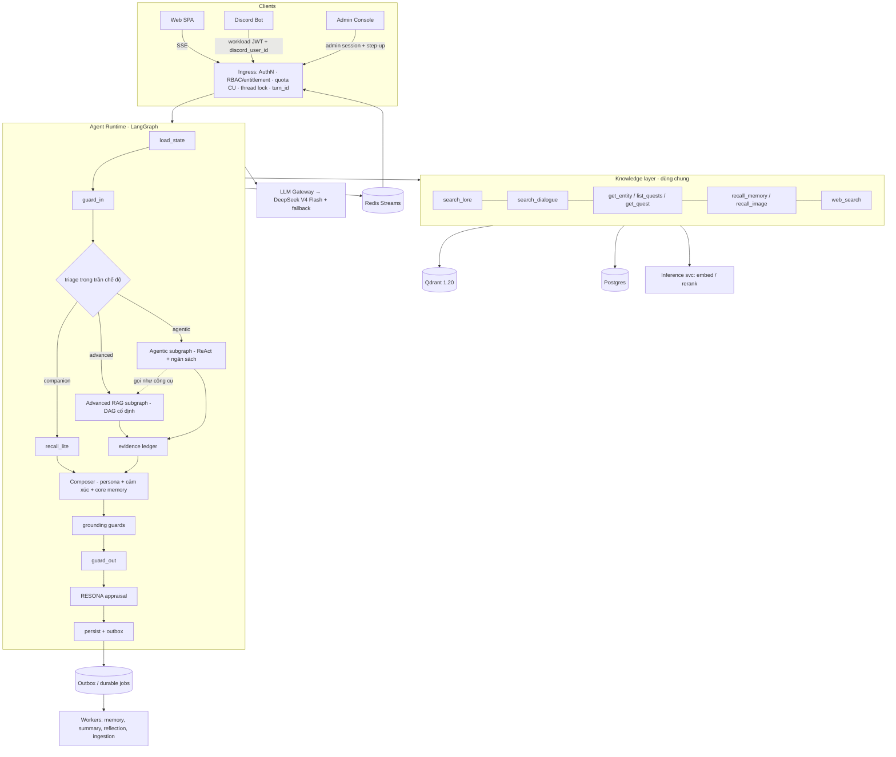

## 3.2 Thành phần

| Thành phần | Trách nhiệm | Nguồn gốc |
|---|---|---|
| Ingress | AuthN, RBAC, entitlement chế độ, quota CU, khoá theo thread, idempotency | Nâng cấp từ auth/admission hiện có |
| Agent Runtime | Đồ thị trạng thái; hai subgraph; checkpoint; sự kiện | **Mới** (thay `ChatPipeline` 12 stage) |
| Knowledge layer | Công cụ có kiểu, lọc ACL ở tầng công cụ | **Mới**; dùng lại scorer memory |
| Composer | Lời Chisa; output `{response, sentiment, claims/citations}` | Tách từ `ContextBuilder`, persona nguyên văn |
| Grounding | Claim/citation guard, extractive fallback trong khung persona | Giữ RAG-06, mở rộng cho sổ bằng chứng |
| RESONA | Cập nhật cảm xúc 8 chiều tất định | **Giữ** `emotion_engine.py`, `state_manager.py` |
| LLM Gateway | Messages/tools API, breaker, bulkhead, retry, fallback, ngân sách theo làn | Nâng cấp từ BE-02 |
| Inference service | Embedding và rerank dùng chung một bản model | **Mới** (thay fastembed trong từng process) |
| Workers | Outbox: memory extraction, core memory, temporal facts, summary, reflection, visual, ingestion | Giữ queue; thêm loại job |
| Ingestion | Control plane giữ; data plane xây lại | Theo đề xuất ingestion |
| IAM | Tài khoản, OAuth Google/Discord, vai trò, MFA, phiên, audit | Nâng cấp lớn |

## 3.3 Lưu trữ

| Kho | Dữ liệu |
|---|---|
| Postgres | accounts, identities, **roles/role_assignments**, **mfa_factors**, sessions, **admin_audit_events**, threads, messages, preferences, emotion_state, **core_memory**, **facts (temporal)**, entities/aliases/quests/glossary, corpus releases, outbox/jobs, **LangGraph checkpoints** |
| Qdrant 1.20 | `lore_canon`, `lore_dialogue`, `memories`, `guild_memories`, `image_memories` (versioned + alias) |
| Redis | Quota, lock, cache, **authz version**, Redis Streams sự kiện |
| Object storage (đĩa VPS) | Ảnh người dùng (có TTL/consent), raw wiki theo `(page_id, revid)` |

## 3.4 Ngân sách tài nguyên VPS (mục tiêu)

| Container | RAM giới hạn | Ghi chú |
|---|---|---|
| postgres | 768 MB | + checkpoints, audit |
| redis | 256 MB | |
| qdrant | 1.200 MB | ~15–20k điểm lore + memories |
| inference (TEI) | 1.000 MB | e5-small hoặc model được chọn ở R1 + reranker local tuỳ chọn |
| api (2 worker, **không** nạp model) | 1.200 MB | |
| worker | 700 MB | |
| discord | 300 MB | |
| web + caddy | 256 MB | |
| otel-collector (Monitoring hồ sơ M0, mục 13) | 200 MB | `memory_limiter` giữ RSS dưới giới hạn |
| **Tổng** | **~5,9 GB** | ≤ CON-003; hồ sơ M1 (tự host monitoring) cần thêm ~0,6 GB, xem MON-003 |

## 3.5 Bộ sơ đồ kiến trúc chi tiết

Các sơ đồ dưới đây là **một phần mang tính quy phạm** của SRS: hiện thực PHẢI khớp về thành phần, ranh giới và luồng dữ liệu. Thay đổi kiến trúc PHẢI cập nhật sơ đồ tương ứng (STD-DOC-003). Tất cả viết bằng Mermaid để xem trực tiếp trên GitHub hoặc IDE.

| # | Sơ đồ | Góc nhìn |
|---|---|---|
| 3.5.1 | Ngữ cảnh hệ thống | Ai/hệ nào tương tác với Chisa |
| 3.5.2 | Container và triển khai trên VPS | Container, vùng mạng, luồng chính |
| 3.5.3 | Phân lớp mã nguồn | Quy tắc phụ thuộc |
| 3.5.4 | Agent Runtime tổng thể | Đồ thị node, hai subgraph, interrupt |
| 3.5.5 | Xác định chế độ và phân làn | Kẹp quyền, lý do hạ chế độ |
| 3.5.6 | Advanced RAG: luồng chi tiết | DAG cố định, sửa sai tất định |
| 3.5.7 | Advanced RAG: tuần tự | Lời gọi giữa các thành phần |
| 3.5.8 | Agentic RAG: vòng ReAct | Validate, ledger, ngân sách, dừng |
| 3.5.9 | Agentic RAG: tuần tự có interrupt | Công cụ, sự kiện, checkpoint |
| 3.5.10 | Composer, grounding, persona | Thứ tự prompt, các lớp kiểm |
| 3.5.11 | Trí nhớ 4 lớp | Đường đọc / đường ghi |
| 3.5.12 | Cảm xúc RESONA | Vòng cập nhật một lần mỗi lượt |
| 3.5.13 | Xác thực và entitlement mỗi request | AuthN, authz_ver, quota |
| 3.5.14 | Liên kết Discord và dùng Agentic trên Discord | OAuth, giải danh tính |
| 3.5.15 | Cấp Chía-con | Phiên Admin, step-up, audit |
| 3.5.16 | Cấp Admin bằng CLI và vòng đời phiên Admin | Break-glass, state machine |
| 3.5.17 | Ingestion data plane | S0–S9, control plane |
| 3.5.18 | Luồng sự kiện streaming | Redis Streams → SSE/Discord |
| 3.5.19 | Outbox và job nền | Giao dịch, lease, retry |
| 3.5.20 | Mô hình dữ liệu cốt lõi | ER |

Sơ đồ topology Monitoring nằm ở mục 13.2.

### 3.5.1 Ngữ cảnh hệ thống

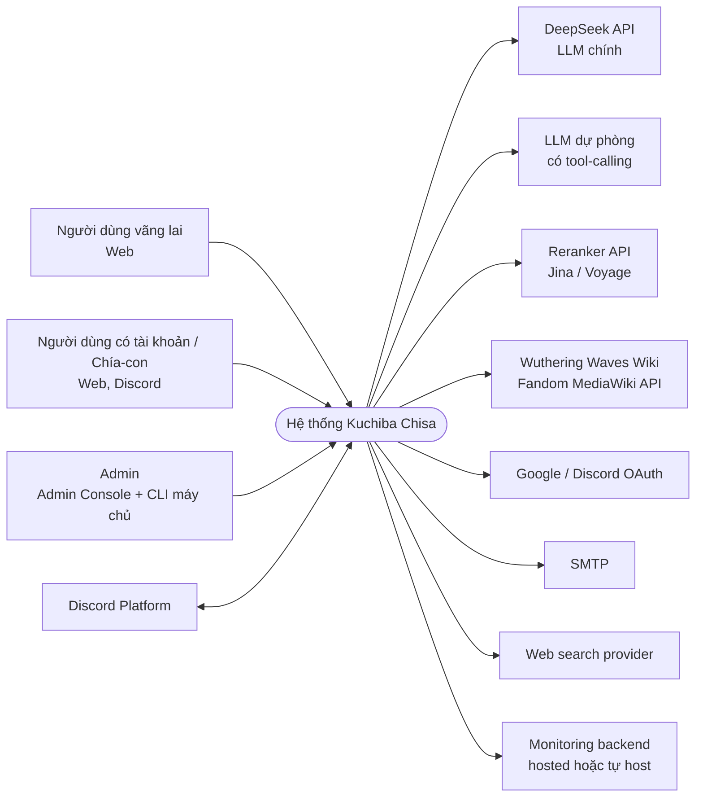

### 3.5.2 Container và triển khai trên VPS

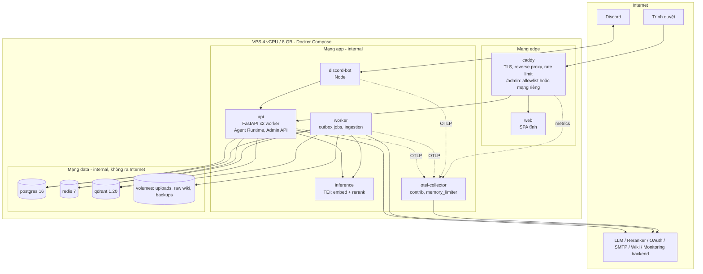

### 3.5.3 Phân lớp mã nguồn và quy tắc phụ thuộc

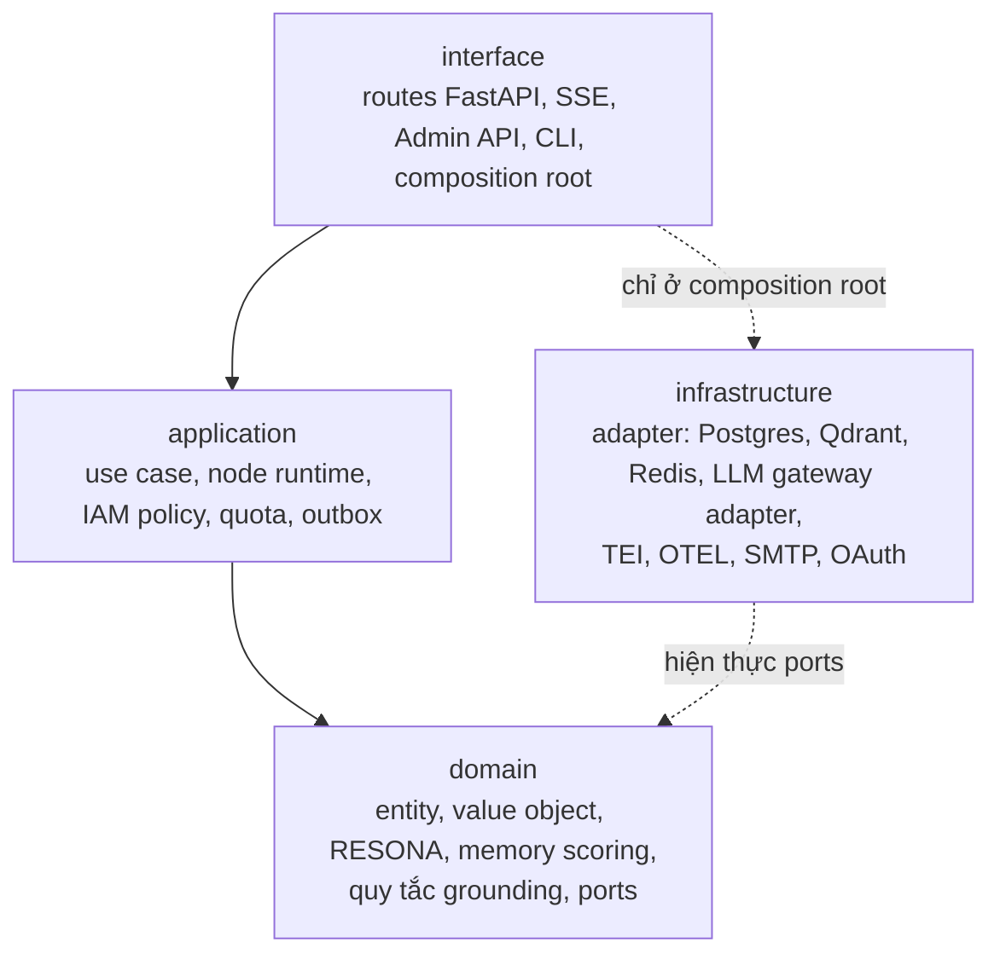

Quy tắc: `domain` không import lớp nào khác; `application` chỉ import `domain`; `infrastructure` import `domain` (ports) và thư viện ngoài; `interface` import `application`, và chỉ composition root được import `infrastructure`. Kiểm bằng import-linter (STD-ARC-001).

### 3.5.4 Agent Runtime tổng thể

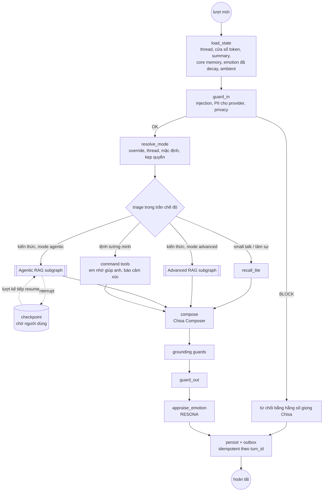

### 3.5.5 Xác định chế độ và phân làn

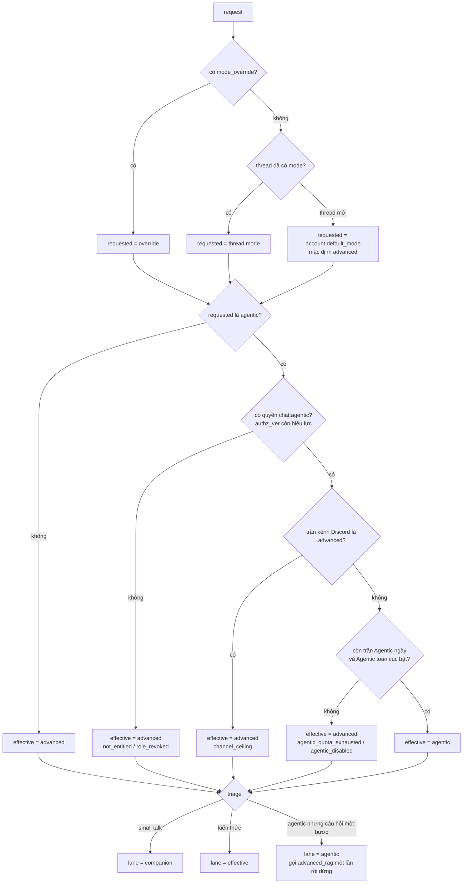

### 3.5.6 Advanced RAG: luồng chi tiết

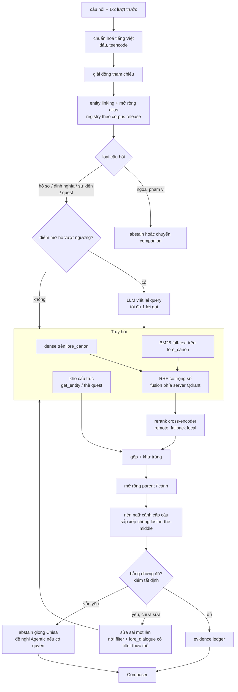

### 3.5.7 Advanced RAG: tuần tự

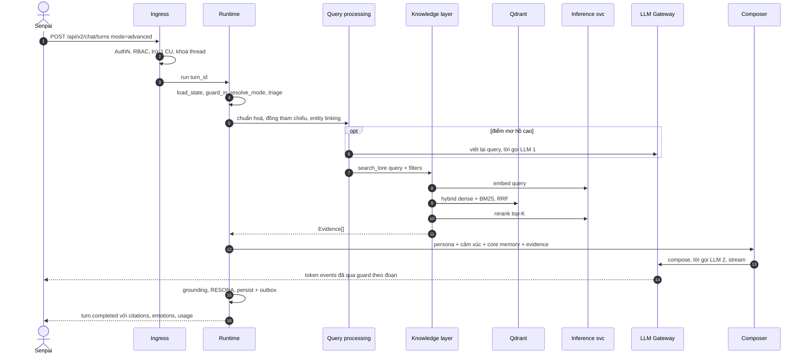

### 3.5.8 Agentic RAG: vòng ReAct

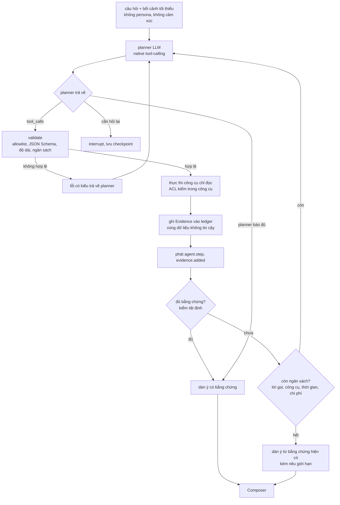

### 3.5.9 Agentic RAG: tuần tự có interrupt

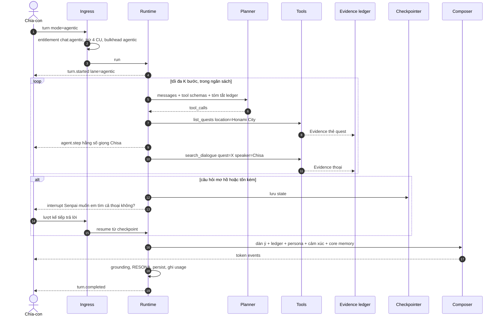

### 3.5.10 Composer, grounding và persona

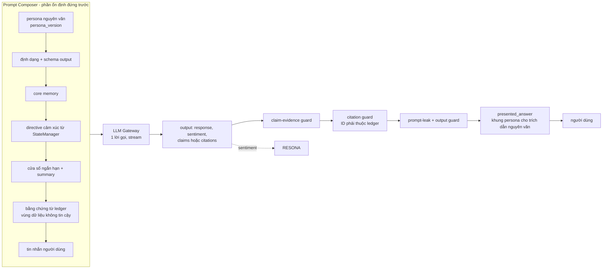

### 3.5.11 Trí nhớ 4 lớp

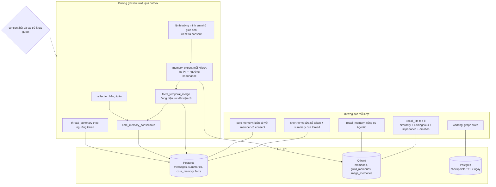

### 3.5.12 Cảm xúc RESONA

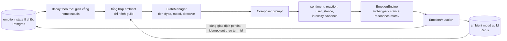

### 3.5.13 Xác thực và entitlement mỗi request

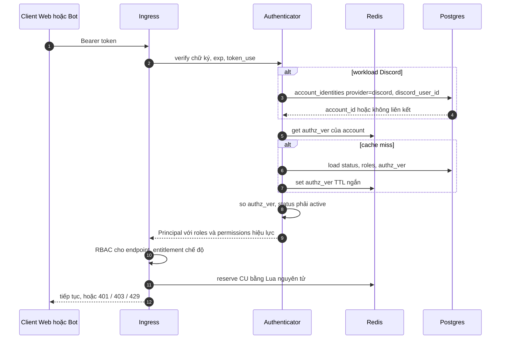

### 3.5.14 Liên kết Discord và dùng Agentic trên Discord

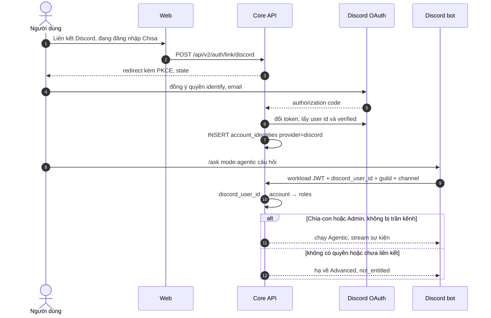

### 3.5.15 Cấp Chía-con

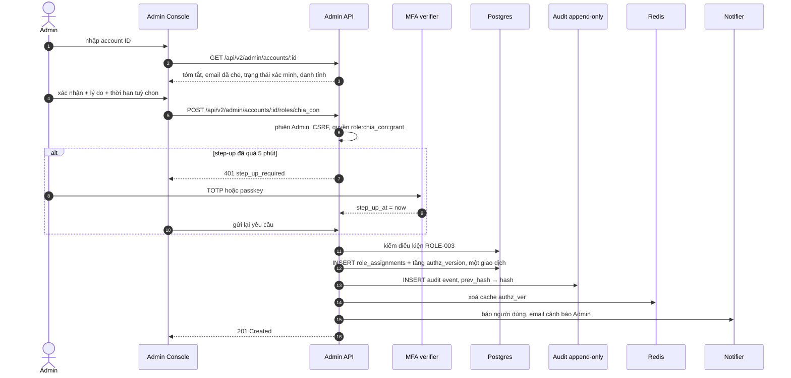

### 3.5.16 Cấp Admin bằng CLI và vòng đời phiên Admin

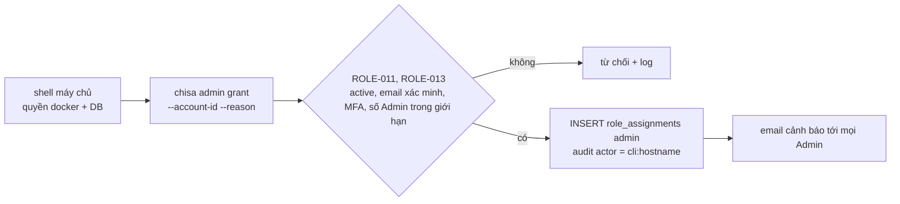

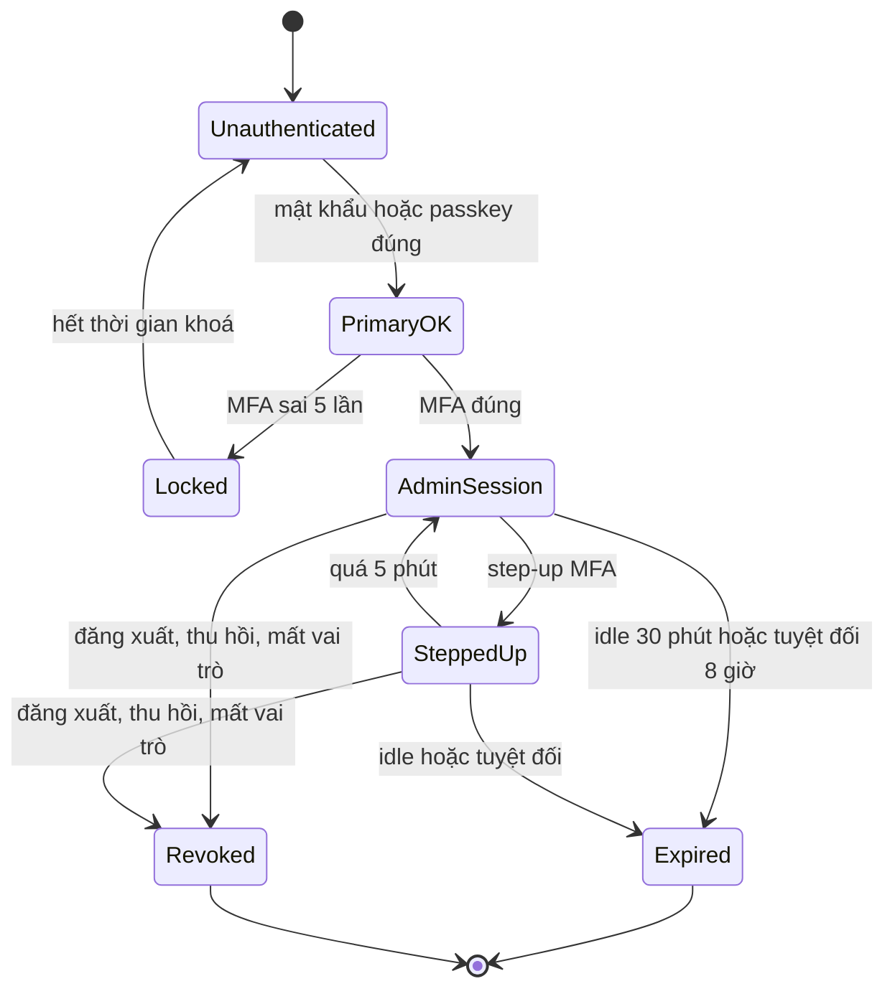

### 3.5.17 Ingestion data plane

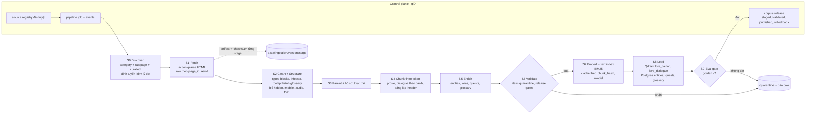

### 3.5.18 Luồng sự kiện streaming

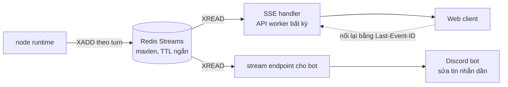

### 3.5.19 Outbox và job nền

```mermaid
sequenceDiagram
  autonumber
  participant RT as Runtime persist
  participant DB as Postgres
  participant W as Worker
  participant QD as Qdrant
  RT->>DB: BEGIN, messages + emotion + outbox jobs, COMMIT
  loop poll có lease
    W->>DB: claim job, lease, attempt + 1
    W->>W: xử lý idempotent theo idempotency key
    alt thành công
      W->>QD: upsert memory hoặc dữ liệu dẫn xuất
      W->>DB: đánh dấu done
    else lỗi
      W->>DB: retry có backoff hoặc dead-letter
    end
  end
```

### 3.5.20 Mô hình dữ liệu cốt lõi

```mermaid
erDiagram
  ACCOUNTS ||--o{ ACCOUNT_IDENTITIES : has
  ACCOUNTS ||--o{ ROLE_ASSIGNMENTS : has
  ACCOUNTS ||--o{ MFA_FACTORS : has
  ACCOUNTS ||--o{ ADMIN_SESSIONS : opens
  ACCOUNTS ||--|| ACCOUNT_PREFERENCES : has
  ACCOUNTS ||--o| CORE_MEMORY : has
  ACCOUNTS ||--o{ FACTS : has
  ACCOUNTS ||--o{ THREADS : owns
  ACCOUNTS ||--|| EMOTION_STATE : has
  THREADS ||--o{ MESSAGES : contains
  MESSAGES ||--o{ OUTBOX_JOBS : triggers
  ADMIN_SESSIONS ||--o{ ADMIN_AUDIT_EVENTS : records
  CORPUS_RELEASES ||--o{ ENTITIES : versions
  CORPUS_RELEASES ||--o{ QUESTS : versions
  ENTITIES ||--o{ ALIASES : has
  ACCOUNTS {
    uuid id PK
    string status
    int authz_version
    bool email_verified
  }
  ROLE_ASSIGNMENTS {
    uuid id PK
    uuid account_id FK
    string role
    uuid granted_by FK
    string reason
    timestamptz expires_at
    timestamptz revoked_at
  }
  THREADS {
    uuid id PK
    string owner_principal
    string channel
    string mode
  }
  MESSAGES {
    uuid id PK
    uuid thread_id FK
    uuid turn_id
    string mode_effective
    string lane
    numeric cost_estimate
  }
  FACTS {
    uuid id PK
    string predicate
    timestamptz valid_from
    timestamptz valid_to
    uuid superseded_by
  }
  ADMIN_AUDIT_EVENTS {
    uuid id PK
    string action
    string target_id
    string reason
    string prev_hash
    string hash
  }
```

Ghi chú: sơ đồ ER đơn giản hoá. Thread và emotion state của **vãng lai** gắn với principal ẩn danh (không có `ACCOUNTS`); chi tiết đầy đủ ở mục 7.1.

---

# 4. Yêu cầu chức năng

## 4.1 Định danh, xác thực và phân quyền (IAM)

### 4.1.1 Mô hình vai trò

```
guest  ⊂  member  ⊂  chia_con
                  ⊂  admin   (admin có mọi quyền sử dụng của chia_con + quyền quản trị)
```

| ID | Yêu cầu | Tiêu chí chấp nhận |
|---|---|---|
| IAM-001 | Hệ thống PHẢI dùng **RBAC**: vai trò → tập quyền (permission) định nghĩa trong code, có version; gán vai trò lưu ở `role_assignments(account_id, role, granted_by, granted_at, reason, expires_at, revoked_at, revoked_by, revoke_reason)` | Không còn scope cứng theo loại phiên; unit test ma trận vai trò–quyền khớp phụ lục A |
| IAM-002 | Quyền hiệu lực PHẢI được **tính ở server** từ vai trò trong DB. Token chỉ chứa `sub`, `session_id`, `authz_ver`; không token nào được tự mang vai trò mà server tin không kiểm tra | Token giả mạo thêm `roles` không có tác dụng; test âm tính |
| IAM-003 | Thu hồi vai trò hoặc khoá tài khoản PHẢI có hiệu lực **≤ 60 giây** trên mọi kênh, nhờ `authz_ver` (tăng khi đổi vai trò, cache Redis) so với token ở mỗi request, cộng access token ngắn hạn | Test tích hợp: thu hồi Chía-con thì lượt Agentic kế tiếp bị hạ về Advanced trong ≤ 60 giây |
| IAM-004 | **Đăng ký thủ công** (email + mật khẩu) PHẢI xác minh email trước khi đăng nhập. Giữ luồng hiện có: chống squat, reset mật khẩu, thu hồi phiên | Tài khoản chưa xác minh không đăng nhập được, không có vai trò `member` |
| IAM-005 | **Đăng nhập Google/Discord** tạo hoặc liên kết tài khoản `member` mà không cần xác minh email riêng, **với điều kiện**: Google PHẢI có `email_verified=true`; Discord PHẢI có `verified=true` khi có email. Nếu Discord không cung cấp email đã xác minh, tài khoản vẫn đăng nhập được bằng Discord nhưng **email được đánh dấu chưa xác minh**; các chức năng cần email (khôi phục mật khẩu, thông báo) bị tắt cho tới khi xác minh | Test với hồ sơ OAuth có/không xác minh; không bao giờ tự gộp tài khoản theo email chưa xác minh |
| IAM-006 | Liên kết danh tính PHẢI tường minh (người dùng đang đăng nhập bấm "Liên kết Google/Discord"); một danh tính ngoài chỉ thuộc một tài khoản; huỷ liên kết không được làm mất phương thức đăng nhập cuối cùng | Test xung đột liên kết, test chặn huỷ liên kết cuối |
| IAM-007 | **Người dùng vãng lai** dùng phiên ẩn danh do server ký, gắn thiết bị, có xoay vòng; không có vai trò ngoài `guest` | Phiên ẩn danh không gọi được endpoint `member` |
| IAM-008 | Vãng lai đăng ký hoặc đăng nhập PHẢI được hỏi có muốn **chuyển thread hiện tại** sang tài khoản không (mặc định: không). Không tự chuyển dữ liệu | Test luồng nâng cấp có/không đồng ý |
| IAM-009 | Danh tính Discord trên bot PHẢI được giải về tài khoản Chisa **chỉ qua liên kết Discord OAuth** của chính người dùng. Workload credential chỉ mang `discord_user_id` đã được Discord xác thực; Core tra `account_identities(provider='discord')` để lấy vai trò | Bot không thể khai vai trò; người dùng Discord chưa liên kết được xem như `guest` của Discord (quota Discord), chỉ dùng Advanced |
| IAM-010 | Trạng thái tài khoản: `active`, `suspended` (Admin khoá), `deleted` (đang xoá). Tài khoản `suspended` không đăng nhập, không chat, mất quyền hiệu lực | Test từng trạng thái trên Web và Discord |
| IAM-011 | Mật khẩu NÊN chuyển sang **Argon2id** (rehash dần khi đăng nhập); giữ bcrypt để xác minh hash cũ | Hash mới là Argon2id; đăng nhập bằng hash bcrypt cũ vẫn được và được rehash |

### 4.1.2 Vai trò Chía-con

| ID | Yêu cầu | Tiêu chí chấp nhận |
|---|---|---|
| ROLE-001 | Chỉ quyền `role:chia_con:grant` / `role:chia_con:revoke` (chỉ Admin có) được cấp/thu hồi Chía-con | Member/Chía-con gọi API cấp vai trò nhận 403; có audit |
| ROLE-002 | Cấp **theo ID tài khoản** (UUID). Trước khi xác nhận, Console hiển thị tóm tắt tài khoản: ID, email đã che, ngày tạo, trạng thái xác minh, danh tính liên kết | Không cấp được theo email hoặc tên hiển thị; nhập ID sai trả "không tìm thấy" |
| ROLE-003 | Điều kiện cấp: tài khoản `active`, có danh tính đã xác minh (IAM-004/005), không phải vãng lai | API từ chối với mã lý do cụ thể |
| ROLE-004 | Cấp/thu hồi PHẢI có **lý do** (bắt buộc), tuỳ chọn **thời hạn** (`expires_at`); PHẢI qua **step-up MFA** (SEC-ADM-006) | Thiếu lý do hoặc thiếu step-up bị từ chối |
| ROLE-005 | Người được cấp/thu hồi PHẢI nhận thông báo (email nếu có email đã xác minh, và thông báo trong ứng dụng) | Test gửi thông báo; không lộ thông tin Admin ngoài "quản trị viên" |
| ROLE-006 | Vai trò hết hạn tự thu hồi bởi job, có audit `system:expiry` | Test hết hạn |
| ROLE-007 | Khi mất Chía-con: thread đang ở `agentic` tự hạ về `advanced` ở lượt kế tiếp, kèm thông báo bằng giọng Chisa (hằng số server) | Test MODE-007 |

### 4.1.3 Vai trò Admin (xem thêm mục 5.2)

| ID | Yêu cầu | Tiêu chí chấp nhận |
|---|---|---|
| ROLE-010 | Vai trò Admin **chỉ được cấp/thu hồi bằng CLI chạy trên máy chủ** (`chisa admin grant/revoke --account-id ... --reason ...`), cần quyền shell và DB. **Không có API cấp Admin** | Tìm trong OpenAPI không có endpoint cấp Admin; test âm tính |
| ROLE-011 | Tài khoản nhận Admin PHẢI: `active`, email đã xác minh, **đã đăng ký MFA** (TOTP hoặc WebAuthn) và có mật khẩu mạnh **hoặc** WebAuthn | CLI từ chối nếu thiếu điều kiện |
| ROLE-012 | Không được thu hồi Admin cuối cùng (chống tự khoá); có quy trình break-glass bằng CLI để khôi phục | Test chặn thu hồi Admin cuối |
| ROLE-013 | Số Admin tối đa cấu hình được (mặc định 2) | CLI từ chối vượt giới hạn |

## 4.2 Chế độ (Mode) và quyền dùng chế độ

### Phương án lưu chế độ đề xuất (giải quyết D8)

**Ba tầng, chiều ưu tiên từ trên xuống:**
1. **Ghi đè theo tin nhắn** (`mode_override` trong request; nút "Tìm kỹ câu này", tuỳ chọn `/ask mode:`).
2. **Chế độ của thread** (`threads.mode`).
3. **Mặc định của tài khoản** (`account_preferences.default_mode`, mặc định `advanced`), áp dụng khi tạo thread mới.

Sau đó **luôn kẹp bởi quyền**: `effective_mode = requested nếu được phép, ngược lại advanced` (D2, D3).

Lý do chọn:
- Lưu **chỉ theo user** thì đổi chế độ cho một cuộc điều tra sâu sẽ ảnh hưởng mọi cuộc trò chuyện khác.
- Lưu **chỉ theo thread** thì mỗi thread mới phải chọn lại.
- Ghi đè theo tin nhắn phục vụ việc hỏi sâu một câu mà không đổi chế độ cả thread, giúp tiết kiệm CU.

Vãng lai luôn `advanced`, không lưu gì.

| ID | Yêu cầu | Tiêu chí chấp nhận |
|---|---|---|
| MODE-001 | Hệ thống PHẢI hỗ trợ hai chế độ `advanced` và `agentic`; **mặc định `advanced`** | Thread mới không có tuỳ chọn thì là `advanced` |
| MODE-002 | Chế độ hiệu lực PHẢI được tính ở server theo thứ tự ghi đè tin nhắn → thread → mặc định tài khoản, rồi kẹp theo quyền `chat:agentic` | Bảng quyết định ở phụ lục B; property test |
| MODE-003 | Mỗi lượt chạy **đúng một** chế độ; không chạy đồng thời hai chế độ cho một lượt | Mỗi lượt chỉ có một `mode_effective`; không có lời gọi LLM của chế độ kia |
| MODE-004 | Đổi chế độ thread được phép **giữa hai lượt**; lịch sử ngắn hạn, trí nhớ, cảm xúc giữ nguyên | Test đổi chế độ rồi hỏi tiếp có tham chiếu ngữ cảnh cũ |
| MODE-005 | Không đổi chế độ khi một lượt đang chạy (khoá theo thread); nếu đang chờ interrupt của Agentic thì đổi chế độ sẽ huỷ interrupt đó | Test đồng thời |
| MODE-006 | Mỗi message PHẢI lưu `mode_requested`, `mode_effective`, `lane`, `downgrade_reason?`, số lời gọi LLM, token, chi phí ước tính | Truy vấn được theo thread |
| MODE-007 | Yêu cầu `agentic` khi không có quyền thì hạ về `advanced` với `downgrade_reason=not_entitled`, kèm thông báo hằng số giọng Chisa; **không tốn CU Agentic** | Test với member, guest, Discord chưa liên kết |
| MODE-008 | Chế độ là **trần**: `triage` có thể chọn làn rẻ hơn (small talk thì `companion` ở mọi chế độ; câu hỏi một bước ở Agentic có thể trả lời bằng một lần gọi `advanced_rag`) | Bộ đánh giá triage (QUAL-006) |
| MODE-009 | Discord: `/mode advanced|agentic` đặt chế độ cho thread hiện tại (DM hoặc kênh); admin guild CÓ THỂ đặt **trần chế độ** cho kênh (chỉ thu hẹp, không mở rộng quyền Chisa) | Guild đặt trần `advanced` thì Chía-con cũng bị kẹp ở kênh đó |
| MODE-010 | Web: công tắc "Hỏi đáp / Chuyên sâu"; với người không có quyền thì công tắc bị khoá kèm giải thích | Kiểm thử UI |

## 4.3 Hội thoại và trí nhớ ngắn hạn (CONV)

| ID | Yêu cầu | Tiêu chí chấp nhận |
|---|---|---|
| CONV-001 | Hội thoại PHẢI tổ chức theo **thread** thuộc một principal. Web: nhiều thread/tài khoản. Discord DM: một thread/người dùng. Kênh guild: một thread/kênh (cộng định danh người nói) | Thay mô hình "một hội thoại mở/user" hiện tại; test quyền object-level |
| CONV-002 | Cửa sổ ngắn hạn PHẢI cắt theo **token** của tokenizer provider (không theo số tin), cộng **summary cuộn** có version | Test ngân sách; summary không bị ghi đè khi đồng thời |
| CONV-003 | Summary PHẢI được tạo bởi job nền theo ngưỡng token, không chặn lượt chat | Đo: lượt chat không chờ summary |
| CONV-004 | Người dùng PHẢI xem, đổi tên, xoá thread; xoá thread kích hoạt workflow xoá dẫn xuất (summary, checkpoint, vector liên quan) | Test xoá và xác minh |
| CONV-005 | Kênh guild PHẢI giữ tính năng cộng đồng hiện có (transcript gần đây do bot gửi, topic summary, ambient mood) | Test hồi quy cộng đồng |

## 4.4 Chế độ Advanced RAG (ADV)

| ID | Yêu cầu | Tiêu chí chấp nhận |
|---|---|---|
| ADV-001 | Advanced RAG PHẢI là **luồng cố định** (DAG): hiểu câu hỏi → (viết lại có điều kiện) → truy hồi lai → hậu xử lý → sửa sai tất định → Composer → grounding | Đồ thị khai báo tĩnh; không có bước do LLM chọn |
| ADV-002 | Hiểu câu hỏi PHẢI tất định: chuẩn hoá tiếng Việt, giải đồng tham chiếu từ 1–2 lượt trước, **entity linking + mở rộng alias** (registry theo corpus release, gồm alias tiếng Việt), nhận dạng loại câu hỏi (hồ sơ / định nghĩa / sự kiện / quest / ngoài phạm vi) | Unit test trên tập câu hỏi mẫu; không gọi LLM |
| ADV-003 | Viết lại query bằng LLM CÓ THỂ dùng **chỉ khi** điểm mơ hồ vượt ngưỡng; tối đa 1 lời gọi | Đo tỷ lệ viết lại; không vượt ngân sách ADV-009 |
| ADV-004 | Truy hồi PHẢI **lai dense + BM25** trên `lore_canon` (Qdrant 1.20, fusion phía server), **RRF có trọng số cấu hình được**, lọc ACL và metadata trong truy vấn DB. Câu hỏi thuộc tính/quest PHẢI tra thêm kho có cấu trúc (`get_entity`, thẻ quest) | Ablation dense / BM25 / hybrid / hybrid+rerank trên golden v2 |
| ADV-005 | Mặc định **không** tìm `lore_dialogue` (thoại chiếm ~68% token corpus, mật độ dữ kiện thấp) | Truy vết cho thấy không có truy vấn dialogue ở lượt bình thường |
| ADV-006 | Hậu xử lý PHẢI gồm rerank cross-encoder (remote + fallback local), khử trùng, mở rộng parent/cảnh, nén ngữ cảnh cấp câu, sắp xếp chống lost-in-the-middle | Có metric riêng cho rerank fallback |
| ADV-007 | **Sửa sai tất định**: bằng chứng dưới ngưỡng thì chạy **một** lượt mở rộng (nới filter, thêm `lore_dialogue` có filter thực thể). Vẫn yếu thì **abstain bằng giọng Chisa**; nếu người dùng có quyền thì **đề nghị chuyển Agentic** | Test 3 nhánh; không gọi LLM ở bước sửa sai |
| ADV-008 | Câu trả lời Advanced CÓ THỂ cache theo khoá `(mode=advanced, câu hỏi chuẩn hoá, corpus_version, prompt_version, persona_version, ACL scope)` | Test cache: không dùng lại khi khác ACL/version |
| ADV-009 | Ngân sách Advanced: **≤ 2 lời gọi LLM**, **≤ 2 vòng truy hồi**, giới hạn token vào/ra cấu hình; vượt ngân sách thì trả kết quả degraded có mã lý do | Test ngân sách; khớp tinh thần `v1:NFR-PERF-009` |

## 4.5 Chế độ Agentic RAG (AGT)

| ID | Yêu cầu | Tiêu chí chấp nhận |
|---|---|---|
| AGT-001 | Agentic RAG PHẢI là vòng **lập kế hoạch → gọi công cụ → quan sát** bằng native tool-calling, với planner có **system prompt trung tính** (không chứa persona) | Planner prompt không chứa nội dung persona; test |
| AGT-002 | Planner chỉ được gọi công cụ trong **allowlist** (phụ lục D), tham số validate bằng JSON Schema, giới hạn độ dài; công cụ không tồn tại hoặc tham số sai thì trả lỗi có kiểu, không thực thi | Test fuzz tham số |
| AGT-003 | Mọi công cụ PHẢI **chỉ đọc** trong vòng agent. Ghi trí nhớ chỉ qua outbox sau lượt (MEM-006) | Rà soát mã: công cụ không có side effect ghi |
| AGT-004 | Mọi kết quả công cụ PHẢI thành `Evidence` có ID, nguồn, ACL, `corpus_version`, `tool`, `step` trong **sổ bằng chứng**; chỉ bằng chứng trong sổ được trích dẫn | Không còn kênh văn bản tự do vào prompt Composer; test |
| AGT-005 | Điều kiện dừng: (a) kiểm tra đủ bằng chứng **tất định** (mỗi thực thể/khía cạnh trong kế hoạch có bằng chứng vượt ngưỡng); (b) planner báo đủ; (c) hết ngân sách | Đo số bước trung bình; không vòng lặp vô hạn |
| AGT-006 | Ngân sách Agentic (cấu hình, giá trị mục tiêu): **≤ 6 lời gọi LLM**, **≤ 8 lời gọi công cụ**, **≤ 30 giây** wall-clock, giới hạn token tổng, **trần chi phí/lượt**. Hết ngân sách thì Composer trả lời từ bằng chứng đã có, nêu giới hạn | Test từng loại hết ngân sách |
| AGT-007 | Công cụ `advanced_rag(query)` PHẢI có sẵn; câu hỏi một bước NÊN kết thúc sau một lần gọi | QUAL-006 |
| AGT-008 | Runtime PHẢI hỗ trợ **interrupt** để hỏi lại người dùng khi câu hỏi mơ hồ hoặc tốn kém; trạng thái lưu bằng checkpoint; trả lời ở lượt kế tiếp sẽ resume. Interrupt hết hạn sau thời gian cấu hình | Test resume, hết hạn, đổi chế độ khi đang chờ |
| AGT-009 | Runtime PHẢI phát **sự kiện tiến trình có kiểu** (mục 8.2). Nội dung hiển thị là **hằng số giọng Chisa** cùng tên công cụ đã rút gọn; không lộ prompt, tham số nhạy cảm hay nội dung chưa kiểm | Test sự kiện; quét lộ prompt |
| AGT-010 | Khi câu trả lời dựa trên bằng chứng `source_kind=dialogue`, Composer PHẢI nêu người nói và nguồn (lời nhân vật không phải dữ kiện khách quan) | Bộ đánh giá attribution |
| AGT-011 | Câu trả lời Agentic mặc định **không cache**; nếu cache thì khoá có `mode=agentic` và TTL ngắn | Test |
| AGT-012 | Lượt Agentic PHẢI chạy trong **bulkhead riêng** (giới hạn đồng thời theo process và toàn cục), không chiếm slot của Advanced/companion | Load test: Agentic bão hoà không làm tăng p95 của Advanced quá 10% |

## 4.6 Lớp tri thức và công cụ (KNW)

| ID | Yêu cầu | Tiêu chí chấp nhận |
|---|---|---|
| KNW-001 | Công cụ là **hàm có kiểu** dùng chung cho cả hai chế độ (Advanced gọi theo chương trình, Agentic gọi qua planner) | Một hiện thực duy nhất cho mỗi công cụ |
| KNW-002 | ACL, privacy và tenant PHẢI được kiểm tra **trong công cụ**, không dựa vào planner | Test cross-tenant qua planner bị prompt-inject |
| KNW-003 | `lore_canon` và `lore_dialogue` là collection riêng; mỗi điểm có `corpus_version`, `source_kind`, `entities[]`, `entity_type`, `page_type`, `nation`, `game_version`, `section_path`, offset | Kiểm tra schema khi publish |
| KNW-004 | Kho có cấu trúc trong Postgres: `entities` (infobox chuẩn hoá), `aliases` (redirect, Other Languages, alias tiếng Việt curated), `quests` (type, chapter, start location, địa điểm trích từ Steps, nhân vật, quest trước/sau), `glossary` (từ tooltip, có xử lý xung đột) | `list_quests(location='Honami City')` trả đúng danh sách theo dữ liệu nguồn |
| KNW-005 | Embedding PHẢI dùng đúng giao thức của model (ví dụ `passage:`/`query:` cho họ e5); model, version, prefix, tokenizer ghi vào corpus release | Startup từ chối nếu dimension/model không khớp release active |
| KNW-006 | Model embedding PHẢI được chọn ở R1 bằng đánh giá trên golden v2 trong giới hạn RAM (ứng viên: multilingual-e5-small làm baseline, bge-m3 và model đa ngữ nhỏ khác) | Báo cáo chọn model có số liệu |
| KNW-007 | Dịch vụ suy luận dùng chung PHẢI phục vụ embedding và rerank local cho API và worker; API process **không** tự nạp model | RAM api giảm; test kết nối và timeout |
| KNW-008 | `web_search` chỉ có ở Agentic, **tắt mặc định cho câu hỏi lore**, theo domain policy, SSRF-safe, nội dung web là dữ liệu không tin cậy (giữ `v1:FR-RAG-010`) | Test chặn private IP, redirect |
| KNW-009 | (CÓ THỂ) Sinh **alias Hán-Việt** từ tên tiếng Trung bằng từ điển tất định; alias tự sinh gắn cờ `unverified`, chỉ dùng cho entity linking sau khi curator duyệt hoặc eval chứng minh không tăng nhầm lẫn (E9) | Báo cáo eval entity linking có/không alias |

## 4.7 Grounding và trích dẫn (GRD)

| ID | Yêu cầu | Tiêu chí chấp nhận |
|---|---|---|
| GRD-001 | Composer PHẢI trả output có cấu trúc gồm `response`, `sentiment`, `claims[{text, evidence_id, quote}]` hoặc `citations[]` khi có bằng chứng | JSON Schema validate; field lạ bị chặn |
| GRD-002 | Claim guard và citation guard (RAG-06) PHẢI áp dụng cho bằng chứng từ **mọi bước** của sổ bằng chứng | Test bằng chứng từ bước 3 của Agentic được trích dẫn đúng |
| GRD-003 | Claim không kiểm chứng được thì loại bỏ hoặc trích nguyên văn trong **khung persona** (hằng số server); không đủ bằng chứng thì abstain bằng giọng Chisa | Giữ hành vi `presented_answer` hiện tại |
| GRD-004 | Không được dùng chỉ dẫn "trả lời như tự biết" để che nguồn hay độ bất định | Rà prompt |

## 4.8 Nhân cách và Composer (PER)

| ID | Yêu cầu | Tiêu chí chấp nhận |
|---|---|---|
| PER-001 | Composer là thành phần **duy nhất** sinh lời Chisa ở mọi làn và chế độ; planner và công cụ không sinh văn bản hiển thị | Rà kiến trúc; test |
| PER-002 | Nội dung persona được bảo vệ PHẢI giữ **nguyên văn**. Việc **di chuyển** ra khỏi `context_builder.py` / `persona_loader.py` sang tài sản có version **chỉ thực hiện khi chủ dự án phê duyệt**; khi đó kiểm tra bảo vệ chuyển từ hash file sang **hash nội dung** | Hash nội dung trước và sau khi di chuyển khớp |
| PER-003 | Quy tắc xưng hô (Em / Senpai, ngoại lệ biệt danh trong core memory) PHẢI đúng ở mọi chế độ, kể cả câu trả lời dài dựa trên nhiều bằng chứng | Bộ đánh giá persona (QUAL-005) |
| PER-004 | Prompt Composer PHẢI có **tiền tố ổn định** (persona → định dạng → core memory → phần biến động) để tối đa cache-hit của provider | Đo tỷ lệ cache-hit |
| PER-005 | Thông điệp hệ thống hiển thị cho người dùng (tiến trình, hạ chế độ, abstain, lỗi) PHẢI là **hằng số giọng Chisa** phía server, có test xưng hô | Mở rộng `test_persona_contract` |

## 4.9 Trí nhớ dài hạn (MEM)

| ID | Yêu cầu | Tiêu chí chấp nhận |
|---|---|---|
| MEM-001 | **Core memory** (khoảng 300–600 token, có cấu trúc: tên/biệt danh, mốc quan hệ, sở thích nổi bật, lời hứa còn hiệu lực) PHẢI có trong prompt Composer **ở mọi làn** với member có consent | Sửa lỗi hiện tại: memory chỉ được gợi khi router chọn vector search |
| MEM-002 | `recall_lite` PHẢI chạy ở làn companion và advanced: memory top-k theo scorer hiện có (similarity + recency Ebbinghaus + importance + emotion match) | Kịch bản: hỏi chuyện thường vẫn nhớ dữ kiện đã kể |
| MEM-003 | `recall_memory` là công cụ của Agentic | Test |
| MEM-004 | **Dữ kiện có thời gian hiệu lực** (`facts`: subject, predicate, object, `valid_from`, `valid_to`, `superseded_by`, `source_message_id`, confidence). Dữ kiện mới mâu thuẫn thì đóng hiệu lực dữ kiện cũ, không xoá lịch sử | Kịch bản "đổi công ty": trả lời theo dữ kiện mới, vẫn biết dữ kiện cũ là quá khứ |
| MEM-005 | Trích xuất memory chạy nền qua outbox (giữ lọc PII và ngưỡng importance); job hợp nhất cập nhật core memory và facts | Test idempotency theo message ID |
| MEM-006 | Ghi memory đồng bộ chỉ khi người dùng ra lệnh tường minh ("em nhớ giúp anh…"), qua công cụ có kiểm tra consent | Test có/không consent |
| MEM-007 | **Vãng lai không có trí nhớ dài hạn** (chỉ thread ngắn hạn, TTL cấu hình, mặc định 30 ngày) | Không có điểm memory nào cho principal guest |
| MEM-008 | Người dùng PHẢI xem, sửa, xoá core memory và từng memory/fact; tắt trí nhớ dài hạn bất kỳ lúc nào (giữ consent hiện có) | API + UI; test xoá lan đến Qdrant/Postgres/cache |
| MEM-009 | Trí nhớ guild (sự kiện, văn hoá) giữ như hiện tại, tách khỏi trí nhớ cá nhân | Test ACL guild |
| MEM-010 | **Reflection** hằng tuần (job): tóm tắt diễn biến quan hệ để cập nhật core memory; bật/tắt được | Test job; tôn trọng consent |

## 4.10 Cảm xúc (EMO)

| ID | Yêu cầu | Tiêu chí chấp nhận |
|---|---|---|
| EMO-001 | Giữ **RESONA**: 8 chiều (joy, sadness, trust, irritation, attachment, shyness, curiosity, comfort), archetype, stance, resonance matrix, homeostasis decay, cập nhật tất định | Unit/property test hiện có vẫn qua |
| EMO-002 | Đầu vào cảm xúc là `sentiment {reaction, user_stance, intensity, variance}` từ **Composer** | Schema validate |
| EMO-003 | Cập nhật cảm xúc **một lần mỗi lượt**, trong cùng giao dịch với lưu message; lượt lỗi hoặc huỷ không cập nhật | Test idempotency theo `turn_id` |
| EMO-004 | Planner **không** nhận trạng thái cảm xúc. Directive cảm xúc chỉ vào Composer | Rà prompt |
| EMO-005 | Đổi chế độ, hạ chế độ, hết ngân sách **không** tác động cảm xúc | Test |
| EMO-006 | Ambient mood guild giữ như hiện tại | Hồi quy cộng đồng |
| EMO-007 | (Chờ phê duyệt) Khi cảm xúc tiêu cực vượt ngưỡng, triage CÓ THỂ giảm ngân sách Agentic | Chỉ bật sau khi chủ dự án duyệt |

## 4.11 Ingestion (ING)

Control plane giữ nguyên tinh thần `v1:FR-ING-001/005/007/008/010` (source registry, ID tất định, corpus version, blue/green alias, audit). Data plane xây lại.

| ID | Yêu cầu | Tiêu chí chấp nhận |
|---|---|---|
| ING-001 | Discover theo category (có độ sâu), **liệt kê subpage** (`/Backstory`, `/Voicelines`, `/Forte Examination Report`, `/Archive`, `/Story`), danh sách bổ sung curated, luật loại trừ theo hậu tố/category; mỗi trang có quyết định định tuyến kèm lý do | Inventory phủ 100% nhóm Tier A của khảo sát (1.049 trang + bổ sung) |
| ING-002 | Fetch bằng `action=parse` (HTML đã render) theo revision; 1 req/s, `maxlag`, retry; raw lưu theo `(page_id, revid)`; revid không đổi thì không tải lại | Chạy lại không tải trang không đổi |
| ING-003 | Làm sạch HTML thành block có kiểu (prose, quote, infobox, table, dialogue theo lượt, list), gồm: tách infobox trước khi duyệt heading; tooltip → glossary; bỏ biến thể `.hidden`/`.mobile-only` bị lặp; bỏ audio/URL, card, tab, navbox, section do DPL sinh (giữ thành quan hệ); có nhật ký loại bỏ kèm lý do | Rác markup = 0 trên toàn corpus (khảo sát còn 51 chỗ do lỗi template của wiki, cần luật riêng) |
| ING-004 | Chunk theo **token thật** của model embedding, ≤ giới hạn model trừ biên an toàn (ví dụ ≤ 450 với model 512), overlap theo câu/lượt; dialogue chia theo **cảnh** rồi theo lượt; bảng lặp header; unit nguyên tử không overlap; bất biến bao phủ (không hở, không đổi chữ) | 100% chunk ≤ giới hạn; test bao phủ |
| ING-005 | Sinh **thẻ quest**, **hồ sơ thực thể**, alias, glossary vào kho có cấu trúc; registry thực thể version theo release | Kiểm tra số lượng so với inventory |
| ING-006 | Lỗi mức item thì **quarantine**; lỗi mức release (tỷ lệ quarantine, sụt giảm số trang/chunk, collection rỗng, vi phạm safety chưa được miễn trừ) thì **chặn publish** | Test từng ngưỡng |
| ING-007 | Mỗi stage ghi artifact có version, checksum, cache theo `(input, config, code version)`, chạy lại được từ một stage | `chisa ingest run --from chunk` không tải lại wiki |
| ING-008 | Publish chỉ khi qua **eval gate** (golden v2, theo nhóm câu hỏi) và không tụt so với release active quá ngưỡng | Test publish/rollback |
| ING-009 | Dữ liệu lore cũ (`data/raw_wiki`, `clean_wiki`, `canonical.jsonl`, `chunks.jsonl`, `ingestion.sqlite`, collection lore cũ) **không được migrate**; xoá sau khi release đầu tiên của hệ mới được publish | Checklist dọn dẹp |
| ING-010 | Code ingestion legacy (khoảng 7.700 dòng) xoá sau khi lấy lại các luật cần thiết | Không còn import |
| ING-011 | **Khử trùng xuyên trang theo trang sở hữu**: trang cụ thể > trang tổng hợp; trang quest > `/Story`; trang báo cáo > trang vùng; Backstory > trang chính (Official Introduction). Trang không sở hữu giữ tham chiếu `duplicate_of` (E2) | 0 khối trùng khớp chính xác giữa các điểm trong cùng corpus release |
| ING-012 | **Chuẩn hoá văn bản** (NFC, bỏ ký tự zero-width, chuẩn hoá placeholder người chơi về `Rover`) áp dụng giống nhau cho index và query (E3) | Test: query "Rover" khớp đoạn có placeholder |

## 4.12 Kênh (CH)

| ID | Yêu cầu | Tiêu chí chấp nhận |
|---|---|---|
| CH-001 | Web dùng SSE với giao thức sự kiện mục 8.2; nối lại được trong cửa sổ ngắn nhờ Redis Streams | Test ngắt/nối lại |
| CH-002 | Discord hỗ trợ trả lời dạng stream bằng cách sửa tin nhắn dần, hiển thị tiến trình ở Agentic; giữ các giới hạn nền tảng (`v1:FR-CH-007`) | Kiểm thử bot |
| CH-003 | Discord: `/mode`, tuỳ chọn `mode` trong `/ask`, `/link` (hướng dẫn liên kết tài khoản qua web OAuth) | Test lệnh |
| CH-004 | Giữ dedupe theo `(provider, tenant, message_id)` và tối đa một phản hồi hiển thị (`v1:FR-CH-002`) | Test retry |
| CH-005 | Bot không bao giờ gọi endpoint Admin; workload credential không mang quyền quản trị | Test âm tính |

## 4.13 Quản trị (ADM)

| ID | Yêu cầu | Tiêu chí chấp nhận |
|---|---|---|
| ADM-001 | Admin Console (web, đường dẫn riêng) và Admin API `/api/v2/admin/*` chỉ cho **phiên Admin** (mục 5.2) | 403 với mọi phiên khác |
| ADM-002 | Tra cứu tài khoản theo **ID** (và theo email chính xác cho hỗ trợ): xem metadata (trạng thái, vai trò, ngày tạo, danh tính liên kết, quota đã dùng). **Không** hiển thị nội dung tin nhắn hay memory | Test phạm vi dữ liệu trả về |
| ADM-003 | Cấp/thu hồi Chía-con theo ROLE-001…007 | Test |
| ADM-004 | Khoá/mở khoá tài khoản (`suspended`) có lý do + step-up; thu hồi mọi phiên khi khoá | Test |
| ADM-005 | Quản lý corpus: xem release, quality report, publish, rollback (giữ quy trình ING-02) với step-up | Test |
| ADM-006 | Điều chỉnh quota toàn cục hoặc theo tài khoản có thời hạn, có lý do | Test |
| ADM-007 | Xem audit log (lọc theo actor, hành động, đối tượng, thời gian); xuất CSV | Test |
| ADM-008 | Thao tác hàng loạt (cấp vai trò cho nhiều tài khoản) **không** được hỗ trợ ở v2 | Không có endpoint |

## 4.14 Quota và chi phí (QUO)

| ID | Yêu cầu | Tiêu chí chấp nhận |
|---|---|---|
| QUO-001 | Quota PHẢI tính theo **đơn vị chi phí (CU)**: companion 1, advanced 1, agentic N (mặc định 4); lượt bị hạ chế độ tính theo làn thực tế | Test trừ CU |
| QUO-002 | Hạn mức mặc định (cấu hình được): guest 30 CU/ngày/thiết bị và trần theo IP; member 150 CU/ngày; Chía-con 150 CU/ngày **cộng trần Agentic** 25 lượt/ngày; Admin không giới hạn sử dụng nhưng có cảnh báo chi phí | Test từng vai trò |
| QUO-003 | Pool theo kênh (web ẩn danh, web tài khoản, Discord) và theo guild giữ như hiện tại | Hồi quy |
| QUO-004 | Lượt lỗi phía server, bận (lock) hoặc hạ chế độ vì không có quyền **không** bị trừ CU của chế độ yêu cầu | Test hoàn CU |
| QUO-005 | Có **trần chi phí ngày toàn hệ thống**; vượt thì tự tắt Agentic toàn cục (Advanced vẫn chạy) và báo Admin | Test giả lập |

---

# 5. Yêu cầu bảo mật

## 5.1 Mô hình đe doạ và ranh giới tin cậy
Ranh giới: client (Web/Discord) ↔ Ingress; Runtime ↔ LLM provider; Runtime ↔ công cụ/kho; Ingestion ↔ wiki công cộng; Admin Console ↔ Admin API. Nguồn không tin cậy:
- nội dung người dùng;
- nội dung wiki (cộng đồng sửa);
- kết quả web;
- output LLM;
- payload từ bot (chỉ tin chữ ký workload và định danh Discord đã xác thực).

## 5.2 Bảo mật Admin (SEC-ADM)

| ID | Yêu cầu | Tiêu chí chấp nhận |
|---|---|---|
| SEC-ADM-001 | Cấp/thu hồi Admin chỉ qua CLI máy chủ (ROLE-010); bootstrap Admin đầu tiên bằng CLI | Không endpoint cấp Admin |
| SEC-ADM-002 | Admin PHẢI có **MFA bắt buộc**: TOTP (RFC 6238) hoặc WebAuthn/passkey (khuyến nghị); có **mã khôi phục** dùng một lần, lưu dạng hash | Đăng nhập Admin không MFA bị chặn |
| SEC-ADM-003 | **Phiên Admin tách biệt** với phiên chat: `session_type=admin`, chỉ tạo sau MFA, TTL tuyệt đối 8 giờ, idle 30 phút, gắn với thiết bị (cookie `HttpOnly; Secure; SameSite=Strict`), CSRF token cho thao tác ghi | Test hết hạn, CSRF |
| SEC-ADM-004 | Phiên chat của tài khoản Admin **không** mang quyền quản trị; quyền quản trị chỉ có trong phiên Admin | Token chat gọi Admin API nhận 403 |
| SEC-ADM-005 | Admin API chỉ phục vụ qua đường dẫn riêng; NÊN giới hạn nguồn truy cập (allowlist IP hoặc mạng riêng như Tailscale/WireGuard) ở Caddy; rate limit riêng | Cấu hình Caddy kiểm thử được |
| SEC-ADM-006 | **Step-up MFA** (hiệu lực ≤ 5 phút) PHẢI có cho: cấp/thu hồi Chía-con, khoá tài khoản, publish/rollback corpus, đổi quota, xuất audit, xem dữ liệu nhạy cảm | Thiếu step-up trả 401 `step_up_required` |
| SEC-ADM-007 | **Audit append-only**: bảng `admin_audit_events` có hash chain (`prev_hash`, `hash`); user DB của ứng dụng chỉ có quyền `INSERT/SELECT`, không `UPDATE/DELETE`; xuất bản sao hằng ngày vào backup | Test: UPDATE bị DB từ chối; xác minh chuỗi hash |
| SEC-ADM-008 | Mỗi audit event gồm: actor, session, hành động, đối tượng, **lý do bắt buộc**, trạng thái trước/sau, thời điểm, hash IP và user-agent. Không chứa secret hay PII thô | Test schema |
| SEC-ADM-009 | **Cảnh báo**: email cho Admin khi đăng nhập Admin từ thiết bị mới, khi MFA sai nhiều lần, khi cấp/thu hồi vai trò, khi publish/rollback | Test gửi |
| SEC-ADM-010 | Khoá tạm sau 5 lần MFA sai (15 phút, tăng dần); không tiết lộ tài khoản có tồn tại hay không | Test |
| SEC-ADM-011 | **Tối thiểu hoá quyền dữ liệu**: Admin Console không đọc nội dung hội thoại, memory, ảnh của người dùng. Truy cập dữ liệu chỉ qua luồng xuất/xoá do chính người dùng yêu cầu. Truy cập DB trực tiếp (break-glass) là thao tác vận hành, ghi nhật ký bằng CLI | Rà API |
| SEC-ADM-012 | Admin không thể tự nâng quyền cho chính mình qua API (không có API nào thay đổi vai trò Admin) | Test |
| SEC-ADM-013 | Secret (khoá API provider, JWT secret, SMTP) **không** quản lý qua Admin Console; chỉ qua secret của máy chủ | Không có endpoint secret |

## 5.3 Định danh và phiên (SEC-IAM)

| ID | Yêu cầu |
|---|---|
| SEC-IAM-001 | Access token ngắn hạn (≤ 15 phút) + refresh token xoay vòng, phát hiện tái sử dụng (reuse detection) thì thu hồi cả họ phiên |
| SEC-IAM-002 | OAuth Google/Discord dùng Authorization Code + PKCE + `state`/`nonce`; xác minh `iss`/`aud`/chữ ký (Google ID token) |
| SEC-IAM-003 | Không tự gộp tài khoản theo email; liên kết chỉ khi người dùng đã đăng nhập chủ động liên kết |
| SEC-IAM-004 | Mọi kiểm tra quyền ở server; object-level (thread, memory, ảnh) theo chủ sở hữu (giữ `v1:FR-CTX-001`) |
| SEC-IAM-005 | Thu hồi vai trò hoặc khoá tài khoản ≤ 60 giây (IAM-003) |

## 5.4 Bảo mật agent và RAG (SEC-AGT / SEC-RAG)

| ID | Yêu cầu |
|---|---|
| SEC-AGT-001 | **Excessive agency (OWASP LLM06)**: công cụ chỉ đọc; allowlist; tham số có kiểu; giới hạn bước/token/thời gian/chi phí |
| SEC-AGT-002 | **Prompt injection gián tiếp (LLM01)**: output công cụ đặt trong vùng dữ liệu có ranh giới, đánh dấu không tin cậy; planner không được làm theo chỉ dẫn trong dữ liệu; có bộ test injection qua wiki/web |
| SEC-AGT-003 | ACL và privacy kiểm tra trong công cụ (KNW-002), kể cả khi planner bị thao túng |
| SEC-AGT-004 | Không lộ system prompt, planner prompt, schema nội bộ qua câu trả lời hay sự kiện tiến trình |
| SEC-RAG-001 | Giữ injection guard đầu vào, PII redaction trước provider, corpus safety gate ở ingestion, output guard |
| SEC-RAG-002 | Attachment/ảnh chỉ trả ID mờ hoặc URL ký do server tạo từ bằng chứng (giữ `v1:FR-RAG-012`) |

## 5.5 Dữ liệu và quyền riêng tư (SEC-DATA)

| ID | Yêu cầu |
|---|---|
| SEC-DATA-001 | Dữ liệu cá nhân chỉ gửi provider sau redaction; memory/ảnh riêng không gửi sang provider rerank/embedding bên ngoài nếu chưa có policy |
| SEC-DATA-002 | Xoá dữ liệu (erasure) bao phủ Postgres, Redis, Qdrant, ảnh, checkpoint, summary, core memory, facts, trace (giữ `v1:FR-CTX-006`, mở rộng cho dữ liệu mới) |
| SEC-DATA-003 | Retention: thread guest 30 ngày; checkpoint agent 7 ngày; audit Admin ≥ 1 năm; trace theo cấu hình (mặc định 14 ngày, đã redaction) |
| SEC-DATA-004 | Backup mã hoá, có diễn tập khôi phục định kỳ |

---

# 6. Yêu cầu phi chức năng

## 6.1 Hiệu năng (mục tiêu, xác nhận ở R2–R4)

| ID | Chỉ số | Mục tiêu |
|---|---|---|
| PERF-001 | Admission + auth + RBAC p95 | ≤ 100 ms |
| PERF-002 | Companion: TTFT p95 | ≤ 3 giây |
| PERF-003 | Advanced: TTFT p50 / p95 | ≤ 1,8 giây / ≤ 3,5 giây |
| PERF-004 | Advanced: tổng thời gian p95 | ≤ 8 giây |
| PERF-005 | Agentic: sự kiện tiến trình đầu tiên | ≤ 1,5 giây |
| PERF-006 | Agentic: tổng thời gian p95 | ≤ 30 giây (khớp AGT-006) |
| PERF-007 | Truy hồi lai Qdrant (top-50, có filter ACL) p95 | ≤ 150 ms |
| PERF-008 | Embedding một query qua inference service p95 | ≤ 60 ms |
| PERF-009 | Rerank remote: giữ cách đo của `v1:NFR-PERF-006` | provider HTTP p95 ≤ 750 ms; local fallback ≤ 1 giây cho 15 ứng viên |
| PERF-010 | Thu hồi quyền có hiệu lực | ≤ 60 giây |

## 6.2 Dung lượng

| ID | Mục tiêu |
|---|---|
| CAP-001 | ≥ 50 luồng Advanced đồng thời và ≥ 5 lượt Agentic đồng thời trên VPS mục tiêu, CPU < 80%, RAM < 75% |
| CAP-002 | Corpus mục tiêu: Tier A khoảng 1,65 triệu token / khoảng 6,7k chunk; mở rộng Tier A+B khoảng 3,36 triệu token / khoảng 15,5k chunk (số đo thật ngày 2026-10-30) |
| CAP-003 | Ingestion toàn bộ Tier A ≤ 30 phút (lần đầu, 1 req/s); cập nhật tuần ≤ 10 phút |

## 6.3 Độ tin cậy

| ID | Yêu cầu |
|---|---|
| REL-001 | Provider lỗi: breaker, retry có giới hạn, fallback provider tương thích tool-calling; không có lời gọi ẩn vượt ngân sách |
| REL-002 | Agentic lỗi giữa chừng: Composer trả lời từ bằng chứng đã có hoặc abstain; không mất lượt của người dùng; không cập nhật cảm xúc hai lần |
| REL-003 | Idempotency theo `turn_id`: gửi lại cùng lượt không tạo message, memory hay cảm xúc mới |
| REL-004 | Side effect qua outbox (giữ job queue có lease, retry, dead-letter) |
| REL-005 | Inference service hoặc reranker lỗi: fallback có metric; truy hồi dense-only được phép nhưng phải gắn cờ degraded |
| REL-006 | Corpus publish/rollback nguyên tử bằng alias; rollback ≤ 1 thao tác |

## 6.4 Chi phí

| ID | Yêu cầu |
|---|---|
| COST-001 | Ghi chi phí ước tính từng lượt (token vào, cache-hit, token ra theo bảng giá cấu hình) |
| COST-002 | Mục tiêu: companion/Advanced ≤ $0,001/lượt; Agentic ≤ $0,01/lượt (trần cứng cấu hình) |
| COST-003 | Báo cáo chi phí ngày theo chế độ và vai trò trên Admin Console |

## 6.5 Chất lượng

| ID | Chỉ số | Ngưỡng phát hành đề xuất |
|---|---|---|
| QUAL-001 | Độ đúng có căn cứ (groundedness), từng chế độ | ≥ 0,90; không có claim nghiêm trọng thiếu căn cứ |
| QUAL-002 | Độ chính xác trích dẫn | ≥ 0,95 |
| QUAL-003 | Advanced: Hit@5 / MRR@10 trên golden v2 (lore canon) | ≥ 0,90 / ≥ 0,80 |
| QUAL-004 | Abstain đúng với câu hỏi không có đáp án | ≥ 0,90 precision; tỷ lệ abstain sai ≤ 5% |
| QUAL-005 | Persona: xưng hô đúng 100%; rubric giọng điệu ≥ 0,90; ở cả hai chế độ | Chặn phát hành nếu giảm |
| QUAL-006 | Triage: chọn làn sai ≤ 10%; câu hỏi một bước ở Agentic kết thúc ≤ 2 lời gọi LLM ở ≥ 70% trường hợp | |
| QUAL-007 | Agentic so với Advanced ở nhóm nhiều bước / liệt kê / chi tiết thoại: cải thiện độ đúng **≥ 15 điểm %** | Nếu không đạt thì không mở Agentic cho Chía-con |
| QUAL-008 | Trí nhớ: kịch bản nhiều phiên (nhớ, cập nhật theo thời gian, quên khi xoá) | ≥ 0,85; quên khi xoá 100% |
| QUAL-009 | Nhất quán giữa hai chế độ trên câu hỏi một bước | ≥ 0,90 cùng kết luận |
| QUAL-010 | Rò rỉ cross-tenant, rò rỉ prompt, vượt quyền | 0 trong bộ adversarial bắt buộc |

Đánh giá PHẢI có version evaluator, cỡ mẫu, khoảng tin cậy, và kiểm tra thủ công một phần; không dựa duy nhất vào một LLM judge (giữ tinh thần `v1:NFR-RAG`).

## 6.6 Quan sát và vận hành

Yêu cầu Monitoring chi tiết (kiến trúc, hồ sơ tài nguyên, catalog metric, SLO, cảnh báo, dashboard, lưu trữ, quyền riêng tư) nằm ở **mục 13**. Bảng dưới chỉ tóm tắt.

| ID | Yêu cầu |
|---|---|
| OPS-001 | Telemetry theo OpenTelemetry và GenAI semantic conventions, đúng mục 13 (MON-010…MON-016) |
| OPS-002 | Hồ sơ Monitoring mặc định là **M0** (collector gọn trên VPS, lưu trữ ở backend hosted); M1 (tự host) chỉ dùng khi chủ dự án chọn và đủ RAM (MON-002, MON-003) |
| OPS-003 | Metric nghiệp vụ và chất lượng theo catalog ở mục 13.4; phân tích theo từng người dùng lấy từ Postgres, không từ metric (MON-021) |
| OPS-004 | CI: lint, type, unit, test tất định của bộ đánh giá; nightly: đánh giá LLM có ngân sách |
| OPS-005 | CD: build image có tag, registry, deploy có health/readiness gate, rollback image |
| OPS-006 | Gỡ phụ thuộc không dùng (Celery, kombu, billiard) |

## 6.7 Khả năng bảo trì
| ID | Yêu cầu |
|---|---|
| MNT-001 | Node của runtime là hàm thuần gọi domain service; runtime (LangGraph) thay được mà không viết lại domain |
| MNT-002 | Không còn object ngữ cảnh mutable dùng chung kiểu `ChatContext`; state có kiểu, bất biến theo bước |
| MNT-003 | Mỗi công cụ, mỗi node có test riêng; ma trận vai trò–quyền có test sinh từ phụ lục A |

---

# 7. Yêu cầu dữ liệu

## 7.1 Mô hình dữ liệu mới / thay đổi (Postgres)

| Bảng | Trường chính |
|---|---|
| `role_assignments` | id, account_id, role (`chia_con`/`admin`), granted_by, granted_at, reason, expires_at, revoked_at, revoked_by, revoke_reason |
| `mfa_factors` | id, account_id, type (`totp`/`webauthn`), secret_enc / credential, created_at, last_used_at; `recovery_codes` (hash) |
| `admin_sessions` | id, account_id, created_at, expires_at, idle_expires_at, step_up_at, device_hash, revoked_at |
| `admin_audit_events` | id, at, actor_account_id, admin_session_id, action, target_type, target_id, reason, before, after, ip_hash, ua_hash, prev_hash, hash |
| `accounts` (+) | status (`active`/`suspended`/`deleted`), authz_version |
| `account_identities` (+) | provider ∈ {google, discord}, email_verified_by_provider |
| `account_preferences` | account_id, default_mode, memory_enabled, reflection_enabled |
| `threads` | id, owner_principal, channel (`web`/`discord_dm`/`discord_guild`), guild_id, channel_id, title, mode, created_at, archived_at |
| `messages` (+) | thread_id, turn_id, mode_requested, mode_effective, lane, downgrade_reason, llm_calls, tool_calls, tokens_in, tokens_cached, tokens_out, cost_estimate |
| `core_memory` | account_id, version, content (JSON có cấu trúc), updated_at |
| `facts` | id, account_id, subject, predicate, object, valid_from, valid_to, superseded_by, source_message_id, confidence |
| `entities`, `aliases`, `quests`, `glossary` | sinh từ ingestion, có `corpus_version` |
| LangGraph checkpoint tables | theo thư viện, TTL 7 ngày |

## 7.2 Migrate dữ liệu

| Dữ liệu | Hành động |
|---|---|
| Hội thoại hiện có (một hội thoại mở/user) | Chuyển thành **một thread "Lịch sử cũ"** cho mỗi user; giữ nguyên tin nhắn |
| Memories Qdrant | Giữ; chạy job khởi tạo **core memory** và **facts** từ memory hiện có (tôn trọng consent) |
| Emotion state | Giữ nguyên |
| Ảnh người dùng | Giữ theo consent và TTL hiện có |
| Tài khoản | Giữ; tất cả thành `member` (nếu đã xác minh); không ai có Chía-con/Admin cho tới khi được cấp |
| Lore cũ | Không migrate (ING-009) |

## 7.3 Retention
Xem SEC-DATA-003.

---

# 8. Giao diện ngoài

## 8.1 API (v2, song song v1 trong thời gian chuyển đổi)

| Endpoint | Quyền | Mô tả |
|---|---|---|
| `POST /api/v2/chat/turns` (SSE) | guest, member+ | Gửi lượt; body: `thread_id?`, `message`, `mode_override?`, `images?`, `turn_id` |
| `GET/POST/PATCH/DELETE /api/v2/threads[/{id}]` | member+ (guest: thread hiện tại) | Quản lý thread, đổi `mode` |
| `GET/PUT /api/v2/me/preferences` | member+ | `default_mode`, memory, reflection |
| `GET/PATCH/DELETE /api/v2/me/memory[...]` | member+ | Core memory, memories, facts |
| `GET /api/v2/me/entitlements` | mọi principal | Vai trò hiệu lực, chế độ được phép, CU còn lại |
| `POST /api/v2/auth/{google,discord}/start`, callback | public | OAuth |
| `POST /api/v2/auth/link/{provider}` | member+ | Liên kết danh tính |
| `POST /api/v2/admin/session` + `/step-up` | tài khoản Admin + MFA | Tạo phiên Admin, step-up |
| `GET /api/v2/admin/accounts/{id}` | admin | Metadata tài khoản |
| `POST /api/v2/admin/accounts/{id}/roles/chia_con` · `DELETE` | admin + step-up | Cấp/thu hồi Chía-con (reason, expires_at) |
| `POST /api/v2/admin/accounts/{id}/suspend` · `/unsuspend` | admin + step-up | |
| `GET /api/v2/admin/audit` | admin | |
| `…/admin/corpus/*`, `…/admin/quotas/*` | admin + step-up | |

## 8.2 Sự kiện SSE / Discord

| Sự kiện | Dữ liệu |
|---|---|
| `turn.started` | turn_id, thread_id, mode_effective, lane, downgrade_reason? |
| `agent.step` | step, tool (tên rút gọn), status, message (hằng số giọng Chisa) |
| `evidence.added` | evidence_id, source_kind, title (không có nội dung thô) |
| `interrupt` | prompt (hằng số giọng Chisa), options, expires_at |
| `token` | delta văn bản đã qua output guard theo đoạn |
| `turn.completed` | response, citations, emotions, emotion_caption, usage (CU) |
| `turn.failed` | code, message (hằng số giọng Chisa) |

## 8.3 Discord
`/ask question mode?`, `/mode advanced|agentic`, `/link`, `/forget` (xoá dữ liệu), lệnh moderator giữ như hiện có. Bot gửi `discord_user_id`, guild, channel, message_id đã xác thực; Core giải vai trò qua liên kết (IAM-009).

## 8.4 LLM provider
Messages + tools (OpenAI-compatible), stream delta gồm tool-call delta, `reasoning_content` passthrough trong vòng tool khi bật thinking, JSON Schema cho output Composer, đo usage gồm cache-hit.

---

# 9. Kiểm chứng và tiêu chí chấp nhận

| Bộ kiểm thử | Nội dung | Cổng |
|---|---|---|
| Ma trận RBAC | Sinh từ phụ lục A: mọi (vai trò × endpoint × kênh) | Bắt buộc mỗi PR |
| Bảo mật Admin | MFA, step-up, CSRF, hết hạn phiên, audit append-only, không có API cấp Admin | Bắt buộc |
| Golden v2 | Lore canon (một bước), liệt kê/quest, nhiều bước, chi tiết thoại, ngoài phạm vi, tiếng Việt/Anh/không dấu/teencode | Phát hành corpus và runtime |
| Trí nhớ | Kịch bản nhiều phiên, cập nhật theo thời gian, xoá | R5 |
| Persona | `test_persona_contract` + rubric | Mỗi thay đổi Composer |
| Cảm xúc | Unit/property RESONA, idempotency | Mỗi PR |
| Adversarial | Injection trực tiếp/gián tiếp, cross-tenant, vượt quyền chế độ, giả vai trò từ bot | Bắt buộc |
| Tải | Advanced + Agentic đồng thời theo CAP-001; cách ly bulkhead | Trước khi mở Agentic |

---

# 10. Lộ trình

Lộ trình đã được chủ dự án phê duyệt ngày 2026-10-31 ([ADR-0001](adr/0001-chisa-v2-development-direction.md)). Nguyên tắc:
- **dữ liệu trước, agent sau**;
- **đo trước khi xây**;
- mỗi pha giao được giá trị riêng và dừng được ở đó;
- Agentic chỉ mở rộng khi đạt QUAL-007.

| Pha | Nội dung | Cổng thoát |
|---|---|---|
| **R0 — Nền móng** | SRS v2 đã duyệt; công cụ thực thi quy ước (mục 14.13); Monitoring M0 (collector, dashboard tổng quan, cảnh báo P1, uptime ngoài, heartbeat); khung đánh giá + **golden v2** (câu hỏi quest kiểu "Honami", kịch bản trí nhớ, persona); baseline hệ hiện tại | Có số baseline; cảnh báo P1 thử nghiệm tới được Admin; CI chặn vi phạm quy ước |
| **R1 — Dữ liệu Tier A** | Data plane mới cho Tier A (~1.050 trang): làm sạch HTML, chuẩn hoá (ING-012), boilerplate, khử trùng theo trang sở hữu (ING-011), chunk thoại hai tầng, thẻ quest có lời dẫn, kho có cấu trúc; Qdrant 1.20; inference service; đánh giá chọn model embedding | Golden v2 đạt QUAL-003; 0 khối trùng khớp chính xác; 0 rác markup |
| **R2 — Advanced RAG v2** | LLM API mới + gateway ngân sách theo làn; runtime trên `/v2`: companion, **Advanced RAG**, Composer (persona tách nguyên văn), core memory, RESONA, grounding, threads. Chạy song song với hệ cũ, chuyển web rồi Discord | Không tụt persona/cảm xúc; Advanced đạt QUAL-001…004; QUAL-009 |
| **R3 — IAM v2** | RBAC 4 vai trò, Discord OAuth + liên kết, Admin (CLI, MFA, phiên, step-up, audit), Admin Console tối thiểu | Bộ RBAC + bảo mật Admin xanh |
| **R4 — Agentic beta** | Công cụ, sổ bằng chứng, interrupt, sự kiện, bulkhead, quota CU, công tắc chế độ; mở cho **Admin trước**, rồi nhóm Chía-con nhỏ | QUAL-007, CAP-001; chi phí trong COST-002 |
| **R5 — Mở rộng** | Trí nhớ 4 lớp đầy đủ + migrate dữ liệu người dùng; corpus Tier B (quest phụ, NPC, event story); alias Hán-Việt đã duyệt (KNW-009) | QUAL-008; golden v2 mở rộng đạt ngưỡng |
| **R6 — Dọn dẹp** | Gỡ pipeline 12 stage, visualizer, ingestion legacy, Celery; OTEL hosted ổn định; diễn tập rollback | Không còn import legacy; rollback đã diễn tập |

> Lưu ý thứ tự: IAM v2 (R3) PHẢI hoàn tất **trước** khi mở Agentic (R4), vì quyền Agentic phụ thuộc vai trò Chía-con.

**Tạm gác ngoài v2.0:** multi-agent; tự động chuyển chế độ thay người dùng; phương án "trả lời nhanh rồi đào sâu"; lọc spoiler theo phiên bản; Monitoring M1; Telegram/Facebook; fine-tune; đổi model embedding khi chưa có bằng chứng eval.

**Hệ thống hiện tại trong thời gian chuyển đổi:** đóng băng tính năng, chỉ sửa lỗi bảo mật và lỗi nghiêm trọng.

---

# 11. Truy vết với SRS v1.1

| v1 | Xử lý ở v2 |
|---|---|
| `v1:FR-ING-001…010` | Control plane giữ (ING-006/008, ADM-005); data plane thay bằng ING-001…007 |
| `v1:FR-RAG-001` (router) | Thay bằng MODE-002/008 + triage + ADV-002 |
| `v1:FR-RAG-004/005` (hybrid + rerank) | ADV-004/006 (Qdrant 1.20, fusion phía server) |
| `v1:FR-RAG-006…009` (evidence, structured output, grounding) | GRD-001…004, AGT-004 |
| `v1:FR-RAG-010…012` | KNW-008, CH-001, SEC-RAG-002 |
| `v1:FR-CH-001…003, 006…008` | CH-001…005, IAM-009 |
| `v1:FR-CH-004/005` (Telegram, Facebook) | Hoãn, ngoài phạm vi |
| `v1:FR-CTX-001…007` | CONV-001…005, MEM-*, EMO-*, SEC-DATA-002 |
| `v1:NFR-PERF-009` (tối đa 2 lời gọi) | **Tách**: ADV-009 (Advanced giữ ≤ 2) và AGT-006 (Agentic ngân sách riêng) |
| `v1:NFR-PERF-006` | PERF-009 (giữ cách đo) |
| `v1:NFR-RAG-001…009` | QUAL-001…010 (theo từng chế độ) |
| `v1:SEC-API/DATA/RAG-*` | SEC-IAM, SEC-ADM (mới), SEC-AGT (mới), SEC-RAG, SEC-DATA |
| BE-02 (gateway) | Giữ resilience, đổi API (mục 8.4) |
| RAG-06 (grounding) | Giữ, mở rộng (GRD-002) |
| TD-025 (lore answer cache) | ADV-008 (khoá có `mode`, version) |

---

# 12. Vấn đề mở (cần chủ dự án quyết định)

| # | Vấn đề | Đề xuất |
|---|---|---|
| O1 | Di chuyển nguyên văn persona ra khỏi file được bảo vệ (PER-002) | Đồng ý di chuyển, kiểm tra bằng hash nội dung |
| O2 | EMO-007 (cảm xúc tiêu cực giảm ngân sách Agentic) | Tắt ở v2.0, cân nhắc sau |
| O3 | Hạn mức CU cụ thể (QUO-002) và trần chi phí ngày (QUO-005) | Dùng giá trị mặc định, chỉnh sau khi có số liệu R5 |
| O4 | Admin Console: truy cập qua mạng riêng (Tailscale) hay allowlist IP | Mạng riêng nếu khả thi |
| O5 | Vãng lai có được upload ảnh không | Có, ảnh tạm, không lưu (ephemeral) |
| O6 | Phương án C ("trả lời nhanh rồi đào sâu") | Không làm ở v2.0 |
| O7 | Provider dự phòng có tool-calling | Đánh giá ở R2 |
| O8 | Hồ sơ Monitoring: M0 (backend hosted, dữ liệu telemetry đã redaction rời VPS) hay M1 (tự host, tốn thêm ~0,6 GB RAM) | M0; chuyển M1 nếu nâng VPS hoặc không muốn telemetry rời máy chủ |
| O9 | Kênh nhận cảnh báo: email + webhook Discord kênh riêng của Admin | Đồng ý cả hai; P1 gửi cả hai |

---

# 13. Hệ thống Monitoring

## 13.1 Mục tiêu và nguyên tắc

Mục tiêu:
- phát hiện sự cố trước người dùng;
- đo SLO của từng chế độ;
- kiểm soát chi phí LLM;
- phát hiện bất thường bảo mật;
- **chiếm ít tài nguyên VPS nhất có thể**.

Nguyên tắc ưu tiên tài nguyên:
1. **Đẩy (push) và gom tại một điểm.** Mọi service gửi OTLP tới **một** OpenTelemetry Collector; không chạy agent riêng cho từng service.
2. **Lưu trữ ngoài VPS khi có thể.** Ở hồ sơ mặc định M0, metric/log/trace nằm ở backend hosted; VPS chỉ giữ collector.
3. **Lấy mẫu ở biên.** Tail sampling trong collector: giữ toàn bộ lỗi, lượt chậm, lượt Agentic, thao tác Admin; phần còn lại lấy mẫu.
4. **Ngân sách cardinality cứng.** Không dùng ID người dùng, thread, IP làm nhãn metric; phân tích theo từng người dùng lấy từ Postgres.
5. **Chu kỳ thu thập vừa đủ:** hạ tầng 60 giây, metric ứng dụng 30 giây.
6. **Không nhân đôi công cụ.** Bỏ `pipeline_tracker`/visualizer tự viết, thay bằng trace chuẩn.

## 13.2 Kiến trúc Monitoring

```mermaid
flowchart LR
  subgraph VPS["VPS"]
    API["api"] -->|"OTLP traces, metrics, logs"| OTC
    WRK["worker"] -->|"OTLP"| OTC
    BOT["discord-bot"] -->|"OTLP"| OTC
    PG[("postgres")] -->|"postgresql receiver"| OTC
    RD[("redis")] -->|"redis receiver"| OTC
    QD[("qdrant /metrics")] -->|"prometheus scrape"| OTC
    CADDY["caddy /metrics"] -->|"prometheus scrape"| OTC
    INF["inference /metrics"] -->|"prometheus scrape"| OTC
    HOST["host /proc, /sys"] -->|"hostmetrics 60s"| OTC
    DSP["docker socket proxy<br/>chỉ đọc"] -->|"docker_stats 60s"| OTC
    OTC["otel-collector<br/>memory_limiter, filter, redaction,<br/>tail_sampling, batch"]
    WRK -. "heartbeat ping" .-> HC
    BK["backup job"] -. "heartbeat ping" .-> HC
  end
  OTC -->|"M0: OTLP qua HTTPS"| HB["Backend hosted<br/>metrics, logs, traces, alerting"]
  HB -->|"P1, P2"| AL["Email + Discord webhook kênh riêng Admin"]
  UP["Uptime check bên ngoài"] -->|"/health, trang web"| CADDY
  UP --> AL
  HC["Dịch vụ heartbeat bên ngoài"] -->|"mất tín hiệu"| AL
  subgraph M1["Thay thế M1 - tự host"]
    VM[("VictoriaMetrics single-node")]
    VL[("VictoriaLogs")]
    GF["Grafana"]
    VMA["vmalert + Alertmanager"]
    VM --> GF
    VL --> GF
    VM --> VMA
  end
  OTC -. "M1" .-> VM
  OTC -. "M1" .-> VL
  VMA -. "M1" .-> AL
```

## 13.3 Hồ sơ triển khai và ngân sách tài nguyên

| Hồ sơ | Thành phần trên VPS | RAM ước tính | Lưu trữ | Khi nào dùng |
|---|---|---|---|---|
| **M0 (mặc định)** | 1 `otel-collector-contrib` (+ docker socket proxy rất nhỏ) | ~150–200 MB | Backend hosted. Tham khảo Grafana Cloud free tier theo các nguồn thứ ba: ~10k active series, 50 GB log, 50 GB trace/tháng, giữ 14 ngày; cần đối chiếu trang giá chính thức | Mặc định |
| **M1 (tự host)** | collector + VictoriaMetrics single-node + VictoriaLogs + Grafana + vmalert/Alertmanager; trace tắt hoặc Jaeger (Badger) lấy mẫu chặt | ~0,7–0,8 GB | Đĩa VPS: metric 30 ngày, log 7 ngày, trace 3 ngày | Khi không muốn telemetry rời máy chủ hoặc đã nâng VPS |
| **Dev** | Phoenix local + console exporter | Máy dev | Local | Chỉ môi trường phát triển |

Lý do chọn VictoriaMetrics/VictoriaLogs cho M1 thay vì Prometheus/Loki: các benchmark công bố (của vendor và bên thứ ba, cần tự đo lại) cho thấy dùng RAM thấp hơn đáng kể ở cùng tải. Đây là ưu tiên số một trên VPS 8 GB.

## 13.4 Catalog tín hiệu

Quy tắc đặt tên:
- dùng tên theo **OpenTelemetry semantic conventions** khi đã có (`http.server.request.duration`, `gen_ai.client.operation.duration`, `gen_ai.client.token.usage`, `db.client.operation.duration`, `system.*`, `container.*`);
- tên riêng dùng tiền tố `chisa.<miền>.<tên>`, đơn vị theo UCUM.

**Nhãn được phép (allowlist):** `service`, `route` (template, không phải URL thật), `method`, `status_class`, `mode`, `lane`, `role` (4 giá trị), `channel` (web/discord), `outcome`, `reason` (enum), `provider`, `model`, `purpose`, `tool`, `collection`, `job_type`, `stage`, `guard`, `action` (enum Admin).

**Cấm dùng làm nhãn:** user/account/thread/turn/message ID, guild/channel ID, IP, email, câu hỏi, nội dung bất kỳ.

| Nhóm | Metric | Loại | Nhãn | Mục đích |
|---|---|---|---|---|
| API | `http.server.request.duration` | histogram (s) | route, method, status_class | RED, SLO khả dụng |
| API | `chisa.ingress.rejections` | counter | reason (auth, rbac, quota, lock) | Từ chối ở ingress |
| Chat | `chisa.chat.turns` | counter | mode, lane, role, channel, outcome | Lưu lượng theo chế độ |
| Chat | `chisa.chat.ttft` | histogram (s) | lane | PERF-002/003/005 |
| Chat | `chisa.chat.turn.duration` | histogram (s) | lane, outcome | PERF-004/006 |
| Chat | `chisa.mode.downgrades` | counter | reason | Phụ lục B |
| Quota | `chisa.quota.cu.consumed` | counter | role, lane | Chi phí theo vai trò |
| LLM | `gen_ai.client.operation.duration` | histogram (s) | provider, model, purpose | Độ trễ provider |
| LLM | `gen_ai.client.token.usage` | histogram (token) | provider, model, purpose, type (input/output) | Token |
| LLM | `chisa.llm.cached_tokens` | counter | model | Hiệu quả cache tiền tố (PER-004) |
| LLM | `chisa.llm.cost` | counter (USD) | purpose, lane | COST-001/002 |
| LLM | `chisa.llm.breaker.state` | gauge | provider | REL-001 |
| LLM | `chisa.llm.fallbacks` | counter | provider | REL-001 |
| LLM | `chisa.llm.budget.exhausted` | counter | lane, kind (calls/tokens/time/cost) | ADV-009, AGT-006 |
| Retrieval | `chisa.retrieval.duration` | histogram (s) | tool, collection | PERF-007 |
| Retrieval | `chisa.rerank.fallbacks` | counter | reason | ADV-006 |
| Retrieval | `chisa.advanced.corrective_runs` | counter | outcome | ADV-007 |
| Chất lượng | `chisa.answers.abstained` | counter | lane, reason | QUAL-004 |
| Chất lượng | `chisa.grounding.claims_dropped` | counter | lane | GRD-003 |
| Chất lượng | `chisa.cache.lore_answer` | counter | outcome (hit/miss/bypass) | ADV-008 |
| Chất lượng | `chisa.synthetic.check` | counter | check, outcome | MON-070 |
| Agentic | `chisa.agent.steps` | histogram | outcome | AGT-005 |
| Agentic | `chisa.agent.tool.calls` | counter | tool, outcome | AGT-002 |
| Agentic | `chisa.agent.tool.duration` | histogram (s) | tool | |
| Agentic | `chisa.agent.interrupts` | counter | outcome (resumed/expired/cancelled) | AGT-008 |
| Agentic | `chisa.agent.bulkhead.in_use` | gauge | | AGT-012 |
| Trí nhớ | `chisa.memory.recall.duration` | histogram (s) | kind | MEM-002 |
| Trí nhớ | `chisa.memory.extracted` | counter | type, outcome | MEM-005 |
| Bảo mật | `chisa.auth.logins` | counter | method, outcome | Bất thường đăng nhập |
| Bảo mật | `chisa.auth.mfa.failures` | counter | | SEC-ADM-010 |
| Bảo mật | `chisa.admin.actions` | counter | action, outcome | Hoạt động Admin |
| Bảo mật | `chisa.guard.decisions` | counter | guard, action | Guardrails |
| Bảo mật | `chisa.authz.denied` | counter | reason | Vượt quyền |
| Job | `chisa.jobs.queue.depth` | gauge | job_type | REL-004 |
| Job | `chisa.jobs.lag` | gauge (s) | job_type | SLO job |
| Job | `chisa.jobs.processed` | counter | job_type, outcome | |
| Ingestion | `chisa.ingest.items` | counter | stage, outcome | ING-006 |
| Ingestion | `chisa.ingest.stage.duration` | histogram (s) | stage | CAP-003 |
| Hạ tầng | `system.cpu.utilization`, `system.memory.usage`, `system.filesystem.utilization` | gauge | (host) | Tài nguyên host |
| Hạ tầng | `container.cpu.utilization`, `container.memory.usage` và số lần restart | gauge/counter | container | OOM, giới hạn §3.4 |
| Hạ tầng | Postgres (kết nối, kích thước DB, deadlock), Redis (bộ nhớ, evictions), Qdrant (points, RAM), Caddy (request, lỗi), TEI (latency, queue) | theo receiver | instance | |

Phân tích theo người dùng, guild, thread (CU đã dùng, chi phí, số lượt theo chế độ) lấy từ cột usage của bảng `messages` (MODE-006) và hiển thị trên Admin Console. **Không** đưa vào backend metric.

## 13.5 Trace và log

- **Trace:**
  - span `invoke_agent` (một lượt Agentic), `chat` (mỗi lời gọi LLM), `execute_tool` (mỗi công cụ), cộng span HTTP, DB, Qdrant, Redis tự động;
  - thuộc tính `chisa.mode`, `chisa.lane`, `chisa.turn_id` (thuộc tính span, **không** phải nhãn metric);
  - **không ghi nội dung** prompt/response/tham số công cụ (tắt content capture của GenAI conventions).
- **Lấy mẫu:** SDK gửi 100%. Collector `tail_sampling` giữ 100% trace lỗi, trace vượt ngưỡng SLO, lượt Agentic, thao tác Admin, job ingestion; giữ 10% còn lại (cấu hình được).
- **Log:**
  - JSON (structlog) có `trace_id`, `span_id`, `turn_id`;
  - mức INFO ở production; DEBUG chỉ bật có thời hạn qua cờ cấu hình;
  - ngân sách log ~200 MB/ngày (mục tiêu);
  - log Docker xoay vòng (10 MB × 3 file mỗi container) làm dự phòng cục bộ.
- **Tương quan:** bot Discord truyền W3C `traceparent` tới Core; một lượt xem được xuyên suốt bot → Core → LLM → công cụ.

## 13.6 SLO và error budget

| SLO | Chỉ số | Mục tiêu (cửa sổ 30 ngày) |
|---|---|---|
| SLO-AVAIL | Lượt chat thành công (không 5xx/timeout; không tính 4xx do auth/quota) | ≥ 99,5% |
| SLO-COMP | TTFT companion ≤ 3 giây | ≥ 95% lượt |
| SLO-ADV | TTFT Advanced ≤ 3,5 giây | ≥ 95% lượt |
| SLO-AGT | Agentic hoàn tất ≤ 30 giây | ≥ 95% lượt |
| SLO-SYN | Kiểm tra tổng hợp (MON-070) đạt | ≥ 95% số lần chạy |
| SLO-JOB | Độ trễ outbox ≤ 2 phút | ≥ 95% thời gian |
| SLO-REVOKE | Thu hồi vai trò có hiệu lực ≤ 60 giây (test tổng hợp hằng tuần) | 100% |

Chính sách: khi đốt quá 50% error budget trong 7 ngày, chủ dự án ưu tiên sửa độ ổn định trước khi phát hành tính năng mới.

## 13.7 Cảnh báo

| Mức | Cảnh báo (ví dụ ngưỡng, cấu hình được) | Kênh |
|---|---|---|
| **P1** | Uptime ngoài lỗi 2 lần liên tiếp; tỷ lệ 5xx > 5% trong 5 phút; SLO-AVAIL đốt nhanh (burn rate 14,4× trong 1 giờ); mọi provider LLM đều mở breaker; Postgres/Qdrant/Redis không phản hồi; đĩa > 90%; container bị OOM ≥ 3 lần trong 15 phút; chi phí ngày chạm trần (QUO-005); heartbeat backup hoặc worker mất > ngưỡng; kiểm hash chain audit thất bại; ≥ 10 lần MFA sai trong 15 phút | Email + Discord webhook |
| **P2** | SLO độ trễ đốt chậm (6 giờ); fallback rerank > 20% trong 15 phút; tỷ lệ hết ngân sách Agentic > 30%; độ trễ job > 10 phút hoặc có dead-letter; RAM container > 85% trong 15 phút; đĩa > 80%; chi phí ngày > 80% trần; release ingestion bị chặn; chứng chỉ TLS hết hạn < 14 ngày; dùng > 80% hạn mức free tier telemetry; Admin đăng nhập từ thiết bị mới | Discord webhook |
| **P3** | Tổng hợp hằng ngày: lượt theo chế độ, hạ chế độ, abstain, CU, chi phí theo chế độ, kết quả kiểm tra tổng hợp, cấp/thu hồi vai trò | Email digest |

## 13.8 Dashboard (tối đa 8, mỗi dashboard ≤ 12 panel)

1. **Tổng quan**: golden signals + trạng thái SLO.
2. **Chat và chế độ**: lượt theo làn/chế độ, hạ chế độ, CU.
3. **LLM và chi phí**: độ trễ, token, cache-hit, chi phí, breaker.
4. **Truy hồi và chất lượng**: độ trễ truy hồi, rerank fallback, sửa sai, abstain, kiểm tra tổng hợp.
5. **Agentic**: số bước, công cụ, interrupt, hết ngân sách, bulkhead.
6. **Bảo mật và IAM**: đăng nhập, MFA, từ chối quyền, hoạt động Admin.
7. **Hạ tầng**: host, container, Postgres, Redis, Qdrant, TEI, Caddy.
8. **Job và ingestion**: hàng đợi, độ trễ, dead-letter, stage ingestion.

## 13.9 Yêu cầu Monitoring

| ID | Yêu cầu | Tiêu chí chấp nhận |
|---|---|---|
| MON-001 | Ở M0, toàn bộ thành phần monitoring trên VPS PHẢI ≤ 250 MB RAM và ≤ 0,5 vCPU trung bình; overhead instrumentation của ứng dụng ≤ 5% CPU | Đo `container.memory.usage` của collector và profile ứng dụng |
| MON-002 | Hồ sơ mặc định là **M0** (mục 13.3) | Compose production chỉ có collector |
| MON-003 | M1 chỉ bật khi chủ dự án chọn; trước khi bật PHẢI cân lại giới hạn RAM để tổng vẫn ≤ CON-003 | Bảng §3.4 được cập nhật trong cùng thay đổi |
| MON-004 | Phoenix và các công cụ LLM-trace nặng chỉ dùng ở dev | Không có trong compose production |
| MON-005 | Collector PHẢI đặt `memory_limiter` là processor đầu tiên (giới hạn dưới mức RAM container), có `batch`, `filter` (bỏ trace health check), xử lý redaction, `tail_sampling`; tự giám sát (RSS, dữ liệu bị từ chối) | Cấu hình được review; metric `otelcol_*` có trên dashboard hạ tầng |
| MON-006 | Metric container lấy qua **docker socket proxy chỉ đọc**; không mount trực tiếp Docker socket vào collector | Rà compose |
| MON-007 | Postgres dùng user giám sát chỉ đọc; Qdrant, Caddy, TEI xuất `/metrics` trong mạng nội bộ, không public | Test truy cập từ ngoài bị chặn |
| MON-008 | Chu kỳ: hạ tầng 60 giây, metric ứng dụng 30 giây; không dùng chu kỳ < 15 giây | Rà cấu hình |
| MON-010 | Instrumentation bằng OpenTelemetry SDK (Python: FastAPI, httpx, SQLAlchemy, Redis có chọn lọc; Node: bot); span GenAI `invoke_agent`, `chat`, `execute_tool`; **ghim phiên bản** semantic conventions | Trace một lượt có đủ các span |
| MON-011 | Đặt tên metric theo mục 13.4 | Lint catalog trong CI |
| MON-012 | Nhãn chỉ trong allowlist; mục tiêu ≤ 3.000 active series toàn hệ thống | Test kiểm định nghĩa metric; cảnh báo P2 khi vượt |
| MON-013 | Telemetry **không** chứa nội dung prompt, câu trả lời, tham số công cụ, memory, email, token; redaction ở cả SDK lẫn collector | Bộ test quét telemetry mẫu |
| MON-014 | Lấy mẫu trace theo mục 13.5 | Kiểm cấu hình `tail_sampling` |
| MON-015 | Log JSON có `trace_id`/`turn_id`, mức INFO ở production, xoay vòng log Docker | Rà cấu hình |
| MON-016 | Truyền W3C `traceparent` từ bot tới Core | Trace xuyên suốt bot → Core |
| MON-020 | SLO theo mục 13.6, có dashboard trạng thái và error budget | Dashboard Tổng quan |
| MON-021 | Phân tích theo người dùng/guild/thread lấy từ Postgres, hiển thị ở Admin Console, không đưa vào metric | Không có nhãn ID trong backend |
| MON-030 | Cảnh báo theo mục 13.7; mỗi cảnh báo có runbook `docs/runbooks/<alert_id>.md` | Không có cảnh báo thiếu runbook |
| MON-031 | Cảnh báo SLO dùng burn rate đa cửa sổ (1 giờ / 6 giờ) | Rà rule |
| MON-032 | P1 gửi email + Discord webhook kênh riêng; P2 qua Discord; P3 digest hằng ngày; có gom nhóm/khử trùng; mục tiêu ≤ 2 P1/tuần khi vận hành bình thường | Thử cảnh báo giả lập |
| MON-033 | Uptime check bên ngoài 1–5 phút/lần trên `/health` và trang web (không kiểm endpoint Admin); heartbeat từ worker (5 phút), backup (hằng ngày), ingestion (hằng tuần) | VPS tắt thì có cảnh báo trong ≤ 10 phút |
| MON-034 | Ở M0, cảnh báo được đánh giá ở backend hosted nên vẫn hoạt động khi VPS chết (có cảnh báo "mất dữ liệu") | Diễn tập tắt VPS |
| MON-040 | Dashboard theo mục 13.8; lưu dạng code (JSON) trong repo | Có file dashboard |
| MON-050 | Lưu trữ: M0 theo backend (~14 ngày); M1: metric 30 ngày, log 7 ngày, trace 3 ngày; audit Admin nằm ở Postgres (SEC-DATA-003), không phụ thuộc telemetry | Rà cấu hình |
| MON-051 | Chỉ Admin truy cập backend monitoring, tài khoản backend bật MFA; không có dashboard public | Rà quyền |
| MON-060 | Gỡ `pipeline_tracker` visualizer, lịch sử pipeline trong Redis và endpoint visualizer ở production | Không còn route/khóa Redis tương ứng |
| MON-061 | Theo dõi hạn mức free tier telemetry; vượt 80% thì giảm tỷ lệ lấy mẫu trace trước, rồi đến log INFO | Cảnh báo P2 + runbook |
| MON-070 | **Kiểm tra tổng hợp**: mỗi giờ một câu hỏi Advanced cố định (từ golden set) qua API công khai bằng tài khoản kiểm thử riêng, đo độ đúng và độ trễ; Agentic mỗi tuần một câu; CU của tài khoản kiểm thử tách riêng | Metric `chisa.synthetic.check` |

## 13.10 Thành phần bị thay thế

| Hiện tại | Thay bằng |
|---|---|
| `pipeline_tracker` + `routes/visualizer.py` + `chisa:pipeline_history` trong Redis | Trace OTEL + dashboard |
| Bật OTEL nhưng chưa có backend | Hồ sơ M0 |
| Không có uptime/heartbeat ngoài | MON-033 |
| Không có cảnh báo chi phí | Cảnh báo P1/P2 chi phí + QUO-005 |

---

# 14. Quy ước hệ thống (bắt buộc)

## 14.1 Hiệu lực và quản trị quy ước

| ID | Quy ước | Cách kiểm |
|---|---|---|
| STD-GOV-001 | Mục này **bắt buộc** với mọi bên phát triển, mở rộng, bảo trì Chisa, gồm cả **trợ lý AI**. Quy tắc đóng góp nằm ở `docs/CONTRIBUTING.md`; file hướng dẫn agent (`.claude/CLAUDE.md`) PHẢI import file này | Rà repo |
| STD-GOV-002 | Thứ bậc khi mâu thuẫn: **SRS (đã phê duyệt) > ADR đã chấp nhận > quy ước mục 14 > code hiện có** | Review |
| STD-GOV-003 | Mọi ngoại lệ PHẢI có ADR nêu lý do, phạm vi, **thời hạn** và được chủ dự án duyệt; ngoại lệ hết hạn thì phải sửa hoặc gia hạn bằng ADR mới | Danh sách ngoại lệ trong `docs/adr` |
| STD-GOV-004 | Quy ước được rà soát mỗi phiên bản lớn của SRS; thay đổi quy ước ghi vào lịch sử thay đổi SRS | Lịch sử thay đổi |
| STD-GOV-005 | Quy ước nào kiểm tự động được thì PHẢI được kiểm trong CI (mục 14.13); vi phạm thì CI đỏ, không merge | CI |

## 14.2 Ngôn ngữ và đặt tên

| ID | Quy ước | Cách kiểm |
|---|---|---|
| STD-LANG-001 | Định danh, comment, docstring, log message, commit message: **tiếng Anh** | Review |
| STD-LANG-002 | Văn bản Chisa hiển thị cho người dùng: **tiếng Việt**, đúng persona. Thông điệp hệ thống là **hằng số** trong một module persona duy nhất, có test xưng hô | `test_persona_contract` mở rộng |
| STD-LANG-003 | Tài liệu (SRS, ADR, runbook): tiếng Việt, giữ thuật ngữ kỹ thuật tiếng Anh | Review |
| STD-LANG-004 | Python: `snake_case` hàm/biến/file, `PascalCase` class, `UPPER_SNAKE` hằng số. JS/TS: `camelCase`, component React `PascalCase` | Ruff, ESLint |
| STD-LANG-005 | Dùng đúng thuật ngữ miền ở mục 1.3 (mode, lane, turn, thread, evidence, ledger, Composer, CU); không đặt từ đồng nghĩa mới | Review |

## 14.3 Kiến trúc

| ID | Quy ước | Cách kiểm |
|---|---|---|
| STD-ARC-001 | Tuân thủ phân lớp và quy tắc phụ thuộc ở §3.5.3 | **import-linter** trong CI |
| STD-ARC-002 | Hệ thống ngoài chỉ truy cập qua **port** (domain/application) và **adapter** (infrastructure) | import-linter + review |
| STD-ARC-003 | Node runtime là hàm async nhận state có kiểu, trả về phần thay đổi state; không giữ trạng thái toàn cục; phụ thuộc được inject, không tự tạo session DB bên trong node | Review + test node độc lập |
| STD-ARC-004 | State runtime có kiểu và bất biến theo bước; **cấm object ngữ cảnh mutable dùng chung** kiểu `ChatContext`; thay đổi schema state thì tăng version checkpoint | mypy + review |
| STD-ARC-005 | Một **composition root** duy nhất; không service locator; singleton chỉ khởi tạo ở composition root | Review |
| STD-ARC-006 | **Một lõi chung**: mỗi năng lực tri thức được hiện thực **một lần** dưới dạng công cụ; hai chế độ gọi cùng một hàm. Cấm sao chép logic truy hồi vào một chế độ | Review + test |
| STD-ARC-007 | Side effect chỉ qua node persist hoặc outbox; công cụ chỉ đọc | Review |
| STD-ARC-008 | Hành vi rủi ro (Agentic toàn cục, công cụ mới, model mới) đặt sau **feature flag** cấu hình, mặc định tắt | Rà config |
| STD-ARC-009 | Thêm thành phần hạ tầng (container, service, thư viện lớn) PHẢI có ADR và cập nhật ngân sách RAM §3.4 | Review + script kiểm RAM |

## 14.4 Mã nguồn

| ID | Quy ước | Cách kiểm |
|---|---|---|
| STD-PY-001 | Python **3.11.x** cố định, giống nhau ở Dockerfile và CI; nâng phiên bản bằng ADR | CI |
| STD-PY-002 | Type hint bắt buộc; **mypy strict** cho module mới/sửa; `Any` phải có comment giải thích | mypy |
| STD-PY-003 | Ruff lint + format theo `pyproject.toml`; không tăng nợ lint (giữ ratchet) | Ruff + ratchet |
| STD-PY-004 | Async: không I/O chặn trong event loop; tác vụ nặng CPU chạy ở thread/process pool; **mọi lời gọi mạng có timeout**; dùng client HTTP dùng chung | Review + test |
| STD-PY-005 | Lỗi: phân cấp exception có kiểu theo miền; cấm `except:` trơn và cấm nuốt lỗi; ánh xạ lỗi cho người dùng ở lớp interface | Ruff (BLE, E722) + review |
| STD-PY-006 | Cấu hình chỉ qua `pydantic-settings`; biến môi trường `UPPER_SNAKE`; mặc định an toàn; validator cho production; cấm `os.getenv` rải rác | Ruff rule tuỳ chỉnh / grep CI |
| STD-PY-007 | Phụ thuộc pin trong requirements + constraints. Thêm phụ thuộc PHẢI nêu lý do, giấy phép (MIT/BSD/Apache hoặc tương thích), mức bảo trì, kích thước. Gỡ phụ thuộc không dùng | pip-audit/osv-scanner + review |
| STD-PY-008 | Cấm `print`; dùng structlog; log không chứa PII | Ruff (T20) + test redaction |
| STD-PY-009 | Mọi dữ liệu qua ranh giới (API, tham số công cụ, output LLM, payload job) là **Pydantic model** | Review |
| STD-PY-010 | Hướng dẫn kích thước: hàm ≲ 60 dòng, module ≲ 600 dòng; vượt thì tách | Cảnh báo CI (không chặn) |
| STD-PY-011 | **Clean code bắt buộc** cho mọi code mới và code bị sửa: một hàm làm một việc; tên nói rõ ý định (không viết tắt khó hiểu, không `data2`, `tmp`); trả về sớm thay vì lồng nhiều tầng `if`; không có code chết, code trùng lặp hay "magic number" không tên; độ phức tạp nhánh mỗi hàm ≤ 10 | Ruff `C90` (max-complexity 10), `F401/F841`, `SIM` trên dòng thay đổi + review |
| STD-PY-012 | **Clean comment bắt buộc**: comment giải thích **tại sao**, không lặp lại **cái gì** code đã nói rõ; ngắn gọn, cô đọng (thường 1 dòng); không comment cho code tự giải thích; không để code bị comment-out; không banner trang trí, emoji hay chữ hoa la hét trong comment; docstring là một câu tóm tắt, chỉ thêm chi tiết khi hành vi không hiển nhiên (ràng buộc, tác dụng phụ, bất biến); `TODO` phải kèm ID yêu cầu hoặc issue | Ruff `ERA001` (code bị comment-out) trên dòng thay đổi + review |
| STD-PY-013 | **Quy tắc hướng đạo sinh**: khi sửa một hàm/module legacy, làm sạch code và comment **trong phạm vi đang sửa** theo STD-PY-011/012; không mở PR riêng chỉ để dọn toàn bộ file cũ trừ khi đã có kế hoạch | Review |
| STD-JS-001 | Node LTS cố định; ESLint + Prettier; code mới ở bot/frontend NÊN viết TypeScript | CI |
| STD-JS-002 | Frontend không chứa secret; API base URL lấy từ cấu hình runtime/build | Review + gitleaks |

## 14.5 API

| ID | Quy ước | Cách kiểm |
|---|---|---|
| STD-API-001 | Tiền tố version `/api/v{n}`; thay đổi phá vỡ thì tạo version mới, có thời gian ngừng hỗ trợ version cũ | oasdiff trong CI |
| STD-API-002 | Đường dẫn chữ thường, danh từ số nhiều; JSON field `snake_case` | Review |
| STD-API-003 | Lỗi theo **RFC 9457** (`application/problem+json`): `type`, `title`, `status`, `detail`, `code` (mã ổn định cho máy); không lộ stack trace hay chi tiết nội bộ | Contract test |
| STD-API-004 | **Mặc định yêu cầu xác thực**; endpoint public phải khai báo tường minh; mọi endpoint khai báo permission và có dòng trong ma trận RBAC (Phụ lục A) | Test ma trận RBAC |
| STD-API-005 | Endpoint thay đổi trạng thái nhận `Idempotency-Key` hoặc `turn_id` | Contract test |
| STD-API-006 | Phân trang bằng cursor (`cursor`, `limit` ≤ 100) | Review |
| STD-API-007 | Thời gian ISO 8601 UTC (`Z`) | Contract test |
| STD-API-008 | OpenAPI sinh tự động và commit; sự kiện SSE có JSON Schema (§8.2) | CI diff |
| STD-API-009 | 429 có `Retry-After`; 401/403 không tiết lộ tài nguyên có tồn tại hay không khi không có quyền | Test |

## 14.6 Dữ liệu và migration

| ID | Quy ước | Cách kiểm |
|---|---|---|
| STD-DATA-001 | Thay đổi schema **chỉ qua Alembic**; thay đổi phá vỡ theo **expand → migrate → contract**; migration tương thích với phiên bản app trước | `alembic check` + test up/down |
| STD-DATA-002 | Bảng `snake_case` số nhiều; PK `id uuid` (bảng mới NÊN dùng UUIDv7); FK `<entity>_id`; `timestamptz` UTC `created_at`/`updated_at`; boolean `is_`/`has_` | Review + lint migration |
| STD-DATA-003 | Cấm ghép chuỗi SQL; dùng SQLAlchemy với tham số ràng buộc | Ruff (S608) + review |
| STD-DATA-004 | Cột chứa dữ liệu cá nhân PHẢI được đánh dấu trong model và nằm trong workflow xoá; thêm cột PII thì cập nhật erasure + test | Test erasure |
| STD-DATA-005 | Qdrant: collection `<logical>__<corpus_version>` (ví dụ `lore_canon__v20261101`), alias `<logical>__active`; payload có `schema_version`; payload index khai báo trong code; ingestion **không bao giờ** ghi vào alias active | Test + review |
| STD-DATA-006 | Redis key `chisa:<miền>:<thực thể>:<id>[:<phụ>]`; **mọi key có TTL** trừ khi được ghi nhận rõ; không để PII trong key (băm ID) | Test + review |
| STD-DATA-007 | Version: `corpus_version` = `vYYYYMMDD[.n]`; `persona.vN`, `prompt.<id>.vN`; `schema_version` số nguyên; ghi id + revision của model embedding | Kiểm khi publish |
| STD-DATA-008 | Không có dữ liệu người dùng thật trong repo, test, fixture | gitleaks + review |
| STD-DATA-009 | Kho lưu trữ mới PHẢI được thêm vào runbook backup/restore | Review |

## 14.7 LLM, prompt, persona, agent và công cụ

| ID | Quy ước | Cách kiểm |
|---|---|---|
| STD-AI-001 | Mọi lời gọi LLM đi qua **LLM Gateway** với `purpose` và ngân sách làn; cấm gọi SDK provider trực tiếp | import-linter (chặn import SDK ngoài adapter) |
| STD-AI-002 | Prompt là **tài sản có version** (file), không là chuỗi rải trong logic; mỗi prompt có id + version; sửa prompt thì đính kèm kết quả eval trong PR | Review + eval |
| STD-AI-003 | Nội dung persona được bảo vệ: test hash; chỉ sửa khi chủ dự án duyệt và ghi lịch sử thay đổi SRS; chỉ di chuyển nguyên văn (PER-002) | Test hash nội dung |
| STD-AI-004 | Thông điệp hệ thống hiển thị (từ chối, tiến trình, hạ chế độ, lỗi) là **hằng số**; LLM không tự sinh | Test |
| STD-AI-005 | Output có cấu trúc được validate bằng JSON Schema; sai thì lỗi có kiểu, **không** dùng regex để vớt văn bản tự do | Test |
| STD-AI-006 | Công cụ: tham số có kiểu (Pydantic → JSON Schema), **chỉ đọc**, ACL bên trong, output là `Evidence`, có timeout; đăng ký trong tool registry với version. **Thêm công cụ** PHẢI có checklist bảo mật (SEC-AGT), eval, cập nhật Phụ lục D và catalog metric | Review + test |
| STD-AI-007 | Tối đa 12 công cụ cho agent; mô tả công cụ ngắn gọn, không chứa persona | Test registry |
| STD-AI-008 | Bằng chứng chỉ đi qua evidence ledger; cấm kênh văn bản tự do vào Composer | Review |
| STD-AI-009 | Nội dung không tin cậy (wiki, web, memory, output công cụ) luôn bọc trong ranh giới có nhãn; không nối vào system prompt | Test injection |
| STD-AI-010 | Đổi model (LLM, embedding, reranker) PHẢI có ADR + so sánh eval; đổi embedding thì phải làm corpus release mới | Review |
| STD-AI-011 | Tham số sinh (temperature...) đặt theo `purpose` trong cấu hình, không viết cứng | Review |
| STD-AI-012 | Đếm token bằng tokenizer của provider/model khi có | Review |
| STD-AI-013 | Không dùng dữ liệu người dùng để huấn luyện hay fine-tune khi chưa có consent tường minh | Review |

## 14.8 Bảo mật

| ID | Quy ước | Cách kiểm |
|---|---|---|
| STD-SEC-001 | Quyền tối thiểu; tên permission `tài_nguyên:hành_động[:phạm_vi]` (ví dụ `chat:agentic`, `role:chia_con:grant`); permission mới thì cập nhật Phụ lục A và test RBAC | Test ma trận |
| STD-SEC-002 | Secret không bao giờ nằm trong repo, log, telemetry, thông báo lỗi; nghi lộ thì xoay ngay | gitleaks (pre-commit + CI) |
| STD-SEC-003 | Validate đầu vào ở ranh giới; mọi URL đi ra lấy từ dữ liệu phải qua fetcher an toàn SSRF | Test |
| STD-SEC-004 | Mọi thao tác Admin/nhạy cảm được audit append-only kèm lý do | Test |
| STD-SEC-005 | Thay đổi liên quan bảo mật (auth, RBAC, công cụ, guardrails, an toàn ingestion) PHẢI có ghi chú threat model trong PR và test adversarial | Review |
| STD-SEC-006 | Quét lỗ hổng phụ thuộc (pip-audit/osv-scanner, npm audit) trong CI; lỗ hổng Critical chặn phát hành | CI |
| STD-SEC-007 | Image container: user non-root, base image pin, tối giản; filesystem read-only khi có thể; không mount Docker socket (trừ socket proxy chỉ đọc cho monitoring) | Rà Dockerfile/compose |
| STD-SEC-008 | Privacy by default: tính năng chạm dữ liệu người dùng mặc định tắt hoặc opt-in; tối thiểu hoá dữ liệu | Review |

## 14.9 Observability

| ID | Quy ước | Cách kiểm |
|---|---|---|
| STD-OBS-001 | Thành phần mới PHẢI phát span cho lời gọi ngoài, metric RED, log JSON có `trace_id` | Review |
| STD-OBS-002 | Metric mới theo tên và allowlist nhãn (MON-011/012), thêm vào catalog §13.4 trong cùng PR | Lint catalog |
| STD-OBS-003 | Không có nội dung hay PII trong telemetry (MON-013) | Test quét |
| STD-OBS-004 | Cảnh báo mới PHẢI có runbook | CI kiểm tồn tại file |
| STD-OBS-005 | Ý nghĩa mức log: ERROR = cần hành động; WARNING = suy giảm đã xử lý; INFO = sự kiện nghiệp vụ; DEBUG = chỉ dev | Review |
| STD-OBS-006 | Mỗi service có `/health` (liveness, không phụ thuộc) và `/ready` (readiness, kiểm phụ thuộc) | Test |

## 14.10 Kiểm thử và đánh giá

| ID | Quy ước | Cách kiểm |
|---|---|---|
| STD-TEST-001 | Kim tự tháp: unit (domain/node/công cụ, không mạng) → integration (Postgres/Redis/Qdrant bằng compose test) → e2e (API với LLM giả) → eval (golden set, chạy đêm với LLM thật có ngân sách) | CI |
| STD-TEST-002 | Code mới/sửa PHẢI có test; diff coverage ở domain/application ≥ 80% | diff-cover |
| STD-TEST-003 | Test tất định: adapter LLM/provider giả; không gọi mạng thật ở unit/integration; seed cố định | CI chặn mạng |
| STD-TEST-004 | Test chập chờn phải cách ly trong 24 giờ kèm issue; không được bỏ qua âm thầm | Review |
| STD-TEST-005 | Dữ liệu test là dữ liệu tổng hợp | Review |
| STD-TEST-006 | Kiểm tra bắt buộc theo loại thay đổi (bảng dưới) | PR template + CI |

| Loại thay đổi | Kiểm tra bắt buộc |
|---|---|
| Prompt / persona | `test_persona_contract` + rubric persona + golden subset |
| Truy hồi / ingestion / chunking / model | Golden v2 + ablation so với release active |
| Công cụ / agent | Eval Agentic subset + test injection gián tiếp + test ngân sách |
| Auth / RBAC / Admin | Ma trận RBAC + bộ bảo mật Admin |
| Schema DB | Test migration up/down + `alembic check` + test erasure nếu có PII |
| Cảm xúc | Property test RESONA |
| API | oasdiff + contract test |
| Hạ tầng / compose | Kiểm ngân sách RAM + smoke test |
| Monitoring | Lint catalog metric + kiểm runbook cho cảnh báo |

## 14.11 Git, review và phát hành

| ID | Quy ước | Cách kiểm |
|---|---|---|
| STD-GIT-001 | `main` được bảo vệ; làm việc trên nhánh `feat/`, `fix/`, `refactor/`, `chore/`, `docs/`, `hardening/`; không push thẳng `main`; không force-push nhánh dùng chung | Branch protection |
| STD-GIT-002 | **Conventional Commits** (`type(scope): subject`, tiếng Anh, thể mệnh lệnh); thân commit/PR ghi ID yêu cầu SRS (`Refs: ADV-004, MON-012`) | commitlint |
| STD-GIT-003 | PR template gồm: tóm tắt, ID SRS, rủi ro, bằng chứng test, kết quả eval (nếu có), kế hoạch rollback, tác động RAM | Template |
| STD-GIT-004 | CI phải xanh trước khi merge (lint, type, test, import-linter, secret scan, dependency scan, `alembic check`, oasdiff); eval gate cho thay đổi liên quan | Branch protection |
| STD-GIT-005 | Phát hành theo semver `vMAJOR.MINOR.PATCH` + CHANGELOG; image gắn tag version và git SHA; deploy qua CD; rollback bằng image trước | CD |
| STD-GIT-006 | PR nhỏ (gợi ý ≤ 400 dòng diff, không tính file sinh tự động); file sinh tự động được đánh dấu | Review |
| STD-GIT-007 | Thay đổi do trợ lý AI tạo tuân theo đúng quy ước này và PHẢI được chủ dự án review trước khi merge | Review |

## 14.12 Tài liệu và quyết định

| ID | Quy ước | Cách kiểm |
|---|---|---|
| STD-DOC-001 | SRS là nguồn sự thật; thay đổi yêu cầu ghi lịch sử thay đổi kèm người duyệt; PR tham chiếu ID yêu cầu | Review |
| STD-DOC-002 | Quyết định quan trọng ghi **ADR** `docs/adr/NNNN-tieu-de.md` (bối cảnh, quyết định, hệ quả, phương án đã cân nhắc; trạng thái proposed/accepted/superseded) | Review |
| STD-DOC-003 | Sơ đồ §3.5 PHẢI được cập nhật trong cùng PR với thay đổi kiến trúc | Review |
| STD-DOC-004 | Runbook vận hành: deploy, rollback, backup/restore, xoay khoá, break-glass Admin, xử lý sự cố, cùng runbook cho từng cảnh báo | CI kiểm tồn tại |
| STD-DOC-005 | Tài liệu cho người dùng (privacy notice, hướng dẫn hai chế độ) cập nhật cùng tính năng | Review |
| STD-DOC-006 | Mỗi module cấp cao có README nêu trách nhiệm và ranh giới | Review |

## 14.13 Vận hành và công cụ thực thi

| ID | Quy ước | Cách kiểm |
|---|---|---|
| STD-OPS-001 | Deploy chỉ qua CD từ image có tag; không sửa tay trong container | Quy trình |
| STD-OPS-002 | Migration chạy như job riêng trước khi rollout app; tương thích ngược với app trước | CD |
| STD-OPS-003 | Mỗi phát hành có kế hoạch rollback; corpus rollback bằng alias | PR template |
| STD-OPS-004 | Mẫu compose/env có trong repo (không chứa secret); thay đổi cấu hình được theo dõi | Review |
| STD-OPS-005 | Mọi container khai báo giới hạn tài nguyên; thay đổi thì cập nhật §3.4 | Script kiểm RAM |
| STD-OPS-006 | Backup hằng ngày; diễn tập khôi phục hằng tháng | Heartbeat + runbook |
| STD-OPS-007 | Sự cố P1: giảm thiểu trước; ghi chú hậu kiểm (blameless, ngắn) trong 7 ngày | Runbook |

**Bộ công cụ thực thi tối thiểu (dựng ở R0):** ruff, mypy, import-linter, pytest + diff-cover, pre-commit, gitleaks, pip-audit/osv-scanner, npm audit, `alembic check`, oasdiff, commitlint, test ma trận RBAC sinh từ Phụ lục A, test hash nội dung persona, lint catalog metric, script so giới hạn RAM compose với §3.4, kiểm runbook cho mỗi cảnh báo, eval runner.

**Definition of Done** cho mọi thay đổi:
1. Đáp ứng ID yêu cầu liên quan và tiêu chí chấp nhận.
2. CI xanh; kiểm tra bắt buộc theo loại thay đổi đã chạy.
3. Tài liệu, sơ đồ, catalog metric, runbook cập nhật nếu bị ảnh hưởng.
4. Có kế hoạch rollback.
5. Không vi phạm ngân sách RAM.
6. Chủ dự án đã review.

---

# 15. Chỉnh sửa từ khảo sát dữ liệu (ĐÃ DUYỆT 2026-10-31)

Nguồn: khảo sát toàn bộ 2.395 trang đã crawl ([WuWa_Wiki_Source_Survey.md](../reports/WuWa_Wiki_Source_Survey.md), mục 12). Chủ dự án đã duyệt E1–E13 ngày 2026-10-31.
- Yêu cầu mới **ING-011, ING-012, KNW-009** đã được thêm vào mục 4.
- Với các yêu cầu được nêu ở cột "Yêu cầu bị ảnh hưởng", **nội dung đề xuất trong bảng dưới có hiệu lực bổ sung/ghi đè**. Khi mâu thuẫn, mục 15 thắng.
- Bảng này được giữ làm nguồn truy vết.

| # | Phát hiện | Ảnh hưởng | Đề xuất chỉnh sửa | Yêu cầu bị ảnh hưởng |
|---|---|---|---|---|
| E1 | 36% cảnh thoại (chia theo mốc bước) > 400 token; p99 10k, max 65k token; event story không có mốc bước; lượt dài nhất 1.730 token | Chunk theo cảnh đơn thuần vượt giới hạn model, mất ngữ cảnh | Sửa ING-004: thoại chia **hai tầng**: (1) mốc bước, lời dẫn `dt`, khối lựa chọn và nhánh `dd` lồng; (2) cửa sổ trượt theo lượt trong ngân sách token, overlap 1–2 lượt, không cắt giữa lượt; lượt vượt ngân sách thì cắt theo câu. Thêm bộ xử lý thoại dạng bảng ở trang NPC | ING-004, KNW-003 |
| E2 | 820 khối trùng xuyên trang, ~221k token dư (~6,8%); cả đoạn thoại 19k token trùng giữa `*/Story` và trang quest | Retrieval trả bản trùng, tốn chỗ trong top-k và trong ngữ cảnh Composer; lệch thống kê | **Thêm ING-011**: khử trùng xuyên trang theo **trang sở hữu** (trang cụ thể > trang tổng hợp; trang quest > `/Story`; trang báo cáo > trang vùng; Backstory > trang chính với Official Introduction); trang không sở hữu giữ tham chiếu `duplicate_of`. Tiêu chí: 0 khối trùng khớp chính xác giữa các điểm trong cùng corpus release | Mới: ING-011; CAP-002 (cập nhật ~3,14 triệu token) |
| E3 | Ký tự zero-width bọc placeholder tên Rover ở 492 trang | Khớp BM25/entity linking sai với "Rover"; trích dẫn hiển thị ký tự lạ | **Thêm ING-012**: chuẩn hoá văn bản (bỏ ký tự zero-width, chuẩn hoá placeholder người chơi về `Rover`, NFC) áp dụng **giống nhau** cho index và query (ADV-002) | Mới: ING-012; ADV-002 |
| E4 | Câu khuôn mẫu wiki, mảnh tiêu đề infobox ở Lead, bảng DPL ở trang terminology | Rác vào chunk, làm loãng embedding | Bổ sung ING-003: **bộ lọc boilerplate** có danh sách mẫu version hoá; bỏ `pi-title`/`pi-header`; mở rộng bộ dò rác (residue) với các mẫu này | ING-003 |
| E5 | Tab giới tính "Male / Female" ở Voicelines bị gộp | Lời thoại hai giới trộn lẫn, sai ngữ cảnh | Bổ sung ING-003: tách nội dung theo tab, gắn metadata `variant` (ví dụ `rover_gender=male/female`) | ING-003, KNW-003 |
| E6 | **92% quest phụ và 45% main quest không có Summary**; Description có ở ~78%, Steps ~90% | Thẻ quest dựa vào Summary sẽ trống với đa số quest; Advanced RAG (mặc định không đọc thoại) khó trả lời "quest X kể gì" | Sửa ING-005/KNW-004: thẻ quest = Description + Steps + infobox + **lời dẫn `dt` trích tất định** (7.054 dòng) + danh sách người nói chính; Summary chỉ là trường tuỳ chọn. Sửa ADV-005: câu hỏi phân loại "quest" ở Advanced **được phép** tìm `lore_dialogue` có filter `quest=` khi thẻ quest thiếu Summary (vẫn ≤ 2 vòng truy hồi) | ING-005, KNW-004, ADV-005, ADV-007 |
| E7 | `game_version` thiếu ở hầu hết trang lore cốt lõi (Backstory 55/57, Faction 24/33, Event story 61/65...) | Không dùng được để lọc spoiler hay trả lời theo phiên bản | Sửa KNW-003: `game_version` **nullable**, ghi nguồn (`category` / `propagated` / `null`); lan truyền từ trang Resonator sang Backstory/Voicelines/Forte report. **Không** có tính năng lọc spoiler theo phiên bản ở v2 | KNW-003 |
| E8 | Category quốc gia lệch mạnh: vùng mới (Ashinohara, Septimont, New Federation) chỉ 7 trang mỗi vùng | `nation` theo category bỏ sót gần hết nội dung mới (ví dụ Honami) | Sửa KNW-003/ING-005: `nation` suy theo thứ tự infobox `nation` → `location` → đồ thị địa điểm (Location → Region → Nation) → category; ghi nguồn suy luận | KNW-003, ING-005 |
| E9 | Tên tiếng Trung có ở 91% NPC, 59/63 Resonator, 75/77 main quest | Có thể sinh alias Hán-Việt quy mô lớn, cầu nối cho câu hỏi tiếng Việt | **Thêm KNW-009 (CÓ THỂ)**: sinh alias Hán-Việt từ tên ZH bằng từ điển tất định; alias sinh tự động đánh dấu `unverified`, **chỉ dùng cho entity linking sau khi được curator duyệt** hoặc qua eval chứng minh không tăng nhầm lẫn | Mới: KNW-009; ADV-002 |
| E10 | 11 thuật ngữ glossary có định nghĩa khác nhau; `???`, `Found you!` là gợi ý UI | Glossary nhiễu | Bổ sung KNW-004: lọc thuật ngữ không hợp lệ (ký hiệu, câu cảm thán, chuỗi ngắn hơn 3 ký tự chữ); chọn định nghĩa chuẩn theo tần suất rồi độ dài; giữ các biến thể làm bằng chứng | KNW-004 |
| E11 | 37% trang là stub | Trang ít nội dung có thể chiếm top-k | Thêm metadata `is_stub` (KNW-003), dùng làm đặc trưng xếp hạng (giảm nhẹ trọng số); golden v2 ghi nhận câu hỏi rơi vào trang stub | KNW-003, ADV-006 |
| E12 | Trang Rover theo nguyên tố và một số trang Archive ra rỗng đúng kỳ vọng | Không phải lỗi | Bổ sung ING-006: trang rỗng sau làm sạch được ghi `empty_after_clean` (không tính là quarantine lỗi) | ING-006 |
| E13 | Markup thoại nhất quán 100% trên 1.221 trang | Rủi ro parse thấp | Không cần đổi; giữ ING-004 theo E1 | — |

**Tác động lên lộ trình:** tất cả đề xuất thuộc R1 (data plane). Không làm đổi thứ tự pha, không làm thay đổi kiến trúc hai chế độ. E6 nới nhẹ quy tắc "mặc định không đọc thoại" của Advanced cho riêng câu hỏi quest, vẫn trong ngân sách ADV-009.

---

## Phụ lục A — Ma trận vai trò và quyền

| Quyền | guest | member | chia_con | admin |
|---|:-:|:-:|:-:|:-:|
| `chat:write` (companion, advanced) | ✓ | ✓ | ✓ | ✓ |
| `chat:agentic` | | | ✓ | ✓ |
| `thread:manage` (nhiều thread) | thread hiện tại | ✓ | ✓ | ✓ |
| `memory:long_term` (có consent) | | ✓ | ✓ | ✓ |
| `memory:manage_self` | | ✓ | ✓ | ✓ |
| `image:upload` | tạm thời | ✓ | ✓ | ✓ |
| `account:link_identity` | | ✓ | ✓ | ✓ |
| `data:export_self`, `data:erase_self` | xoá thread | ✓ | ✓ | ✓ |
| `admin:console` | | | | ✓ (phiên Admin) |
| `account:read_metadata` | | | | ✓ |
| `role:chia_con:grant/revoke` | | | | ✓ + step-up |
| `account:suspend` | | | | ✓ + step-up |
| `corpus:publish/rollback` | | | | ✓ + step-up |
| `quota:override` | | | | ✓ + step-up |
| `audit:read/export` | | | | ✓ (export cần step-up) |
| `role:admin:grant/revoke` | | | | **chỉ CLI máy chủ** |
| Đọc nội dung chat/memory của người khác | | | | **Không** (SEC-ADM-011) |

## Phụ lục B — Bảng quyết định chế độ

| Vai trò | Yêu cầu | Trần guild (Discord) | Chế độ hiệu lực | Lý do hạ |
|---|---|---|---|---|
| guest | bất kỳ | — | advanced | `not_entitled` nếu yêu cầu agentic |
| member | agentic | — | advanced | `not_entitled` |
| chia_con | agentic | không có | agentic | — |
| chia_con | agentic | advanced | advanced | `channel_ceiling` |
| chia_con (vừa bị thu hồi) | agentic | — | advanced | `role_revoked` |
| chia_con | agentic, hết trần Agentic ngày | — | advanced | `agentic_quota_exhausted` |
| bất kỳ | agentic, Agentic toàn cục bị tắt (QUO-005) | — | advanced | `agentic_disabled` |
| admin | agentic | — | agentic | — |

Bên trong chế độ hiệu lực, `triage` vẫn chọn làn (companion / advanced / agentic) theo MODE-008.

## Phụ lục C — Thống kê corpus (đo ngày 2026-10-30, prototype cleaner)

| Phạm vi | Trang | Token sạch | Chunk (≤ 450) |
|---|---|---|---|
| Tier A (lore cốt lõi + main quest) | ~1.050 | ~1,65 triệu | ~6,7 nghìn |
| Main quest riêng | 77 | ~974 nghìn | ~2,9 nghìn |
| Backstory | 57 | ~266 nghìn | ~1,1 nghìn |
| Toàn bộ full-text đã tải (A + quest phụ + NPC + event story) | 2.395 | ~3,36 triệu | ~15,5 nghìn |
| Tỷ lệ thoại | | ~68% token | ~96 nghìn lượt |
| Section vượt một chunk | 1.206 / 8.143 | | |
| Glossary từ tooltip | 343 thuật ngữ (11 xung đột thực, phần lớn do lỗi chính tả) | | |
| Quest có Summary | Main 42/77 (55%); quest phụ 32/397 (**8%**); quest khác 9/26 | | |
| Quest có Description / Steps | Main 75% / 92%; quest phụ 78% / 90% | | |
| Lượt thoại | 96.637: 82% có người nói, 11% lựa chọn người chơi, 6% không người nói; markup `div.dialogue` nhất quán 100% | | |
| Kích thước cảnh (chia theo mốc bước) | p50 249, p90 1.233, p99 10.044, max 65.456 token; **36% cảnh > 400 token** | | |
| Trùng lặp xuyên trang (khớp chính xác) | 820 khối, ~221k token dư (~6,8%); sau khử trùng còn ~3,14 triệu token | | |
| Trang có ký tự zero-width (placeholder Rover) | 492 | | |
| Trang stub | 886 / 2.395 (37%) | | |
| Tên tiếng Trung (nguồn alias Hán-Việt) | 91% NPC, 59/63 Resonator, 75/77 main quest | | |

Chi tiết: [WuWa_Wiki_Source_Survey.md](../reports/WuWa_Wiki_Source_Survey.md), mục 12.

## Phụ lục D — Danh mục công cụ (Knowledge layer)

| Công cụ | Chế độ | Tham số chính | Trả về |
|---|---|---|---|
| `advanced_rag` | agentic | query | Evidence[] đã rerank |
| `search_lore` | advanced (nội bộ), agentic | query, scope?, filters? | Evidence[] (canon) |
| `search_dialogue` | agentic; advanced chỉ ở bước sửa sai | query, quest?, speaker?, location? | Evidence[] (dialogue) |
| `get_entity` | cả hai | name | Hồ sơ thực thể + Evidence |
| `list_quests` / `get_quest` | cả hai | location? / chapter? / character? / name | Danh sách / thẻ quest + Evidence |
| `expand_context` | agentic | evidence_id, window | Evidence[] |
| `recall_memory` | agentic (companion/advanced dùng `recall_lite` nội bộ) | query, kind? | Evidence[] (memory) |
| `recall_image` | cả hai | query | Evidence[] (image, attachment ID) |
| `web_search` | agentic, tắt cho lore | query | Evidence[] (web) |
| `emotion_report` | cả hai | — | Mô tả trạng thái (không phải bằng chứng lore) |
