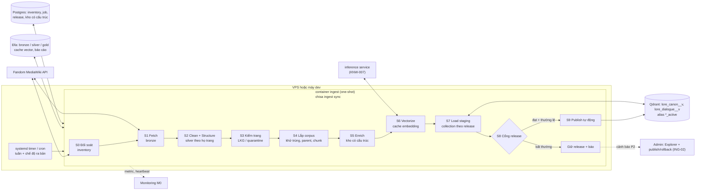

# Thiết kế hệ thống Ingestion cho Chisa: Crawl → Clean → Vectorize → Ingest

| Thuộc tính | Giá trị |
|---|---|
| Trạng thái | **ĐÃ DUYỆT 2026-10-31** (chủ dự án uỷ quyền chọn phương án đề xuất): [ADR-0002](../adr/0002-ingestion-system.md), SRS v2.1 |
| Ngày | 2026-10-31 |
| Phạm vi nguồn | **Chỉ Wuthering Waves Fandom wiki** (`wutheringwaves.fandom.com`, MediaWiki API). Không dùng datamine, wiki Kuro hay nguồn không ổn định khác |
| Bổ sung cho | SRS v2 mục 3.5.17 (S0–S9), 4.11 (ING-001…012), mục 15 (E1–E13); [WuWa_Wiki_Source_Survey.md](../../reports/WuWa_Wiki_Source_Survey.md); [Ingestion_Pipeline_Redesign_Proposal.md](../../reports/Ingestion_Pipeline_Redesign_Proposal.md) |
| Bốn tiêu chí | (1) độ tin cậy cao, (2) tối thiểu Human In The Loop, (3) mở rộng tốt khi dữ liệu game phình, (4) dễ dùng, triển khai, bảo trì, nâng cấp |

> Ghi chú tên gọi: tài liệu hiểu "Visualizing" là bước **Vectorize** (embedding). Phần **trực quan hoá để kiểm tra dữ liệu** được thiết kế riêng ở mục 11 (Corpus Explorer), vì đó là công cụ chính để giảm thời gian con người phải can thiệp.

---

## 0. Tóm tắt

SRS hiện mô tả **data plane** (S0–S9: làm gì với một trang). Còn thiếu phần làm cho hệ chạy **tự động, an toàn và lâu dài**:
- phát hiện thay đổi;
- chống phá hoại và chống thoái lui;
- chính sách tự publish;
- lịch chạy;
- mở rộng;
- nâng cấp thành phần;
- công cụ kiểm tra.

Tài liệu này bổ sung các phần đó. Mười quyết định chính:

| # | Quyết định | Vì sao |
|---|---|---|
| 1 | **Đối soát trạng thái toàn bộ wiki mỗi lần chạy** (`allpages` + `prop=info`, khoảng 200 request, khoảng 3,5 phút), không dựa riêng vào luồng `recentchanges` | Không bao giờ lệch trạng thái; tự lành sau sự cố; xử lý được xoá và đổi tên |
| 2 | Phát hiện thay đổi theo **`revid` + `touched` + loại template đã đổi**, cộng **làm mới cuốn chiếu** | Đo thật: 7 ngày có 470/1.049 trang Tier A bị `touched` nhưng chỉ 93 trang có revision mới. Chỉ theo `revid` thì bỏ sót; tải lại mọi trang `touched` thì vượt CAP-003 |
| 3 | **Kênh có cấu trúc** lấy từ `pageprops.infoboxes` (JSON của PortableInfobox, 50 trang/request) và category, phủ **toàn bộ 9,2 nghìn trang**. **Kênh văn bản** chỉ phủ Tier đã chọn | Dữ kiện thuộc tính và quan hệ (quest, địa điểm, phe phái) rẻ và tin cậy hơn cào DOM; câu hỏi kiểu "Honami" cần đồ thị toàn wiki |
| 4 | **Bronze bất biến, mọi tầng khác dựng lại được.** Không sửa tay dữ liệu dẫn xuất; mọi chỉnh sửa của người là cấu hình có version | Nâng cấp cleaner/chunker/model chỉ cần chạy lại từ bronze, không tải lại wiki |
| 5 | **Last-known-good theo trang**: trang mới hỏng (layout đổi, bị phá, cleaner lỗi) giữ phiên bản tốt gần nhất, không biến mất khỏi corpus | Không bao giờ thoái lui vì một trang |
| 6 | **Cổng tự động theo release + tự publish** khi mọi cổng đạt và thay đổi nằm trong "phong bì thường lệ"; ngược lại **giữ release** và báo | Con người chỉ vào cuộc khi có bất thường (exception-based HITL) |
| 7 | Evidence ID **định địa chỉ theo nội dung**, ổn định qua các release khi chữ không đổi | Cache embedding trúng; trích dẫn cũ không vỡ |
| 8 | **Không thêm hạ tầng**: Postgres + Qdrant + đĩa + một container chạy một lần (one-shot); không Airflow/Dagster/Prefect; không thêm thư viện nặng | Vừa ngân sách RAM; ít thứ phải vận hành |
| 9 | **Họ trang (page family) khai báo bằng cấu hình** + bộ làm sạch theo họ có test fixture | Thêm loại nội dung mới mà không sửa lõi |
| 10 | **Corpus Explorer**: báo cáo HTML tĩnh sinh mỗi lần chạy (diff, quarantine, page inspector) | Khi cần người duyệt thì duyệt trong ≤ 15 phút |

---

## 1. Hiện trạng (số đo ngày 2026-10-30/31)

### 1.1 Nguồn: Fandom wiki

| Mục | Giá trị đo | Hệ quả thiết kế |
|---|---|---|
| Nền tảng | MediaWiki 1.43.9; có PortableInfobox, DynamicPageList3, Scribunto, Tabber; **không có** Cargo / Semantic MediaWiki | Không có API truy vấn có cấu trúc; dữ kiện nằm trong infobox và category |
| Infobox có cấu trúc | `prop=pageprops&ppprop=infoboxes` trả JSON gồm `source` (tên tham số template), `label`, `value` (HTML) | Trích thuộc tính **không cần cào DOM**; khoá `source` ổn định hơn selector CSS |
| Quy mô | 9.231 bài ns0, 79 nghìn trang mọi namespace, 38 người sửa tích cực | Toàn bộ danh sách ns0 tải được trong khoảng 19 request |
| Hoạt động | khoảng 500 thay đổi/tuần ở ns0 + Template + Module (103 trang mới/tuần); đỉnh vào ngày ra bản | Lịch hằng tuần là đủ, cộng chế độ tăng tốc sau ngày ra bản |
| `touched` so với `revid` (Tier A, 7 ngày) | **470** trang `touched`, **93** trang có revision mới | Template, navbox, DPL làm HTML đổi mà revision không đổi |
| Phá hoại | 500 sửa gần nhất: 0 sửa ẩn danh, 15 người sửa, 4 lần hoàn tác, 0 lần xoá > 50% trang | Rủi ro thấp; chỉ cần trễ ổn định và phát hiện sụt kích thước |
| Đổi tên / xoá | khoảng 50 lần đổi tên trong 3 tháng (chủ yếu File/User); khoảng 50 lần xoá trong 3 tháng | Khoá theo `page_id` (không đổi khi đổi tên); xoá cần xác nhận |
| Robots / dump | `robots.txt` cho phép `api.php`; dump XML có nhưng cũ (2026-06-20) | Chỉ dùng API; dump không phải nguồn chính |
| Giấy phép | CC BY-SA | Lưu `url`, `revid`, giấy phép cho mỗi trang; trích dẫn phải ghi nguồn |
| Địa điểm "Honami" | **Không có trang "Honami City"**. Vùng tên `Chronorift Metropolis` (category `The Black Shores Locations`) gồm `Honami Central Park`, `Honami Convention Center`, `Shashou Cafe`… Infobox địa điểm chỉ có `map`, `type`; quan hệ cha–con nằm ở category `<Vùng> Locations` | Đồ thị địa điểm phải dựng từ category; tên gọi dân dã ("Honami") cần **alias suy luận có bằng chứng** (mục 6.5) |

Số liệu nội dung (token, thoại, trùng lặp, stub) giữ nguyên như phụ lục C của SRS.

### 1.2 Codebase

| Thành phần | Hiện trạng | Đánh giá |
|---|---|---|
| Control plane | Source registry (curator duyệt), `pipeline_jobs`/`events`, `corpus_releases` + audit, publish/rollback qua alias, manifest checksum, ACL | **Giữ** |
| Cổng chất lượng | `CorpusQualityReport` đòi metric sinh câu trả lời (faithfulness…) **và `human_audit_completed`** cho **mọi** release | **Mâu thuẫn với tối thiểu HITL** khi corpus cập nhật hằng tuần; cần tách cổng (mục 6.8) |
| Data plane | DAG có lỗi D1–D11 (đề xuất cũ); mỗi lần chạy chỉ ghi một staging collection; không có artifact theo stage | Viết lại theo SRS; đổi hợp đồng chạy |
| Trạng thái đồng bộ | `wiki_sync_state` chỉ theo `revision_id` | Thiếu `touched`, template, last-known-good |
| Lịch chạy | Có durable job (lease, retry, dead-letter) nhưng **không có scheduler** | Dùng timer của host (giống `backup.sh`) |
| Hạ tầng | Qdrant **1.12.4** (SRS yêu cầu 1.20); chưa có inference service (KNW-007) | Là điều kiện tiên quyết của R1 (mục 12) |

---

## 2. Mục tiêu đo được

| Tiêu chí | Chỉ số | Mục tiêu |
|---|---|---|
| Tin cậy | Release lỗi được publish | **0** (mọi publish phải qua cổng) |
| | Trang biến mất do lỗi xử lý (không phải do wiki xoá) | **0** (last-known-good) |
| | Lần chạy định kỳ thành công | ≥ 95% / quý |
| | Độ tươi: thay đổi trên wiki → đã publish | ≤ 7 ngày thường lệ; ≤ 48 giờ trong chế độ ra bản |
| | Lệch trạng thái giữa inventory và wiki sau một lần chạy | 0 |
| Tối thiểu HITL | Thao tác người bắt buộc mỗi chu kỳ tuần | **0** |
| | Lần can thiệp ở trạng thái ổn định | ≤ 1 / tháng |
| | Thời gian một lần duyệt khi bị giữ release | ≤ 15 phút |
| Mở rộng | Chi phí mỗi lần chạy | Tỷ lệ với **số trang thay đổi**, không với kích thước corpus |
| | Cập nhật tuần | Tier A ≤ 10 phút (CAP-003); Tier A+B ≤ 15 phút |
| | Dựng lại toàn bộ từ bronze, không mạng | Tier A+B ≤ 30 phút (embedding có cache) |
| | Dư địa | Gấp 4 lần quy mô hiện tại (khoảng 60 nghìn chunk) trong ngân sách RAM |
| Dễ dùng | Lệnh vận hành thường ngày | 1 (`chisa ingest sync`, chạy tự động) |
| | Dịch vụ mới phải chạy thường trực | **0** |
| | Thêm một họ trang | 1 khai báo cấu hình + 1 bộ làm sạch + fixture |

---

## 3. Nguyên tắc thiết kế

1. **Bronze bất biến, phần còn lại dựng lại được.** Bản tải về của wiki (bronze) không bao giờ bị sửa. Silver, gold, vector, release đều là hàm tất định của `bronze + cấu hình + phiên bản code`.
2. **Đối soát thay vì tin sự kiện.** Mỗi lần chạy so trạng thái thật của wiki với inventory. `recentchanges` chỉ là gợi ý ưu tiên. Lỡ một lần chạy thì lần sau tự bù.
3. **Hàm thuần theo trang, cache theo nội dung.** Mỗi stage có khoá `hash(input, cấu hình, phiên bản stage)`. Khoá không đổi thì không chạy lại.
4. **Không bao giờ thoái lui.** Ở cấp trang: last-known-good. Ở cấp release: cổng tự động và rollback một thao tác.
5. **Con người theo ngoại lệ.** Mọi việc thường lệ tự động. Con người chỉ nhận việc khi hệ thống tự phát hiện bất thường, kèm báo cáo đủ để quyết định nhanh.
6. **Cấu trúc trước, văn bản sau.** Dữ kiện có cấu trúc lấy từ nguồn có cấu trúc (infobox JSON, category, redirect). Văn bản chỉ để truy hồi ngữ nghĩa và trích dẫn.
7. **Không thêm hạ tầng.** Postgres, Qdrant, đĩa VPS, inference service đã có trong SRS. Artifact dùng JSON Lines nén gzip (thư viện chuẩn); báo cáo dùng Jinja2 (đã có).

---

## 4. Kiến trúc tổng thể

**Nơi chạy:**
- **Bây giờ** (chưa có VPS): chạy trên máy dev bằng cùng container, trỏ vào stack dev.
- **Khi có VPS**: `docker compose --profile ingest run --rm ingest sync` do systemd timer gọi lúc thấp tải (04:00 ICT). Giới hạn 768 MB RAM, ưu tiên CPU thấp. Embedding gọi inference service theo lô, có giới hạn tốc độ để không ảnh hưởng chat.
- **Dựng lại lớn** (đổi model embedding): có thể chạy trên máy dev rồi xuất **gói release** (`chisa ingest export`) chuyển lên VPS (`chisa ingest import`). Điều kiện: cùng backend embedding được ghi trong manifest.

**Không dùng orchestrator ngoài.** Chỉ có một pipeline; control plane, job và audit đã có trong Postgres. Dagster, Prefect hay Airflow sẽ thêm một dịch vụ thường trực, tốn RAM và tạo phụ thuộc. Mô hình "build tăng dần theo khoá nội dung" (giống Make/DVC) đủ cho nhu cầu và dễ test.

**Khoá chạy đơn:** advisory lock của Postgres ngăn hai lần chạy chồng nhau (timer + chạy tay).

---

## 5. Dữ liệu và các tầng lưu trữ

| Tầng | Nội dung | Khoá | Nơi lưu / định dạng | Giữ lại |
|---|---|---|---|---|
| L0 Inventory | Mọi trang ns0: `page_id`, title, họ trang, tier, `lastrevid`, `touched`, template đang dùng, revision đã tải, `render_hash`, trạng thái, con trỏ last-known-good | `page_id` | Postgres (`wiki_pages`, thay `wiki_sync_state`) | Luôn luôn |
| L1 Bronze | Kết quả `action=parse` (HTML, categories, sections, templates, displaytitle) + `pageprops` + `fetched_at`, url, giấy phép | `(page_id, revid, render_hash)` | `data/ingestion/bronze/<page_id>/<revid>-<hash>.json.gz` | 3 bản gần nhất mỗi trang + bản là LKG |
| L2 Silver | `CanonicalDocument`: block có kiểu, nhật ký loại bỏ, dữ kiện có cấu trúc, quan hệ, ứng viên glossary | `hash(bronze, họ trang, phiên bản cleaner, cấu hình)` | `silver/<page_id>/<key>.json.gz` | Bản hiện hành + LKG |
| L3 Gold | Theo corpus: chunk, entity, alias, quest, glossary, quan hệ, bản đồ khử trùng | Theo `corpus_version` | `gold/<corpus_version>/*.jsonl.gz` + `manifest.json` | 4 release gần nhất |
| L4 Vector cache | Vector dense (và sparse nếu dùng) | `hash(embedding_text) + model_id + model_revision + prefix_version + backend` | `vectors/<model>/<shard>.jsonl.gz` hoặc bảng Postgres | Theo model đang dùng + model trước |
| L4b Ảnh thực thể | Bản gốc + bản hiển thị WebP ≤ 1.024 px; manifest liên kết ảnh–thực thể | `sha256` của bản gốc | `images/blobs/<sha[:2]>/<sha256>.<ext>`, `images/display/<sha256>.webp` | Ảnh còn được tham chiếu; không cần backup (tải lại được) |
| L5 Release | Qdrant `lore_canon__<ver>`, `lore_dialogue__<ver>`; bảng có cấu trúc có cột `corpus_version`; alias `*_active` | `corpus_version` | Qdrant + Postgres | Release đang active + release trước (rollback tức thì); release cũ hơn dựng lại từ gold trong vài phút |

Quy ước lưu trữ (ING-007): artifact và manifest chỉ dùng **đường dẫn tương đối** so với `data/ingestion/`; trạng thái chạy ở Postgres hoặc SQLite; log tiến độ JSONL append-only. IndexBeast ghi đè file JSON trạng thái 1–6 MB sau mỗi trang, mỗi ảnh, tốn khoảng 7–8 GB và 30 GB ghi đĩa cho một lần crawl.

`corpus_version` dạng `YYYY.MM.DD-N`. Manifest ghi:
- ảnh chụp nguồn (`page_id → revid`, mốc `recentchanges`);
- phiên bản mọi thành phần (fetcher, cleaner theo họ, chunker, enricher, model embedding, tokenizer);
- hash cấu hình;
- số lượng theo collection và họ trang;
- checksum từng file;
- kết quả cổng.

**Evidence ID ổn định:** `wiki:<page_id>:<sha256(văn bản unit đã chuẩn hoá)[:16]>`, thêm số thứ tự nếu một trang có hai unit trùng chữ. Point ID trong Qdrant là `uuid5(evidence_id)`. Unit không đổi chữ thì giữ ID qua các release, nên embedding cache trúng và trích dẫn cũ vẫn tra được.

---

## 6. Pipeline chi tiết

### 6.1 S0 Đối soát và inventory (giải quyết đồng bộ, xoá, đổi tên)

Mỗi lần chạy:
1. `list=allpages` ns0 (khoảng 19 request): danh sách đầy đủ `page_id`, title.
2. `prop=info` theo lô 50 (khoảng 185 request): `lastrevid`, `touched`.
3. Với trang mới hoặc có `touched` đổi: lấy metadata theo lô gồm categories, `pageprops.infoboxes`, redirects, templates. Sau đó **phân loại họ trang và tier** theo `families.yaml` (mục 10.2).
4. Trang không còn trong `allpages`: tra `logevents` (move/delete).
   - Đổi tên thì giữ `page_id`, chỉ cập nhật title và thêm alias cũ.
   - Bị xoá thì đánh dấu `pending_delete`. Chỉ thành tombstone sau **2 lần chạy liên tiếp** vẫn vắng, để chống lỗi API nhất thời.
5. `list=recentchanges` (Template, Module ns 10/828) cho cửa sổ kể từ lần chạy trước: danh sách template đã sửa, dùng ở S1.

Chi phí khoảng 200–250 request, tức khoảng 3,5–4 phút ở 1 req/s, không phụ thuộc số trang thay đổi.

### 6.2 S1 Fetch (bronze)

Một trang trong phạm vi văn bản được đưa vào hàng tải nếu thoả một trong các điều kiện sau, theo thứ tự ưu tiên:

| Ưu tiên | Điều kiện | Lý do |
|---|---|---|
| 1 | Trang mới, hoặc `lastrevid` khác revision đã tải | Nội dung đã đổi |
| 2 | `touched` đổi **và** trang dùng một template thuộc nhóm **content** vừa bị sửa (infobox, dialogue, quote, tooltip…) | Template mang nội dung đổi |
| 3 | **Làm mới cuốn chiếu**: khoảng 5% trang có lần tải cũ nhất | Bảo đảm hội tụ cuối cùng (eventual consistency) dù phân loại template sai |

`touched` đổi do template nhóm **chrome** (navbox, stub, DPL, bảo trì) thì **không** tải lại, vì các phần đó vốn bị bỏ ở S2. Phân loại template nằm trong `templates.yaml`. Template chưa phân loại mặc định là **content** (an toàn).

**Trễ ổn định:** chỉ tải revision đã tồn tại ≥ 24 giờ, hoặc ≥ 6 giờ trong chế độ ra bản. Trang mới hoàn toàn không phải chờ. Bản sửa phá hoại thường bị hoàn tác trong cửa sổ này, nên hệ thống tự lấy bản tốt.

**Lịch sự và chịu lỗi:**
- 1 req/s (cấu hình được), `maxlag=5`, User-Agent có liên hệ, nén gzip (giới hạn byte tính trên dữ liệu đã giải nén).
- HTTP client theo mẫu `crawl/http.py` của IndexBeast: một nhịp chung cho mọi request, `Retry-After` dạng số giây và HTTP-date, dừng nếu phải chờ > 60 giây, chặn redirect ra ngoài host allowlist, chống vòng lặp `continue` ([bài học IndexBeast](indexbeast-lessons.md) L1, L2).
- Retry có backoff + jitter.
- **Circuit breaker**: chuỗi 429/5xx thì dừng lần chạy **một cách sạch** (đã tải thì giữ). Lần chạy sau tiếp tục từ hàng đợi, không có bước "rollback lần chạy".
- **Ngân sách mỗi lần chạy** (số trang tối đa): phần dư dồn sang lần sau, nên thời gian chạy luôn bị chặn trên.

Ước tính tuần: Tier A khoảng 93 trang đổi revision + một phần nhỏ do template + khoảng 52 trang cuốn chiếu ≈ 150–250 lần parse ≈ 3–4 phút. Tổng cộng cả S0 khoảng **7–8 phút**, đạt CAP-003. Tier A+B ước khoảng 12–15 phút.

### 6.3 S2 Clean + Structure (silver)

- **Bộ làm sạch theo họ trang** (registry): `resonator`, `backstory`, `voicelines`, `forte_report`, `quest` (gồm thoại), `event_story`, `terminology`, `lore`, `faction`, `region`, `location`, `npc`… Mỗi bộ là hàm thuần `HTML → CanonicalDocument`, có `version` riêng.
- **Bộ làm sạch chung (fallback)** cho trang chưa có họ: chỉ lấy văn xuôi. Gắn cờ `generic_cleaner`, đưa vào báo cáo để biết khi nào nên thêm họ mới.
- Áp dụng toàn bộ quy tắc của ING-003, ING-012 và E3–E5 (tách infobox trước, tooltip → glossary, bỏ hidden/mobile/audio/DPL, boilerplate, zero-width, biến thể giới tính).
- **Dữ kiện có cấu trúc lấy từ `pageprops.infoboxes`** (khoá `source`), không lấy từ DOM. DOM chỉ là dự phòng khi trang thiếu pageprops.
- **Hợp đồng theo họ trang** (contract):
  - mỗi họ khai báo dấu hiệu bắt buộc (ví dụ quest có thoại thì phải có `div.dialogue`; resonator phải có infobox với `source` nhất định);
  - vi phạm nghĩa là layout wiki đã đổi.
- **Bộ dò rác (residue)** trên output, gồm mẫu wikitext, URL, `Media:`, `.ogg`, "[ ]", các câu boilerplate.

### 6.4 S3 Kiểm tra mức trang và last-known-good

| Kiểm tra | Vi phạm thì |
|---|---|
| Residue = 0 | `quarantine`, dùng LKG |
| Hợp đồng họ trang | `quarantine` (nhãn `layout_changed`), dùng LKG; gom theo họ để báo một lần |
| Sụt token > 40% so với LKG mà không có lý do (trang bị cắt, sửa lỗi) | `hold`: dùng LKG. Nếu trạng thái mới **giữ nguyên qua 2 lần chạy / 7 ngày** thì chấp nhận và ghi báo cáo |
| Safety gate: dấu hiệu prompt injection ("ignore previous instructions"…), PII, nội dung ngoài phạm vi | `quarantine`, giữ ngữ nghĩa fail-closed hiện có (curator miễn trừ bằng cấu hình `safety_exceptions`) |
| Trang rỗng đúng kỳ vọng (E12) | `empty_after_clean`, không tính là lỗi |

Trang chưa từng có LKG mà bị quarantine thì chưa vào corpus; nó chỉ xuất hiện trong báo cáo.

### 6.5 S4–S5 Lắp corpus và kho có cấu trúc

**Lắp corpus** (chạy trên toàn corpus, rẻ vì chỉ đọc silver đã có):
1. Chọn silver hiệu lực cho mỗi trang (hiện hành hoặc LKG).
2. **Khử trùng xuyên trang** (ING-011): index dấu vân tay block (hash văn bản chuẩn hoá) trên toàn corpus. Trang sở hữu được quyết định bởi `owner_rules` trong cấu hình. Trùng gần đúng (MinHash) là bước sau, chưa cần ở R1.
3. Parent và **hồ sơ thực thể** (văn bản dựng từ trường infobox).
4. **Chunk** theo token thật của model (ING-004, E1):
   - văn xuôi: theo đoạn và câu;
   - thoại: hai tầng;
   - bảng: lặp header;
   - unit nguyên tử: không overlap;
   - **chống chunk vụn**: unit kề nhau cùng section path, collection và ngôn ngữ được gộp tới ~250–400 token; ngưỡng tối thiểu ~120 token; infobox chỉ có **một thẻ hồ sơ** mỗi trang. IndexBeast cho thấy cắt theo trường hoặc theo lượt tạo 47% chunk dưới 50 token.

   Bất biến bao phủ được kiểm bằng code; thuật toán cắt theo tìm kiếm nhị phân trên token thật lấy từ `core/text/chunking.py` của IndexBeast.
5. Định tuyến chunk vào `lore_canon` hoặc `lore_dialogue` theo họ trang và loại block.

**Kho có cấu trúc** (phủ toàn wiki):

| Bảng | Nguồn | Ghi chú |
|---|---|---|
| `entities` | Tiêu đề trang thực thể + `pageprops.infoboxes` | Mỗi trường giữ `source` và trang gốc |
| `aliases` | Redirect (độ tin cao), bảng *Other Languages* (ZH/JA/KO…), **alias suy luận**, alias curated | Mỗi alias có `kind`, `confidence`, `evidence` |
| `locations` (đồ thị) | Category `<X> Locations`, `Regions`, `Nations`; câu dẫn quest "occurs in A, B, C" | Cạnh `located_in` có nguồn |
| `quests` | Infobox + Description + Steps + lời dẫn `dt` (E6) + người nói chính + quest trước/sau + địa điểm | Quest không có Summary vẫn có thẻ đầy đủ |
| `glossary` | Tooltip; chọn định nghĩa chuẩn theo E10 | |
| `relations` | Category "X Story Mentions / Appearances", link, DPL | Bổ sung `entities[]` cho chunk |

`nation` và `game_version` được suy luận có ghi nguồn theo E7 và E8.

**Alias suy luận có bằng chứng** (thay cho việc curator duyệt tay từng tên):
- Ví dụ: nhiều địa điểm cùng tiền tố "Honami" thuộc category `Chronorift Metropolis Locations`, và glossary có định nghĩa "nation encompassing Honami City". Từ đó sinh alias `Honami (City)` → `Chronorift Metropolis` với `confidence=inferred` và danh sách bằng chứng.
- Alias suy luận chỉ được dùng cho entity linking khi eval chứng minh không tăng nhầm lẫn (cùng cơ chế với KNW-009). Không cần curator duyệt từng alias.

### 6.6 S6 Vectorize

- `embedding_text = "passage: {title}\n{section_path}\n{text}"` (giao thức e5, KNW-005). `text` giữ nguyên văn để offset trích dẫn không vỡ.
- **Cache** theo khoá ở L4: chỉ chunk có chữ mới mới phải embed. Một tuần bình thường chỉ embed vài trăm chunk.
- Gọi **inference service** ([ADR-0004](../adr/0004-inference-service.md)) ở làn `passage`, lô 4 (service cho tối đa 8), một lô tại một thời điểm, **nghỉ giữa các lô khi có người dùng hoạt động**. Query của người dùng đi làn riêng; đo được p95 khoảng 78 ms trong lúc embed passage liên tục.
- **Một backend embedding cho mỗi release** (ghi vào manifest). Query side bắt buộc dùng cùng model, revision và backend. Startup từ chối nếu lệch (KNW-005).
- Kênh lexical (BM25) chọn ở I0 theo kết quả kiểm chứng ASM-002:
  - **sparse vector BM25 do Qdrant tự sinh** (có từ 1.15.2);
  - hoặc **BM25 trên full-text payload index** (mới có ở 1.20.0, phát hành 2026-10-22).

### 6.7 S7 Load staging

- Mỗi release tạo **collection vật lý mới** (`lore_canon__<ver>`, `lore_dialogue__<ver>`) với schema tường minh: named vector dense, kênh lexical, payload index (`access_scope`, `entities`, `entity_type`, `page_type`, `nation`, `corpus_version`).
- Upsert theo lô 256 điểm từ gold + cache vector, nên không cần embedding lúc load. Khoảng 15 nghìn điểm mất khoảng 1–2 phút.
- Đối chiếu số điểm bằng manifest. Ghi bảng có cấu trúc với `corpus_version` mới. Release chuyển sang `STAGED`.
- Collection thiếu kênh lexical thì **fail**, không ghi dense-only (D11).

### 6.8 S8 Cổng release (tách theo loại thay đổi)

Cổng hiện tại đòi metric sinh câu trả lời và kiểm tra thủ công cho mọi release. Cách đó không vận hành được với cập nhật hằng tuần, nên tách thành ba lớp:

| Lớp | Nội dung | Khi nào chạy | Chi phí |
|---|---|---|---|
| **Cổng dữ liệu** (tất định) | Residue = 0; 100% chunk ≤ giới hạn token; 0 trùng khớp chính xác (ING-011); tỷ lệ quarantine ≤ 2% trang; không collection rỗng; số lượng mỗi bảng có cấu trúc lệch ≤ 5% (trừ phần giải thích được bằng trang mới hoặc xoá); không có quarantine safety chưa miễn trừ | Mọi release | Vài giây |
| **Cổng truy hồi** | Golden v2 ở **mức truy hồi** (Hit@5, MRR@10 theo nhóm câu hỏi, không gọi LLM) chạy trên staging; **canary**: tập câu hỏi cố định phải còn tìm thấy trang đích | Mọi release | Vài phút, không tốn tiền |
| **Cổng sinh câu trả lời** | Golden v2 đầy đủ với LLM thật (groundedness, persona…) | Khi đổi runtime/prompt/model, hoặc release có thay đổi vượt phong bì; chạy theo lịch đêm có ngân sách (OPS-004) | Có ngân sách |

**Phong bì thường lệ** (cấu hình, đề xuất mặc định):
- số trang bị xoá ≤ 1% hoặc ≤ 10 trang;
- số chunk thay đổi trong ±10%, phần vượt phải được giải thích bằng trang mới;
- metric truy hồi **không thấp hơn release active quá 2 điểm %**, có tính khoảng tin cậy;
- canary đạt 100%.

### 6.9 S9 Publish, theo dõi sau publish, dọn dẹp

- **Tự publish** khi cổng dữ liệu và cổng truy hồi đạt **và** thay đổi nằm trong phong bì. Actor ghi trong audit là `service:ingestion-autopublish`, kèm link báo cáo.
- Ngoài phong bì hoặc cổng không đạt: release ở trạng thái **`HELD`**. Cảnh báo P2 kèm link Corpus Explorer. Admin publish hoặc huỷ bằng luồng ING-02 hiện có (step-up).
- **Theo dõi sau publish**: kiểm tra tổng hợp (MON-070) và canary chạy lại sau publish. Nếu tụt thì **tự rollback** về release trước (một thao tác alias, REL-006) và cảnh báo P1.
- **Dọn dẹp**:
  - giữ release active và release trước trong Qdrant;
  - release cũ hơn bị xoá khỏi Qdrant nhưng vẫn dựng lại được từ gold;
  - bronze/silver giữ theo chính sách ở mục 5.

### 6.10 Luồng ảnh thực thể (ING-019, KNW-010)

Chạy sau S5, **tách khỏi luồng text**: lỗi ảnh không bao giờ làm hỏng trang text (khác IndexBeast).

1. Danh sách ảnh lấy từ mục `image` của `pageprops.infoboxes` cho các thực thể trong kho có cấu trúc; bổ sung thẻ `characters=` và category `<Thực thể> Images` của trang file.
2. `imageinfo` theo lô 50: `url`, `sha1`, `size`, `mime`, `timestamp`. `sha1` không đổi thì không tải lại.
3. Tải **bản gốc**, kiểm bằng Pillow (decompression bomb, ≤ 25 MB, ≤ 60 megapixel, MIME khớp định dạng thật), lưu theo SHA-256.
4. Sinh **bản hiển thị** WebP cạnh dài ≤ 1.024 px tại chỗ; câu trả lời dùng bản này, bản gốc chỉ khi người dùng mở xem.
5. Lưu `file_page_url`, `revid`, `license=fair_use`; cổng riêng cho tỷ lệ lỗi và ảnh mồ côi.

Quy mô Tier A: khoảng 650 file, 0,94 GB bản gốc. Tốc độ chung 1 req/s, nên tải lần đầu mất khoảng 15–20 phút (chạy sau text, có ngân sách riêng).

---

## 7. Ma trận độ tin cậy

| Sự cố | Phát hiện | Phản ứng tự động | Cần người? |
|---|---|---|---|
| Wiki chậm, 429, 5xx | Breaker | Dừng sạch, lần sau tiếp tục | Không (cảnh báo nếu 3 lần chạy liên tiếp thất bại) |
| Lần chạy chết giữa chừng | Lock + trạng thái stage | Lần sau chạy tiếp từ các khoá đã có | Không |
| Layout wiki đổi (một họ trang) | Hợp đồng họ trang | Quarantine + LKG; gom một cảnh báo theo họ | **Có**: sửa cleaner (code + fixture) |
| Phá hoại | Trễ ổn định + sụt kích thước | Lấy bản sau hoàn tác hoặc giữ LKG | Không |
| Template đổi hàng loạt | `touched` + phân loại template | Chỉ tải lại khi template là content | Không |
| Trang đổi tên / bị xoá | Đối soát + `logevents` | Giữ `page_id`; tombstone sau 2 lần | Không |
| Lỗi code cleaner hoặc chunker mới | Cổng dữ liệu + cổng truy hồi | Release bị `HELD`, active không đổi | **Có**: xem Explorer |
| Inference service lỗi | Lỗi gọi | Dừng ở S6, giữ release active | Không (cảnh báo nếu kéo dài) |
| Load Qdrant thiếu điểm | Đối chiếu manifest | Release `FAILED`, active không đổi | Không |
| Chất lượng tụt sau publish | MON-070 + canary | Tự rollback | Xem nguyên nhân sau |
| Artifact hỏng (bit rot) | So `(size, mtime, sha256 đã lưu)` khi đọc; `chisa ingest verify` băm lại toàn bộ | Tính lại từ tầng dưới | Không |
| Hai lần chạy chồng nhau | Advisory lock | Lần sau thoát ngay | Không |
| Đầy đĩa | Cảnh báo `chisa-disk-*` có sẵn | Dọn theo chính sách giữ lại | Có nếu vẫn thiếu |

---

## 8. Human In The Loop: chỉ theo ngoại lệ

| Mức | Khi nào | Con người làm gì | Tần suất kỳ vọng |
|---|---|---|---|
| 0 Tự động | Chạy định kỳ, mọi cổng đạt | Không gì | Hằng tuần |
| 1 Thông báo | Sau mỗi lần publish | Không bắt buộc đọc: bản tóm tắt gửi Discord (trang thêm/đổi/xoá, quarantine) | Hằng tuần |
| 2 Giữ release | Ngoài phong bì, cổng không đạt, safety | Mở Explorer, publish hoặc huỷ (≤ 15 phút) | ≤ 1 lần/tháng |
| 3 Sửa code | Hợp đồng họ trang vỡ | Cập nhật cleaner + fixture, chạy `rebuild --from clean` | Vài lần/năm (khi wiki đổi layout) |

**Điểm chạm của con người** (danh sách đầy đủ):

| Điểm chạm | Thay thế tự động | Còn lại cho người |
|---|---|---|
| Duyệt nguồn | Không đổi | Một lần khi thêm nguồn (chỉ có wiki) |
| Duyệt mỗi release | Cổng + phong bì + tự publish + tự rollback | Chỉ release bị `HELD` |
| Alias tiếng Việt / Hán-Việt | Alias suy luận có bằng chứng + eval | Overlay curated (tuỳ chọn, qua PR) |
| Miễn trừ safety | Không đổi (fail-closed) | Hiếm |
| Golden set | Đề xuất câu hỏi mới từ trang mới (tuỳ chọn, sau R1) | Duyệt theo đợt |
| Quarantine | Tự thử lại mỗi lần chạy | Chỉ khi tồn tại > 14 ngày (nằm trong bản tóm tắt) |

---

## 9. Khả năng mở rộng

| Trục | Hiện nay (đo) | Ước 2 năm (giả định thêm khoảng 6–8 bản game/năm) | Cách hệ đáp ứng |
|---|---|---|---|
| Trang ns0 | 9,2 nghìn | 15–20 nghìn | Đối soát O(trang/50) request, khoảng 6–7 phút |
| Trang phạm vi văn bản | Tier A 1,05 nghìn; A+B 4,2 nghìn | A+B 7–9 nghìn | Thêm tier bằng cấu hình; chi phí tuần theo số trang đổi |
| Chunk | 6,7 nghìn (A) / 15,5 nghìn (A+B) | 30–40 nghìn | Qdrant khoảng 200–400 MB cho 2 release; vector on-disk + quantization nếu cần |
| Embedding | Toàn bộ một lần | Chỉ phần đổi | Cache theo nội dung |
| CPU làm sạch/chunk | Một tiến trình | Pool tiến trình theo trang | Hàm thuần theo trang nên song song hoá được |

Tốc độ tải bị chặn có chủ đích bởi lịch sự (1 req/s). Hệ mở rộng bằng **tăng dần**, không bằng tải song song.

---

## 10. Dễ dùng, triển khai, bảo trì, nâng cấp

### 10.1 CLI

| Lệnh | Việc |
|---|---|
| `chisa ingest sync` | Chu trình đầy đủ (lệnh của timer) |
| `chisa ingest plan` | Xem trước: sẽ tải, dựng lại, xoá những gì (giống `terraform plan`) |
| `chisa ingest rebuild --from clean\|chunk\|embed` | Dựng lại từ bronze sau khi nâng cấp, không gọi wiki |
| `chisa ingest backfill --tier A` | Lần nạp đầu, chạy tiếp được nếu dừng |
| `chisa ingest status` | Lần chạy gần nhất, release active, hàng đợi, quarantine |
| `chisa ingest inspect --page "Chisa"` | Raw → silver → chunk của một trang, lý do loại bỏ, số token |
| `chisa ingest diff --from vA --to vB` | Thêm/bớt/đổi theo trang và chunk |
| `chisa ingest report` | Sinh Corpus Explorer |
| `chisa ingest verify` | Kiểm checksum artifact và manifest |
| `chisa ingest export / import` | Gói release để chuyển máy |
| Publish/rollback | Giữ ở ING-02 (Admin Console/CLI, step-up) |

### 10.2 Cấu hình (trong repo, review qua PR)

| File | Nội dung |
|---|---|
| `config/ingestion/families.yaml` | Họ trang: luật nhận dạng (hậu tố, category, template infobox), tier, bộ làm sạch + version, chính sách chunk, collection đích, độ ưu tiên sở hữu khi khử trùng |
| `config/ingestion/templates.yaml` | Phân loại template `content` / `chrome` |
| `config/ingestion/cleaning.yaml` | Selector bỏ, mẫu boilerplate, mẫu residue (version hoá) |
| `config/ingestion/gates.yaml` | Ngưỡng cổng và phong bì thường lệ |
| `config/ingestion/schedule.yaml` | Lịch, trễ ổn định, ngân sách mỗi lần chạy, tốc độ |
| `config/ingestion/overrides/*.yaml` | Overlay của người (alias curated, ghim/loại trang, luật sở hữu đặc biệt, miễn trừ safety): **đầu vào thủ công duy nhất**, áp dụng như một stage |

**Thêm một họ trang mới:**
1. Thêm khai báo vào `families.yaml`.
2. Viết bộ làm sạch (hàm thuần).
3. Thêm 3–5 fixture bronze cùng output kỳ vọng.
4. Chạy `rebuild --from clean`.

Không phải sửa lõi pipeline.

### 10.3 Ma trận nâng cấp

| Thay đổi | Phạm vi tính lại | Cách phát hành |
|---|---|---|
| Sửa cleaner của một họ | Silver của họ đó → phía sau | Release mới qua cổng như thường |
| Đổi chunker | Gold + embedding của chunk đổi chữ | Như trên |
| Đổi model embedding | Toàn bộ vector (cache theo model) | **Release bóng (shadow)**, so A/B bằng golden, publish bằng alias; query side đổi model cùng lúc (KNW-005). Lưu ý trí nhớ người dùng cũng phải embed lại (xem rà soát SRS) |
| Đổi schema silver/gold | Tính lại từ bronze | `schema_version` tăng; không có migration dữ liệu dẫn xuất |
| Nâng Qdrant | Không đụng gold | Collection lore dựng lại từ gold; collection trí nhớ theo kế hoạch riêng |

### 10.4 Kiểm thử

| Loại | Nội dung |
|---|---|
| Fixture theo họ trang | Bronze mẫu → silver kỳ vọng (approval test); fixture lấy từ wiki, ghi nguồn CC BY-SA |
| Property test | Bao phủ chunk (không hở, không đổi chữ), giới hạn token, ID ổn định khi chèn đoạn |
| Contract test | Hợp đồng họ trang chạy trên fixture |
| Dựng offline end-to-end trong CI | Từ fixture tới gold + manifest, không mạng, không Qdrant thật |
| Integration | Load vào Qdrant/Postgres của compose test, publish/rollback |
| Eval | Golden v2 mức truy hồi trên staging (dùng `evals/`, thêm target truy hồi) |

### 10.5 Quan sát

- **Metric** (OTEL, theo catalog mục 13):
  - `chisa.ingest.run.duration`, `chisa.ingest.pages{action}`, `chisa.ingest.quarantine{reason,family}`;
  - `chisa.ingest.gate{gate,result}`, `chisa.ingest.release{status}`, `chisa.ingest.freshness_hours`.
- **Heartbeat** `INGEST_HEARTBEAT_URL` sau mỗi lần chạy thành công, giống `backup.sh`.
- **Cảnh báo mới** (kèm runbook theo STD-OBS-004):
  - `chisa-ingest-stale` (P2): không chạy thành công trong 14 ngày;
  - `chisa-ingest-held` (P2): có release bị giữ;
  - `chisa-ingest-layout-changed` (P2): một họ trang vỡ hợp đồng;
  - `chisa-ingest-auto-rollback` (P1).

---

## 11. Corpus Explorer (trực quan hoá để kiểm tra)

Báo cáo **HTML tĩnh**, sinh bằng Jinja2 sau mỗi lần chạy, lưu cùng artifact. Mở được trên máy, không cần server. Admin Console tải về được.

| Trang | Nội dung |
|---|---|
| Tổng quan | Kết quả cổng, phong bì, thời gian từng stage, so với release active |
| Diff | Trang thêm/đổi/xoá; diff văn bản theo block; chunk thêm/bớt |
| Quarantine | Theo lý do và họ trang, kèm link tới inspector |
| Inspector trang | Raw HTML (đã làm gọn) ↔ silver ↔ chunk đặt cạnh nhau; nhật ký loại bỏ; số token |
| Phân bố | Histogram token theo họ trang, tỷ lệ stub, glossary, alias suy luận và bằng chứng |
| Eval | Metric truy hồi theo nhóm câu hỏi, canary, mẫu kiểm thủ công cố định |

---

## 12. Điều kiện tiên quyết và thay đổi SRS đề xuất

**Điều kiện tiên quyết của R1** (chưa có trong codebase):
1. Qdrant **1.12.4 → 1.20.x**:
   - phải nâng **qua từng bản minor**, hoặc dựng instance mới;
   - collection lore dựng lại từ gold;
   - không còn dữ liệu cũ cần giữ (SRS v2.0.4), nên dựng **instance 1.20 mới** thay vì nâng qua từng bản.
2. Inference service (KNW-007).

**Thay đổi SRS đề xuất** (chi tiết ở [rà soát SRS](../reviews/2026-10-31-srs-v2-audit.md)):

| ID | Loại | Nội dung |
|---|---|---|
| ING-002 | Sửa | Phát hiện thay đổi theo `revid` + `touched` + nhóm template; trễ ổn định; làm mới cuốn chiếu |
| ING-006 | Sửa | Ngưỡng cụ thể ở `gates.yaml`; last-known-good theo trang |
| ING-008 | Sửa | Tách cổng dữ liệu / truy hồi / sinh câu trả lời; phong bì thường lệ; tự publish và tự rollback |
| ING-013 | Mới | Đối soát toàn bộ inventory mỗi lần chạy; xử lý đổi tên/xoá theo `page_id` |
| ING-014 | Mới | Kênh có cấu trúc từ `pageprops.infoboxes` + category phủ toàn wiki |
| ING-015 | Mới | Evidence ID định địa chỉ theo nội dung, ổn định qua release |
| ING-016 | Mới | Lịch chạy (tuần + chế độ ra bản), ngân sách mỗi lần chạy, khoá chạy đơn |
| ING-017 | Mới | Corpus Explorer + bản tóm tắt sau publish |
| ING-018 | Mới | Ghi nguồn CC BY-SA cho mọi trích dẫn từ wiki |
| ADM-005 | Sửa | Publish thủ công chỉ cho release `HELD`; actor `service:ingestion-autopublish` cho tự publish |
| CAP-003 | Sửa | Tier A ≤ 10 phút, Tier A+B ≤ 15 phút cho cập nhật tuần |
| KNW-004 | Sửa | Tiêu chí chấp nhận "Honami" dựa trên đồ thị địa điểm + alias suy luận (không có trang "Honami City") |
| 3.3 / 3.4 | Sửa | Volume artifact ingestion; hồ sơ RAM cho container ingest one-shot (768 MB, ngoài giờ cao điểm) |
| 13.7 | Bổ sung | 4 cảnh báo ingestion ở mục 10.5 |

---

## 13. Quyết định (đã chốt 2026-10-31)

| # | Quyết định | Đề xuất |
|---|---|---|
| D-ING-1 | Tự publish khi đạt cổng và nằm trong phong bì (thay cho kiểm tra thủ công mỗi release) | **Đồng ý**; giữ publish thủ công cho release `HELD` |
| D-ING-2 | Tự rollback khi kiểm tra sau publish tụt | **Đồng ý** |
| D-ING-3 | Trễ ổn định 24 giờ (6 giờ trong chế độ ra bản) | **Đồng ý**; nội dung mới chậm tối đa 1 ngày để đổi lấy an toàn |
| D-ING-4 | Chạy ingestion bằng container one-shot do timer của host gọi, không phải job trong worker thường trực | **Đồng ý**: cách ly tài nguyên, giống mô hình backup |
| D-ING-5 | Không dùng orchestrator ngoài | **Đồng ý** |
| D-ING-6 | Phạm vi văn bản R1 = Tier A; kho có cấu trúc phủ toàn wiki ngay từ R1 | **Đồng ý** |
| D-ING-7 | Alias suy luận có bằng chứng, dùng sau khi eval chứng minh không tăng nhầm lẫn | **Đồng ý** |
| D-ING-8 | Kênh lexical: sparse BM25 (Qdrant ≥ 1.15) hay BM25 full-text index (1.20) | **Quyết ở I0** bằng thử nghiệm trên golden v2 |

---

## 14. Lộ trình triển khai (thuộc R1)

| Bước | Nội dung | Cổng thoát |
|---|---|---|
| **I0 Spike (2–3 ngày)** | Đo throughput và lỗi của `action=parse` trên Tier A; độ phủ `pageprops.infoboxes` theo họ trang; thử phân loại template; so vector TEI và fastembed; thử hai kiểu BM25 trên Qdrant 1.20; nâng Qdrant trên môi trường dev | Số đo cho D-ING-8; xác nhận ước tính thời gian ở mục 6.2 |
| **I1 Nền** | Hợp đồng dữ liệu (pydantic), artifact store, inventory + đối soát, fetch bronze, `plan/sync/status`, metric, khoá chạy | Chạy lại không tải trang không đổi; lệch inventory = 0 |
| **I2 Silver** | Bộ làm sạch theo họ Tier A + fixture; residue; hợp đồng họ trang; trích pageprops; LKG | Residue = 0; review tay 30 trang mẫu; 100% Tier A có họ trang |
| **I3 Gold** | Chunker (chống chunk vụn), khử trùng, parent, hồ sơ thực thể, kho có cấu trúc, đồ thị địa điểm, alias suy luận, thẻ quest; luồng ảnh thực thể (6.10) | Bất biến bao phủ; 0 trùng khớp chính xác; truy vấn "Honami" đúng theo nguồn |
| **I4 Release** | Cache vector, load staging, manifest, cổng 3 lớp, Explorer | Release `STAGED` khớp manifest; golden v2 mức truy hồi đạt QUAL-003 |
| **I5 Tự động hoá** | Timer, chế độ ra bản, tự publish, tự rollback, cảnh báo, runbook; xoá ingestion legacy (ING-010) | 4 tuần chạy tự động không cần can thiệp; diễn tập rollback |

---

## 15. Rủi ro còn lại

| Rủi ro | Mức | Giảm thiểu |
|---|---|---|
| Fandom đổi API, chặn bot, hoặc đổi layout lớn | Trung bình | Hợp đồng họ trang + LKG giữ corpus đứng yên; bronze cho phép dựng lại khi sửa xong; dump XML làm phương án cuối cho wikitext |
| Phân loại template sai làm sót thay đổi | Thấp | Template chưa phân loại mặc định là content; làm mới cuốn chiếu bảo đảm hội tụ trong khoảng 20 tuần (5%/tuần). Có thể tăng tỷ lệ |
| Phong bì quá chặt gây giữ release thường xuyên (tăng HITL) | Trung bình | Bắt đầu chặt, điều chỉnh theo số liệu 4 tuần đầu ở I5 |
| Golden v2 nhỏ (44 câu) làm cổng truy hồi kém nhạy | Cao | Mở rộng golden trước khi bật tự publish (xem rà soát SRS) |
| BM25 full-text index của Qdrant 1.20 còn rất mới | Trung bình | I0 so với sparse BM25 đã ổn định từ 1.15 |

---

## Phụ lục: nguồn kiểm chứng

- MediaWiki API của wiki (siteinfo, `pageprops`, `recentchanges`, `logevents`, `robots.txt`, Special:Statistics), gọi ngày 2026-10-31.
- Qdrant releases: v1.15.2 (BM25 inference local), v1.17 (weighted RRF), v1.20.0 (BM25 trên full-text index) — [github.com/qdrant/qdrant/releases](https://github.com/qdrant/qdrant/releases), [Qdrant 1.17](https://qdrant.tech/blog/qdrant-1.17.x/), [BM25 inference](https://qdrant.tech/documentation/inference/inference-bm25/).
- Nâng cấp Qdrant chỉ bảo đảm tương thích giữa các bản minor liền kề — [Qdrant roadmap](https://github.com/qdrant/qdrant/blob/dev/docs/roadmap/README.md).
- Codebase: `app/application/ingestion/**`, `app/domain/models/corpus_release.py`, `app/infrastructure/database/models/ingestion.py`, `docker-compose.yml`.
