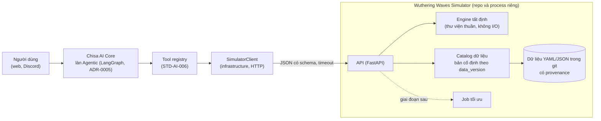
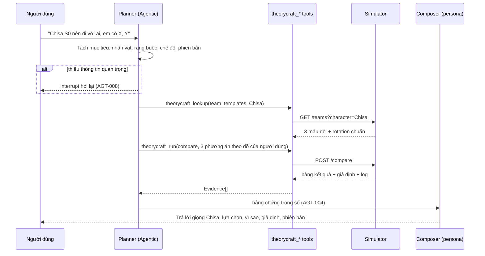
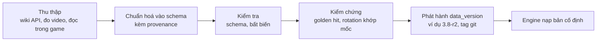

# Nghiên cứu: Wuthering Waves Simulator dùng Chisa làm agent

| Mục | Nội dung |
|---|---|
| Ngày | 15/11/2026 |
| Trạng thái | Nghiên cứu và thiết kế. **Không phải yêu cầu**, không đổi SRS, kiến trúc hay phạm vi hiện tại của Chisa |
| Liên quan | SRS mục 10.1: BL-001 Chisa Theorycrafter, BL-002 sandbox |
| Điều kiện bắt đầu | Xong SRS hiện tại; BL-001 ghi rõ chỉ xét sau R4 khi Agentic đạt QUAL-007 |

Tài liệu dùng ba nhãn:

- **[XM]** đã xác minh: có nguồn, đã đọc trong ngày 15/11/2026.
- **[GĐ]** giả định hoặc suy luận: chưa có bằng chứng trực tiếp.
- **[ĐX]** đề xuất của tài liệu này.

## 0. Kết luận ngắn

1. **Làm được, nhưng chỉ khi thu hẹp phạm vi.** MVP hợp lý gồm engine mô phỏng tất định cho 1–2 đội đã có số đối chiếu, cộng hai công cụ chỉ đọc cho agent Chisa. Một "WuwaLAB đầy đủ" thì không làm được trong 2 tháng với một người.
2. **Rủi ro lớn nhất là dữ liệu và điều khoản, không phải code.** Wiki có hệ số kỹ năng và cooldown, nhưng không có frame data. Frame data công khai chỉ thấy trên các simulator cộng đồng, và các trang này không có API hay giấy phép tái sử dụng. Datamine vướng Điều khoản của Kuro.
3. **Ranh giới:** Simulator là service riêng, không gọi LLM. Chisa chỉ gọi nó qua công cụ có kiểu. LLM chọn phương án và giải thích; engine kiểm tra và tính toàn bộ số.
4. **Khác biệt sản phẩm nằm ở trải nghiệm, không ở độ chính xác.** WuwaLAB đã có 161 rotation được xác nhận. Cạnh tranh về độ chính xác là không thực tế. Chisa nên giúp người dùng *không cần biết theorycraft* vẫn hỏi được, rồi giải thích kết quả bằng tiếng Việt kèm bằng chứng.
5. **Nên hỏi xin phép tác giả WuwaLAB và WU.DA.MAGE trước khi tự đo dữ liệu.** Nếu được phép, phần việc tốn nhất (frame data) giảm mạnh.

## 1. Tổng quan sản phẩm và hệ thống tham chiếu

### 1.1 Các hệ thống đã khảo sát

| Hệ thống | Đã xác minh | Ý nghĩa với dự án |
|---|---|---|
| [WuwaLAB](https://wuwalab.com/) | **[XM]** Tự mô tả là dự án fan độc lập, không liên kết với Kuro Games. Simulator cần đăng nhập Discord. Có Loop DPS, 2 Min DPS, sequence, nhân vật, vũ khí, Echo, Sonata, changelog. Trang Chisa ghi "Fully implemented", 35 kỹ năng; bảng kỹ năng có các cột HITS, FRAMES, CANCEL, NOSWAP, TSTOP, MSTOP, CONCERTO, ENERGY, OFF-TUNE, CD. Changelog có bản V11 ngày 15/11/2026, sửa kit và timing thường xuyên, có buff endgame Matrix. Bảng Verified Loop DPS có 161 rotation. [Patreon](https://www.patreon.com/cw/WuwaLAB) nói dùng thời gian animation thật và đối chiếu với sát thương đo trong game | Tham chiếu chính về độ sâu. Không thấy API hay giấy phép dữ liệu, nên không được lấy dữ liệu nếu chưa xin phép |
| [WU.DA.MAGE](https://wudamage.com/) ([hướng dẫn](https://wudamage.com/how-to-use)) | **[XM]** Mô phỏng theo timeline, xử lý từng hit theo thứ tự; có buff window, Forte, Energy, cooldown, DoT, Outro. Đầu vào gồm build, vũ khí, Echo kèm optimizer, S0–S6, hai đồng đội, trình sửa rotation trên desktop. Đầu ra là log từng hit kèm công thức. Kẻ địch cố định: level 100, RES 20%, DEF 1592. Không mã nguồn mở, không API, không có AI | Mẫu tốt cho đầu ra "giải thích được" (log từng hit) |
| [WuWaSim](https://github.com/Philipp-DI/WuWaSim) | **[XM]** JS tĩnh; dữ liệu lấy từ nanoka.cc và BinData của Arikatsu; không có giấy phép; tự đối chiếu với số Carlotta trong game | Cho thấy engine nhỏ chạy được trong trình duyệt. Nguồn dữ liệu là datamine |
| [tideforge](https://github.com/RishabhRaj7/tideforge) | **[XM]** Next.js, MIT cộng giấy phép dữ liệu riêng; engine chưa xây; đang xin phép nanoka.cc và Prydwen | Cùng bài toán dữ liệu với dự án này, và họ cũng đang chờ xin phép |
| [wuthering-waves-optimizer](https://github.com/ryanbenson/wuthering-waves-optimizer) | **[XM]** GPL-3.0; dùng API của Encore; [issue #575](https://github.com/ryanbenson/wuthering-waves-optimizer/issues/575) là lỗi hệ số (Denia S2) | Dữ liệu ngoài có thể sai; cần kiểm chứng độc lập |
| [wuthering-resonance](https://github.com/bretomart/wuthering-resonance) | **[XM]** Trực quan hoá độ hợp đội; không có giấy phép | Ý tưởng hiển thị, không dùng được mã |
| Các trang "WuWa Calculator" ([ví dụ 1](https://jscalc-blog.com/wuwa-dps-calculator/), [ví dụ 2](https://www.gachahaven.com/wuthering/tools/damage-calculator)) | **[XM]** Máy tính công thức tĩnh với hệ số đơn giản hoá; công thức DEF của trang thứ nhất khác công thức trên wiki | Không mô phỏng timeline; minh hoạ rủi ro công thức sai |
| [encore.moe](https://encore.moe/) | **[XM]** Trang About nói dữ liệu chủ yếu từ datamine (repo của Arikatsu, asset của alt3ri). Có API `api-v2.encore.moe`. Terms (cập nhật 24/07/2026) cảnh báo dữ liệu có thể thiếu hoặc sai; không thấy giấy phép tái sử dụng. Có công tắc dữ liệu Release/Beta | Không dùng: nguồn datamine và có dữ liệu Beta chưa phát hành |
| [nanoka.cc](https://nanoka.cc/) | **[XM]** Trang chỉ mục nhiều game; trang WuWa là shell JS, không đọc được nội dung, không thấy terms | Chưa đánh giá được |
| Datamine: [Arikatsu/WutheringWaves_Data](https://github.com/Arikatsu/WutheringWaves_Data), [Dimbreath/WutheringData](https://github.com/Dimbreath/WutheringData) | **[XM]** Repo của Arikatsu theo game 3.8.0, mỗi phiên bản một nhánh; repo của Dimbreath là ConfigDB. Cả hai không có giấy phép | Độ phủ cao nhất nhưng rủi ro điều khoản (mục 2.2) |
| [Fandom wiki](https://wutheringwaves.fandom.com/) | **[XM]** Giấy phép CC-BY-SA (theo `reports/WuWa_Wiki_Source_Survey.md`). Trang `Chisa/Combat` có hệ số theo cấp 1–10, số hit (như `×8`, `×16`) và cooldown 12 s, nhưng **không có frame data**. Trang [Damage](https://wutheringwaves.fandom.com/wiki/Damage) có công thức, nhưng change history chỉ ghi bản 1.0 | Nguồn hợp pháp duy nhất Chisa đang dùng. Đủ cho hệ số, không đủ cho timeline |

**Đối chiếu chéo [XM]:**

- WuwaLAB ghi cooldown Skill của Chisa là 720f, còn wiki ghi 12 s. Hai số khớp nếu 60 frame bằng 1 giây.
- WU.DA.MAGE dùng DEF 1592 cho địch level 100, khớp công thức wiki `8 × 100 + 792`.

### 1.2 Khoảng trống và hướng của dự án

- **[XM]** WU.DA.MAGE ghi rõ không có tính năng AI. Các trang còn lại đã đọc không có tính năng AI nào; riêng phần simulator của WuwaLAB cần đăng nhập nên chưa xem được. Người dùng phải tự chọn đội, tự xếp rotation và tự đọc kết quả.
- **[GĐ]** Rào cản lớn nhất với người chơi phổ thông là phải hiểu Concerto, cancel, swap và thứ tự buff trước khi dùng được simulator.
- **[ĐX]** Giá trị của Chisa:
  - nhận câu hỏi tự nhiên, như "Chisa của em S0, có vũ khí 4 sao này, nên chơi với ai?";
  - chọn từ các rotation đã kiểm chứng, chạy mô phỏng, so sánh;
  - giải thích bằng tiếng Việt và trích log mô phỏng.
- **[ĐX]** Không cạnh tranh về độ chính xác hay độ phủ với WuwaLAB. Có ba phương án:

| Phương án | Ưu | Nhược |
|---|---|---|
| A. Tự xây engine và tự thu dữ liệu | Toàn quyền; không phụ thuộc | Tốn nhất; độ chính xác thấp hơn WuwaLAB trong thời gian dài |
| B. Xin phép dùng engine hoặc dữ liệu của WuwaLAB / WU.DA.MAGE; Chisa chỉ làm lớp agent | Rẻ nhất; số liệu đã kiểm chứng | Hiện không có API; phụ thuộc bên ngoài; có thể bị từ chối |
| C. Engine riêng; dữ liệu từ wiki và tự đo; số công khai của WuwaLAB chỉ dùng làm mốc đối chiếu | Hợp pháp, kiểm soát được | Vẫn phải tự đo frame |

**[ĐX] Khuyến nghị:** chọn C làm mặc định, và hỏi xin phép theo B ngay từ giai đoạn S0. Nếu B được chấp nhận thì bỏ phần tự đo.

## 2. Tính khả thi, thách thức và rủi ro

### 2.1 Khả thi theo từng năng lực

| Năng lực (định hướng của chủ dự án) | Khả thi | Điều kiện |
|---|---|---|
| Quản lý dữ liệu nhân vật, vũ khí, Echo, kỹ năng | Cao | Hệ số có trên wiki **[XM]**; frame thì phải tự đo |
| Đội hình, build, Resonance Chain | Cao | Mô hình dữ liệu; mỗi chain là một hiệu ứng trong kit |
| Sửa và mô phỏng rotation | Trung bình | Engine làm được. Trình sửa giao diện tốn công, nên lùi lại |
| Damage và DPS theo hit, timeline, frame | Trung bình | Công thức cơ bản có **[XM]**; cơ chế mới chưa có (mục 5.3) |
| Buff, cooldown, tài nguyên, DoT, stack, Outro, swap, off-field | Trung bình | Engine làm được. Chi phí nằm ở *mỗi nhân vật* (35 kỹ năng với Chisa trên WuwaLAB **[XM]**) |
| Phân tích, so sánh, tối ưu | Cao với so sánh; trung bình với tối ưu | Tối ưu cần tách lượt timeline và lượt sát thương (mục 5.4) |
| Kết quả truy xuất, giải thích, kiểm chứng được | Cao | Log từng hit; gắn `data_version` và `engine_version` |

**[GĐ]** Chi phí tăng theo *số nhân vật × độ phức tạp kit × số bản cập nhật*, không theo độ khó của engine. Engine là chi phí một lần; dữ liệu là chi phí định kỳ.

### 2.2 Điều khoản và quyền sử dụng

**Đã đọc [XM]:**

- [Điều khoản sử dụng](https://wutheringwaves.kurogames.com/p/language_en/terms_of_service.html), hiệu lực 29/09/2025. Bản PDF đã đọc mục 1–10.
- [Hướng dẫn tác phẩm phái sinh](https://wutheringwaves.kurogames.com/p/en/produce.html).

**Các điều khoản liên quan [XM]:**

- **Mục 3(1):** giấy phép sử dụng dịch vụ có giới hạn và cho mục đích *phi thương mại*.
- **Mục 3(2):** fan work phải theo hướng dẫn tác phẩm phái sinh. Dùng thương hiệu và tên dịch vụ cần đồng ý bằng văn bản.
- **Mục 3(4):** "KURO GAMES Content" không được tải, sao chép, phân phối hay khai thác khi chưa có đồng ý bằng văn bản. Mục 2 định nghĩa khái niệm này rất rộng: phần mềm, mã, văn bản, nhân vật, gameplay, v.v.
- **Mục 8(2)(e), (f), (i):** cấm chương trình bên thứ ba trái phép trên server; cấm né hoặc vô hiệu hoá biện pháp kỹ thuật trong gói game; cấm phát tán nội dung chưa phát hành.
- **Hướng dẫn tác phẩm phái sinh:** định nghĩa tác phẩm phái sinh *loại trừ* game, phần mềm và sản phẩm thương mại. Vì vậy hướng dẫn này không cấp quyền cho công cụ phần mềm. Kuro giữ quyền yêu cầu gỡ.
- **Chưa thấy:** trong các phần đã đọc, không có chữ "reverse engineering", "datamining", AI hay quy định riêng cho công cụ cộng đồng.

**Suy luận [GĐ], không phải tư vấn pháp lý:**

- Toàn bộ hệ sinh thái công cụ fan đang hoạt động trong vùng xám mà Kuro dung thứ.
- Datamine dễ rơi vào mục 3(4) và 8(2)(f).
- Dữ liệu Beta rơi vào mục 8(2)(i).

**Hệ quả [ĐX]:**

- Phi thương mại. Không bán gói trả phí cho tính năng mô phỏng.
- Không dùng datamine. Điều này khớp hướng BL-001 đã ghi.
- Không dùng dữ liệu Beta hoặc chưa phát hành.
- Số đo từ gameplay của chính mình là nguồn sạch nhất. Hướng dẫn phái sinh có nhắc tới video.
- Ghi nguồn CC-BY-SA khi dùng wiki.
- Ghi rõ "không liên kết với Kuro Games".

### 2.3 Rủi ro lớn nhất

| # | Rủi ro | Mức | Giảm thiểu [ĐX] |
|---|---|---|---|
| R1 | Không có frame data hợp pháp, đầy đủ | Cao | Xin phép (phương án B); tự đo bằng video 60 fps cho ít nhân vật; ghi `confidence` cho từng số |
| R2 | Công thức của cơ chế mới (Off-tune/Tune Break, Deepen, buff Matrix) chưa được xác minh | Cao | Chỉ hỗ trợ cơ chế đã kiểm bằng "golden hit"; cơ chế chưa kiểm thì báo `unsupported`, không đoán |
| R3 | Bản cập nhật game liên tục làm dữ liệu cũ | Cao, định kỳ | Versioning theo bản game; bộ đối chiếu chạy lại sau mỗi bản |
| R4 | Một người làm, phải ưu tiên SRS Chisa | Cao | Chỉ bắt đầu sau R4; MVP 1–2 đội |
| R5 | LLM bịa rotation hoặc số | Trung bình | Engine kiểm mọi rotation; LLM không viết số (BL-001); câu trả lời chỉ trích kết quả engine |
| R6 | Vi phạm điều khoản, bị yêu cầu gỡ | Trung bình | Mục 2.2; không datamine; phi thương mại |
| R7 | Kết quả sai ảnh hưởng quyết định quay gacha (tiền thật) | Trung bình | Ghi giả định, độ tin cậy, phiên bản; không khuyên chi tiền |
| R8 | Ngân sách Agentic (AGT-006) không đủ cho vòng tối ưu | Trung bình | Engine tự tìm kiếm; việc nặng chạy nền (mục 4.3) |
| R9 | Giới hạn 12 công cụ (STD-AI-007), đã dùng khoảng 10–11 | Trung bình | Gộp thành 2 công cụ (mục 4.2) |
| R10 | Chisa dùng khoảng 6,4 GB trên gói 8 GB, chỉ còn khoảng 1,6 GB cho hệ điều hành và page cache (`docs/design/target-architecture.md`) | Thấp với MVP | Service nhỏ có giới hạn bộ nhớ. Khi chạy thật thì lên gói 10 GB (trần chủ dự án đã cho) hoặc tách máy; tối ưu nặng tách máy (BL-002 đã nêu tín hiệu này) |

### 2.4 Khó khăn chưa được nêu trong yêu cầu

- **Chế độ chơi khác nhau:**
  - Buff endgame theo mùa (Matrix trong changelog WuwaLAB **[XM]**) làm đổi rotation tối ưu.
  - Một con số DPS chỉ đúng cho một chế độ và một kẻ địch.
- **Mô phỏng giả định thao tác hoàn hảo.** Người chơi thật chậm hơn. Cần phân biệt "trần lý thuyết" và "dễ thực hiện".
- **FPS và độ trễ mạng [GĐ]** có thể làm lệch cửa sổ cancel. Chưa có số đo.
- **Rotation người dùng lưu sẽ hỏng khi dữ liệu đổi bản.** Cần chuyển đổi dữ liệu hoặc gắn phiên bản cố định.
- **Tên kỹ năng tiếng Việt:** cần bảng ánh xạ, giống entity linking hiện có.
- **Đánh giá agent:** cần bộ eval theorycraft riêng, tốn chi phí judge.
- **Bus factor bằng 1.** Tài liệu dữ liệu và quy trình đo phải đủ để người khác tiếp tục.

## 3. Kiến trúc tổng thể và ranh giới



**Ranh giới [ĐX]:**

| Thành phần | Chịu trách nhiệm | Không được làm |
|---|---|---|
| Chisa AI Core | Hiểu ý người dùng; hỏi lại khi thiếu; chọn và sửa phương án; gọi công cụ; giải thích; persona | Tính số; giữ luật combat; ghi dữ liệu game |
| Agent (planner Agentic) | Lập kế hoạch, gọi công cụ trong allowlist, dừng theo ngân sách | Gửi rotation chưa qua schema; vượt AGT-006 |
| `SimulatorClient` | Ánh xạ kết quả thành `Evidence` (AGT-004); timeout; lỗi có kiểu | Chứa logic combat |
| Simulator | Dữ liệu, luật, mô phỏng, kiểm tra rotation, giải thích từng hit | Gọi LLM; biết người dùng, persona hay trí nhớ |

**Vì sao là service riêng, không phải thư viện nhúng [ĐX]:**

- Chủ dự án yêu cầu độc lập với AI Core.
- Dữ liệu Simulator đổi theo bản game, khác nhịp phát hành của Chisa.
- Simulator có thể phục vụ client khác (giao diện web riêng, sau này có thể là MCP).

**Đánh đổi:** thêm một process và một hợp đồng API phải giữ ổn định.

Để không over-engineer, Simulator bắt đầu là **một process** gồm API, engine và catalog. Chỉ tách job runner khi có optimizer.

**Khớp với Chisa hiện tại [XM]:**

- Theo luật lớp (SRS 3.5.3), adapter HTTP nằm ở `infrastructure`.
- Giao diện cổng nằm ở `domain`.
- Công cụ đăng ký trong tool registry, giống `advanced_rag`.
- Không đổi gì trong Advanced lane.

## 4. Agentic workflow và cơ chế tích hợp

### 4.1 Nguyên tắc: LLM chọn, engine tính

- **[ĐX]** LLM không viết rotation từ đầu. Simulator giữ một **thư viện rotation đã kiểm chứng**: mỗi đội có rotation chuẩn và nguồn đối chiếu.
- **[ĐX]** LLM làm ba việc: chọn mẫu gần nhất, chỉnh tham số (vũ khí, Echo, S-level, bỏ hoặc thêm một hành động), rồi diễn giải kết quả.
- **[ĐX]** Phần tìm kiếm nhiều phương án do engine làm theo thuật toán. Agent không thử từng phương án qua nhiều lời gọi LLM.

**Lý do:** AGT-006 chỉ cho tối đa 6 lời gọi LLM, 8 lời gọi công cụ, 30 giây. Để LLM tự viết rồi sửa rotation qua nhiều vòng sẽ hết ngân sách và dễ sai.

### 4.2 Công cụ cho agent

STD-AI-007 cho tối đa 12 công cụ, và Phụ lục D đã có khoảng 10–11. **[ĐX]** Vì vậy chỉ thêm **hai** công cụ, mỗi công cụ có tham số `kind`:

| Công cụ | `kind` | Trả về |
|---|---|---|
| `theorycraft_lookup` | `character`, `weapon`, `echo_set`, `team_templates`, `rotation_templates` | Hồ sơ có cấu trúc kèm provenance, dưới dạng `Evidence` |
| `theorycraft_run` | `validate`, `simulate`, `compare` (tối đa 5 phương án) | Lỗi có kiểu hoặc kết quả: tổng sát thương, DPS, phân bổ theo nhân vật và kỹ năng, giả định, `data_version`, `engine_version`, `confidence` |

**Cả hai công cụ đều chỉ đọc (AGT-003, STD-AI-006):**

- Mô phỏng là hàm thuần.
- Cache kết quả theo `hash(request) + data_version + engine_version` không phải tác dụng phụ nghiệp vụ.

**Giới hạn đầu vào [ĐX]:**

- rotation tối đa 120 hành động;
- tối đa 120 s thời gian game;
- `compare` tối đa 5 phương án;
- timeout 2 s mỗi lời gọi.

**Lỗi `validate` phải đủ cụ thể để LLM sửa trong một vòng.** Ví dụ: "frame 812: Resonance Skill đang hồi chiêu, còn 140f" hoặc "Outro chưa đủ Concerto".

### 4.3 Luồng một lượt



Ước lượng một lượt **[GĐ]**:

- 3–4 lời gọi LLM: tách mục tiêu, chọn phương án, có thể một lần sửa, Composer;
- 2–3 lời gọi công cụ;
- nằm trong AGT-006.

**Việc vượt ngân sách [ĐX]**, như tối ưu substat Echo hay quét mọi đội:

1. Không chạy trong lượt.
2. Agent dùng interrupt để hỏi người dùng có muốn chạy nền không.
3. Khi người dùng đồng ý, lớp ứng dụng gửi job, không phải công cụ, để giữ AGT-003.
4. Kết quả về dưới dạng tin nhắn sau.

Cơ chế này cần ADR khi triển khai, vì SRS chưa có khái niệm "kết quả Agentic trả về muộn".

### 4.4 Tích hợp: so sánh phương thức

| Phương thức | Ưu | Nhược | Kết luận [ĐX] |
|---|---|---|---|
| Thư viện Python nhúng vào Chisa | Đơn giản nhất, không có mạng | Gắn chặt nhịp phát hành; trái yêu cầu độc lập | Không |
| HTTP JSON API (OpenAPI) | Độc lập; dễ test; Chisa đã có mẫu adapter | Thêm một process | **Chọn** |
| MCP server | Client khác (Claude Desktop, v.v.) dùng được | Thêm một lớp giao thức; Chisa vẫn cần công cụ có kiểu trong registry | Lùi lại; có thể làm một lớp mỏng trên cùng API |

**An toàn [ĐX]:**

- Mọi đầu vào từ LLM được kiểm bằng JSON Schema (STD-AI-005).
- Kết quả Simulator là nội dung không tin cậy, bọc trong ranh giới có nhãn (STD-AI-009). Ví dụ: tên rotation do người dùng đặt không được đi vào system prompt.
- Không chạy code tuỳ ý, nên không cần sandbox BL-002.

## 5. Dữ liệu, pipeline và Combat Engine

### 5.1 Nguồn dữ liệu

| Nguồn | Loại | Độ tin cậy | Độ phủ | Cập nhật | Quyền dùng | Dùng? [ĐX] |
|---|---|---|---|---|---|---|
| Mô tả trong game (đọc tay) | Chính thức | Cao | Hệ số, mô tả kỹ năng | Tay, theo bản game | Mục 3(4) hạn chế sao chép nội dung; con số dùng để tính, không sao chép văn bản **[GĐ]** | Có, để đối chiếu |
| Fandom wiki (MediaWiki API) | Cộng đồng | Trung bình–cao | Hệ số theo cấp, số hit, cooldown, Concerto, chi phí; **không có frame** **[XM]** | Tình nguyện viên | CC-BY-SA **[XM]** | Có, là nguồn chính về hệ số |
| Tự đo bằng video | Đo đạc | Trung bình; sai số **[GĐ]** ±1–2 frame | Frame, hit frame, cancel, NoSwap, Time Stop | Tự làm, tốn công | Gameplay của chính mình | Có, là nguồn chính về frame |
| WuwaLAB, WU.DA.MAGE | Cộng đồng, đã kiểm chứng | Cao **[GĐ]** | Rất cao | Thường xuyên **[XM]** | Không có giấy phép | Chỉ dùng số công khai làm mốc đối chiếu; dùng dữ liệu cần xin phép |
| Datamine (Arikatsu, Dimbreath, encore.moe) | Datamine | Cao về giá trị gốc | Cao nhất | Nhanh | Không giấy phép; vướng điều khoản (mục 2.2) | **Không** |
| Bảng tính, Discord theorycraft | Cộng đồng | Không đồng đều | Không rõ | Không rõ | Không rõ | Chỉ tham khảo, không nạp vào dữ liệu |

### 5.2 Mô hình và quy trình dữ liệu

**[ĐX] Dữ liệu là mã (data-as-code):**

- Mỗi thực thể là một file YAML trong repo Simulator.
- Schema sinh từ Pydantic thành JSON Schema.
- CI kiểm tra schema và các bất biến.
- Một người làm thì git là hệ thống versioning tốt nhất: diff theo bản game đọc được, review được, quay lui được.
- Chưa cần database cho catalog.

**Thực thể chính:**

- `Character`: chỉ số theo cấp, `abilities[]`, `chain[]`, `forte`.
- `Ability`:
  - `hits[]`, mỗi hit có `frame`, `multiplier_by_level`, `scaling_stat`, `element`, `damage_type`;
  - `duration_frames`, `cancel_frame`, `noswap_frames`, `time_stop_frames`, `motion_stop_frames`;
  - `concerto`, `energy`, `off_tune`, `cooldown_frames`, `cost`.
- `Effect`:
  - `trigger` (khi cast, khi hit, Outro, Intro, theo stack);
  - `target` (bản thân, nhân vật đang ra sân, cả đội, kẻ địch);
  - `stat`, `bucket`, `value`, `duration_frames`, `max_stacks`, `clock` (`game` hoặc `real`).
- `Weapon`, `EchoSet`/`Sonata`, `EnemyPreset` (level, RES, DEF).
- `RotationTemplate`: đội, hành động, nguồn đối chiếu, kết quả kỳ vọng và dung sai.

**Mỗi giá trị số có provenance:**

```yaml
cooldown_frames:
  value: 720
  source: wiki            # wiki | in_game | measured | reference_sim | inferred
  ref: "https://wutheringwaves.fandom.com/wiki/Chisa/Combat?oldid=<revid>"
  game_version: "3.8"
  confidence: high        # high | medium | low
  verified_by: golden_hit # golden_hit | rotation_match | none
```

Bốn loại dữ liệu mà chủ dự án yêu cầu phân biệt, ánh xạ vào `source` và `verified_by`:

- **Chính thức:** `in_game`.
- **Cộng đồng:** `wiki`, `reference_sim`.
- **Suy luận:** `inferred`.
- **Chưa kiểm chứng:** `verified_by: none`.

Engine báo trong kết quả tỷ lệ sát thương đến từ giá trị chưa kiểm chứng.

**Quy trình [ĐX]:**



**Đo frame [ĐX]:**

- Quay ở 60 fps. WuwaLAB biểu diễn thời gian theo frame, và 720f khớp 12 s **[XM]**.
- Đếm frame từ lúc nhập lệnh tới hit, tới lúc swap được, tới lúc cancel được.
- Mỗi số đo ít nhất 3 lần; ghi trung vị và độ lệch.
- **[GĐ]** Mỗi nhân vật cần khoảng 1–2 ngày cho bộ kỹ năng chính.

Khó đo:

- ICD ẩn;
- giá trị Off-tune và Hardness;
- thời điểm chính xác buff bắt đầu;
- buff nào dừng trong Time Stop.

Những số này ghi `confidence: low` cho đến khi có cách kiểm.

### 5.3 Công thức sát thương

Theo [trang Damage của wiki](https://wutheringwaves.fandom.com/wiki/Damage) **[XM]**:

- `DMG = Base DMG × Resistances × Bonuses`.
- `Base Ability DMG = Ability Attribute × %MV`, cộng Flat DMG.
- `Resistances = RES Multiplier × DEF Multiplier × DMG Reduction × Elem Reduction`.
- **RES Multiplier** tính theo từng khoảng:
  - `1 − RES/2` khi RES < 0;
  - `1 − RES` khi 0 ≤ RES < 0,8;
  - `1/(1 + 5·RES)` khi RES ≥ 0,8.
- RES nền của kẻ địch là 10%; boss có kháng nguyên tố là 40%.
- **Enemy DEF** = `8 × LVL + 792`.
- **DEF Multiplier** = `(800 + 8·LVL_attacker) / (800 + 8·LVL_attacker + DEF × (1 − DEF Ignore))`. DEF Reduction áp dụng trước công thức này.
- `Bonuses = %DMG Bonus × DMG Amplify × %Special DMG × Crit DMG`:
  - DMG Bonus cộng dồn trong cùng nhóm;
  - Amplify là một nhóm riêng (`1 + Amplify_target + Amplify_attacker`).

Chưa xác minh **[XM: không có trên trang]**:

- "Deepen" có phải tên khác của Amplify không;
- Off-tune/Tune Break;
- buff Matrix;
- trang chỉ ghi lịch sử bản 1.0.

Một máy tính cộng đồng dùng công thức DEF khác ([jscalc-blog](https://jscalc-blog.com/wuwa-dps-calculator/)).

**[ĐX] Engine tổ chức sát thương theo nhóm nhân (bucket):** mỗi `Effect` khai báo bucket của nó.

- Thêm cơ chế mới nghĩa là thêm bucket, không sửa code tính.
- Cơ chế chưa kiểm chứng bị engine từ chối, với lỗi `unsupported_mechanic`. Engine không đoán.

### 5.4 Combat Engine

**Mô hình [ĐX]:** mô phỏng sự kiện rời rạc trên đồng hồ frame nguyên.

- Không chạy từng frame. Hàng đợi ưu tiên chứa các sự kiện: hành động bắt đầu, hit, buff hết hạn, tick DoT, hồi chiêu xong, đòn phối hợp off-field.
- Tất định. Crit tính theo kỳ vọng ở MVP.
- Monte Carlo lùi lại. Hiệu ứng kích hoạt khi crit là giới hạn đã biết của mô hình kỳ vọng.

| Vấn đề | Cách xử lý [ĐX] |
|---|---|
| Game time và real time | Hai đồng hồ. Time Stop dừng `game_frame`, `real_frame` vẫn chạy; buff có `clock` riêng. DPS tính trên real time. Buff nào dừng trong Time Stop phải đo **[GĐ]**; WuwaLAB tách TSTOP và MSTOP nên khác biệt này có ý nghĩa **[XM]** |
| Hit và animation | Mỗi hit lên lịch ở `start + hit.frame`. Hành động sau bắt đầu sớm nhất ở `cancel_frame`; hit sau mốc cancel bị huỷ nếu kỹ năng bị cancel |
| Swap, quickswap, NoSwap | Swap hợp lệ khi đã qua `noswap_frames`. Đủ Concerto thì swap kích hoạt Outro của người ra và Intro của người vào |
| Cooldown, Energy, Forte, Concerto | Tài nguyên theo nhân vật; kiểm tra điều kiện trước mỗi hành động; vi phạm thì trả lỗi `validate` cụ thể |
| Buff/debuff, stack | `Effect` dựa trên dữ liệu, với một tập nhỏ loại trigger và target. Kit không vừa mô hình dùng "module kit" bằng code. Không xây DSL scripting chung (over-engineering) |
| DoT, off-field | Sự kiện định kỳ độc lập với nhân vật đang ra sân; snapshot hay tính động phải đo theo từng hiệu ứng **[GĐ]** |
| Giải thích | Log từng hit: frame, nhân vật, kỹ năng, giá trị từng bucket, buff đang chạy. Giống đầu ra của WU.DA.MAGE **[XM]** |

**Tách hai lượt để tối ưu nhanh [ĐX]:**

1. **Lượt timeline:** xác định hit nào xảy ra lúc nào và buff nào đang chạy. Lượt này phụ thuộc rotation, cooldown và Energy Regen.
2. **Lượt sát thương:** với timeline cố định, sát thương là hàm của chỉ số. Lượt này vector hoá bằng numpy được trên hàng nghìn bộ chỉ số.

Đổi build mà không đổi timeline (cùng Energy Regen đủ ngưỡng) thì chỉ chạy lại lượt 2. Nhờ đó optimizer Echo rẻ mà không cần brute force mọi tổ hợp.

**Kiểm chứng [ĐX]:**

1. **Property test:** tài nguyên không âm; không dùng kỹ năng khi đang hồi chiêu; tổng sát thương bằng tổng log.
2. **Golden hit:**
   - một build cố định, tắt crit;
   - so sát thương một hit với số hiện trong game (ảnh chụp lưu làm bằng chứng);
   - dung sai ±1 do làm tròn **[GĐ]**.
3. **Khớp rotation:**
   - chạy rotation chuẩn của đội, so với số công khai trên WuwaLAB hoặc WU.DA.MAGE;
   - dung sai đề xuất ±3%;
   - nếu lệch thì ghi rõ trong kết quả.
4. **Hồi quy:** mọi rotation trong thư viện chạy lại khi đổi `data_version` hoặc `engine_version`.

**Hiệu năng [GĐ]:**

- Một rotation 25 s có vài trăm sự kiện, nên Python thuần chạy cỡ mili giây.
- Cần đo ở S1 trước khi nghĩ tới numba hoặc Rust.

## 6. Công nghệ đề xuất

| Lớp | Lựa chọn [ĐX] | Lý do | Phương án khác |
|---|---|---|---|
| Ngôn ngữ engine và API | Python 3.12, FastAPI, Pydantic v2 | Cùng bộ công cụ với Chisa (ruff, mypy, pytest, import-linter); một người làm | TypeScript chạy trong trình duyệt như WuWaSim: không tốn server, nhưng Chisa cần gọi từ server. Rust: nhanh nhưng tốn công, chỉ xét khi đo thấy chậm |
| Tính toán | numpy cho lượt sát thương | Vector hoá optimizer | numba khi đo thấy cần |
| Dữ liệu | YAML trong git + JSON Schema | Versioning, review, CI | Postgres khi có dữ liệu người dùng (rotation đã lưu) |
| Cache | LRU trong process; Redis nếu chạy nhiều process | Kết quả tất định nên cache được | — |
| Job nền (S4) | Hàng đợi đơn giản trên Postgres hoặc `arq` | Chỉ cần khi có optimizer | Không dùng Celery (Chisa đang bỏ, R6) |
| Giao diện (S4+) | Trang xem timeline chỉ đọc trong web Chisa (React/Vite) | Tái dùng web hiện có | Trình sửa rotation kéo thả: lùi lại |
| Triển khai | Container riêng, giới hạn khoảng 300 MB RAM **[GĐ]** | Gói 8 GB chỉ còn khoảng 1,6 GB dư, nên chạy thật thì cần gói 10 GB | Tách máy khi optimizer nặng |

## 7. MVP, roadmap và ưu tiên

**Cổng bắt đầu:** xong SRS hiện tại. Agentic (R4) phải chạy thật, vì công cụ Simulator cần làn Agentic.

| Giai đoạn | Nội dung | Điều kiện xong | Ứng với BL-001 |
|---|---|---|---|
| **S0 Dữ liệu và pháp lý** | Chọn chính sách dữ liệu (ADR); xin phép tác giả WuwaLAB và WU.DA.MAGE; chọn 1–2 đội mốc từ bảng Verified; đo frame 3 nhân vật; kiểm công thức bằng golden hit | ADR dữ liệu; 3 nhân vật có provenance; golden hit đạt | T0 |
| **S1 Engine lõi (MVP)** | Engine sự kiện, bucket sát thương, tài nguyên, swap/Outro/Intro, `validate`; 1 đội; dùng qua CLI | Rotation chuẩn khớp mốc ±3%; property test đạt | T2 (một phần) |
| **S2 Service và công cụ Chisa (MVP)** | API; `theorycraft_lookup`, `theorycraft_run`; thư viện rotation; bộ eval khoảng 20 câu theorycraft | Số trong câu trả lời trùng engine 100%; không có số do LLM tự tạo; nằm trong AGT-006 | T1, T2 |
| S3 Mở rộng độ phủ | Thêm nhân vật theo mức phổ biến; quy trình cập nhật theo bản game | Mỗi nhân vật mới có golden hit và một rotation khớp mốc | T2 |
| S4 Tối ưu và hiển thị | Optimizer Echo (hai lượt), quét đội chạy nền, trang xem timeline | Job chạy nền không làm chậm Chisa | T3 |
| S5 Lùi lại | Trình sửa rotation, Monte Carlo, nhiều mục tiêu, buff endgame theo mùa, chia sẻ cộng đồng, MCP, đề xuất rotation mới | Chỉ làm khi có nhu cầu thật | T4 |

**MVP = S0 + S1 + S2 cho 1–2 đội.**

Thứ tự ưu tiên giữ đúng lý do: dữ liệu và pháp lý trước, vì nếu S0 thất bại thì code phía sau vô nghĩa.

## 8. Độ phức tạp, nguồn lực, khả thi

**Giả định nguồn lực [GĐ]:**

- một lập trình viên có trợ lý AI;
- khoảng 30–40 giờ một tuần;
- có tài khoản game với các nhân vật của đội mốc.

| Giai đoạn | Công sức [GĐ] | Rủi ro chính | Khả thi |
|---|---|---|---|
| S0 | 1–2 tuần | Không có ai trả lời xin phép; đo frame chậm hơn dự kiến | Cao |
| S1 | 3–4 tuần | Kit có cơ chế ngoài mô hình; không khớp mốc | Trung bình–cao |
| S2 | 2–3 tuần | Phụ thuộc R4; ngân sách AGT-006 | Cao nếu R4 xong |
| S3 | 1–3 ngày mỗi nhân vật; 2–5 ngày mỗi bản game | Chi phí định kỳ không dừng | Trung bình (bền vững là vấn đề chính) |
| S4 | 3–5 tuần | Tài nguyên VPS | Trung bình |
| S5 | 6 tuần trở lên | Giao diện tốn công | Thấp trong ngắn hạn |

**Mốc 2 tháng, đánh giá thẳng:**

- **Nếu 2 tháng tính từ lúc SRS Chisa xong:**
  - S0 + S1 + S2 cần khoảng 6–9 tuần, nên chỉ vừa đủ cho MVP 1–2 đội, và chỉ khi S0 không gặp bất ngờ.
  - Không đủ cho optimizer, giao diện hay độ phủ nhiều nhân vật.
- **Nếu 2 tháng tính từ hôm nay:**
  - Chisa đang ở R2; còn R3–R6.
  - BL-001 đặt Theorycrafter sau R4.
  - Trong 2 tháng tới không nên viết code Simulator. Việc duy nhất làm song song mà không ảnh hưởng SRS là phần không code của S0: xin phép tác giả, chọn đội mốc. Phần này cũng chỉ làm khi chủ dự án đồng ý.
- **Không khả thi trong 2 tháng:** một nền tảng tương đương WuwaLAB về độ phủ và độ chính xác.

**Chi phí định kỳ [GĐ]:**

- Mỗi bản game có thêm nhân vật và buff mới, mất 2–5 ngày để cập nhật và kiểm chứng.
- Đây là chi phí thật lâu dài, lớn hơn chi phí xây engine.
- Nếu không duy trì được nhịp này, nên dừng ở số nhân vật đã kiểm chứng và ghi rõ phạm vi, thay vì phủ rộng mà sai.

## 9. Việc cần ADR khi bắt đầu (không đổi SRS bây giờ)

| Chủ đề | Vì sao |
|---|---|
| Chính sách nguồn dữ liệu | Quy tắc hiện tại chỉ cho phép Fandom; BL-001 đề xuất nhận thêm số đo trong game, không datamine |
| Hai công cụ `theorycraft_*` | STD-AI-006, STD-AI-007, Phụ lục D, checklist SEC-AGT |
| Kết quả Agentic trả về muộn (job nền) | SRS chưa có khái niệm này; liên quan AGT-003, AGT-008 |
| Simulator là service ngoài | Hợp đồng API, timeout, ánh xạ `Evidence`, triển khai trên VPS |

## Nguồn

Truy cập ngày 15/11/2026.

- WuwaLAB: <https://wuwalab.com/>, Patreon <https://www.patreon.com/cw/WuwaLAB>
- WU.DA.MAGE: <https://wudamage.com/>, <https://wudamage.com/how-to-use>
- WuWaSim: <https://github.com/Philipp-DI/WuWaSim>
- tideforge: <https://github.com/RishabhRaj7/tideforge>
- wuthering-waves-optimizer: <https://github.com/ryanbenson/wuthering-waves-optimizer>, issue <https://github.com/ryanbenson/wuthering-waves-optimizer/issues/575>
- wuthering-resonance: <https://github.com/bretomart/wuthering-resonance>
- Datamine: <https://github.com/Arikatsu/WutheringWaves_Data>, <https://github.com/Dimbreath/WutheringData>
- encore.moe: <https://encore.moe/about?lang=en>, <https://encore.moe/terms>
- nanoka.cc: <https://nanoka.cc/>
- Kuro Games, Terms of Use (hiệu lực 29/09/2025): <https://wutheringwaves.kurogames.com/p/language_en/terms_of_service.html>
- Kuro Games, Guidelines for Derivative Works: <https://wutheringwaves.kurogames.com/p/en/produce.html>
- Fandom: <https://wutheringwaves.fandom.com/wiki/Damage>, <https://wutheringwaves.fandom.com/wiki/Chisa/Combat>
- Máy tính cộng đồng: <https://jscalc-blog.com/wuwa-dps-calculator/>, <https://www.gachahaven.com/wuthering/tools/damage-calculator>
- Trong repo: `docs/SRS_Chisa_v2_Advanced_Agentic_RAG.md` (mục 10.1, AGT-*, STD-AI-*, Phụ lục D), `docs/adr/0005-langgraph-agentic-only.md`, `docs/design/target-architecture.md`, `reports/WuWa_Wiki_Source_Survey.md`
